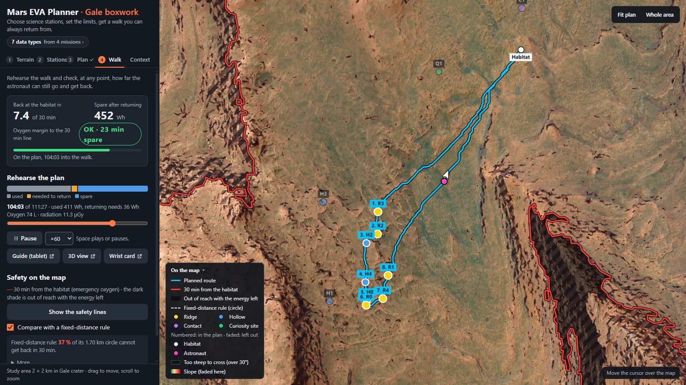
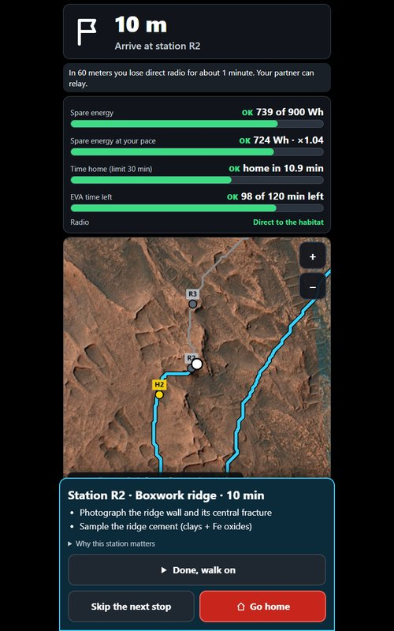
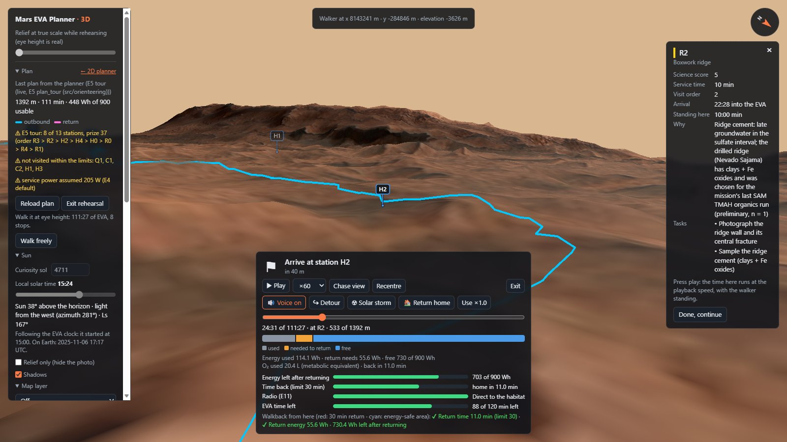

# Mars EVA Planner · Gale boxwork

**Plan a Mars walk you can come back from, checked at every step.** A hyper-local planner and guide for an astronaut on foot in a 2 × 2 km box of the boxwork ridges on Mount Sharp, Gale crater, where Curiosity is driving now. It works from a 1 m terrain model and 25 cm orbital photos, and it checks the plan against the route Curiosity actually drove.

NASA Space Apps Challenge 2026 · *Interplanetary Survival Guide: Martian Map*

<!-- No hosted demo: the deploy (#122) is future work. -->
**30 s video:** [YouTube](https://www.youtube.com/watch?v=7LSQqSFdU6c) · **Run it locally:** [Quick start](#quick-start) (one server, works offline)



## Why this matters

Mars maps today (Mars Trek, MMGIS) are regional or global. An astronaut on foot needs *this* slope, *this* sand patch, *this* way home, and a guarantee that every step of the plan still leaves enough energy and oxygen to get back. Light takes 3–22 min each way to Earth, so the crew must decide on their own.

The usual answer is a rule like "stay within X km of the habitat". On this terrain that rule is wrong half the time:

| Return rule | Goals it calls safe that its own route cannot complete |
| --- | --- |
| Fixed radius around the habitat | **45.5 %**; it would need a 4× safety factor to be safe in 99 % of cases |
| A* on slope only | 28.5 % |
| Linear oxygen budget | 22.4 % |
| **This planner** (exact return cost from every point, E4) | **0 %** |

<sub>21 habitats × 2,028 goals (42,588 evaluations), budget 50 % of the costliest round trip. False safes on the human cost (E3 × E1 sand); safety factor on E3. Registry rows `base-false-safe-*` and `base-safety-factor-b2`.</sub>

The reason is that walking back is not walking out: coming back can cost half as much as going out, or 1.7 times as much (5th–95th percentile, `e4-return-ratio-*`). No circle captures that.

## What it does

**One server, four views of the same plan:**

| View | For | What you get |
| --- | --- | --- |
| **Planner (HUD)** `/` | Habitat crew | Layers (HiRISE photo, slope, steep cells, sand, boulders, walking cost, radio, night temperature, rover photos). Pick science stations. Set time, energy and O₂ limits. Get the best tour, then rehearse it with the safety lines on the map. |
| **Arm tablet guide** `/guide.html` | Astronaut | Turn-by-turn voice, "can I get back?" meters, a way home on demand, re-routing when off route, a solar-storm return, and a plan-against-the-walk summary. |
| **3D rehearsal** `/3d/` | Everyone | The 1 m terrain at eye height under the Sun of the EVA's sol, with the route, the map layers and 383 Curiosity Navcam photos at their real camera poses (release `rover-photos-v1`, built from the raw images as described in [`web/3d/README.md`](web/3d/README.md); without it the rest works). |
| **Wrist card** `/card.html` | Astronaut | A printable step list with turn-back rules and a QR code to the guide. |

<table><tr>
<td width="32%"></td>
<td></td>
</tr><tr><td><sub>Arm tablet guide, arriving at a station</sub></td><td><sub>3D rehearsal at eye height, 24 min into the walk</sub></td></tr></table>

**How a plan is made:**
1. **Energy of every step (E3).** Metabolic cost of walking on Mars (Santee 2001, 124 kg suited astronaut, g = 3.71 m/s²) for each of the 8 moves out of every 1 m cell. Cells steeper than 30° are blocked; the limit is adjustable.
2. **The way home from everywhere (E4).** A reversed shortest-path search gives, for every cell, the energy and time to walk back to the habitat. Every plan is checked at every vertex: what you have used + what you need to get home must fit the budget.
3. **The best tour (E5).** An orienteering solver picks the stations and their order to collect the most science value within the energy, time and O₂ limits. The solver is exact (dynamic programming / CP-SAT, 100 % optimal in the benchmark); a genetic algorithm reaches the optimum in 97 % of runs. When nothing fits, the planner says which station and which resource fall short, and by how much.
4. **During the walk (X2, A2).** The guide learns how much harder than the model this astronaut is working (a factor k, from each 30 m walked) and re-checks the way home at the 90th percentile of k. The way home and every re-route are checked for energy, time and O₂ on the same path. A slower way home is taken when the fastest one does not fit, and the guide never calls an unsafe path safe.

## Results

All figures come from scripts in this repository. Each one is a row in [`results/registry.csv`](results/registry.csv) with its population, setting, script, output file, commit and checksum ([readable table](results/results_table.md)).

| Result | Value | Kind |
| --- | --- | --- |
| False safes of the exact planner vs a fixed radius | **0 % vs 45.5 %** | model |
| Walks that run out of O₂ when the astronaut works 1.5× harder than planned: fixed vs adaptive walkback | **90 % vs 4.7 %** | simulation, 300 walks |
| Reserve violations over a full 5-station EVA, nominal vs adaptive policy, paired worlds | **60.7 % vs 3.7 %** (95 % Wilson 2.1–6.5 %) | simulation, 300 paired worlds |
| Best 120 min tour from the habitat | 8 of 13 stations, 37 points, 445 Wh, 111 min | model |
| Radio: share of the box in direct sight of a 3 m habitat antenna | 22.5 %; 575 m of the 120 min tour has no direct radio | model |
| Background radiation on the 120 min tour | 12.1 µGy (RAD, boxwork sols) | observation + model |
| Best departure: whole tour in sunlight | 06:45–15:15 local solar time; terrain shadows cut 15–45 min | model |

The simulated results are simulations, not measurements on astronauts. The value of k is an assumed stress scenario.

## Checked against Curiosity, including what did not work

We used Curiosity's real drive through this box (5,247 localized poses, sols 4369–4868) as the closest thing to ground truth. Negative results are reported with the same weight as the rest:
- **Terrain model.** The rover's elevation matches the 1 m DEM (median −0.01 m).
- **Choice of valley vs path inside it.** Terrain explains the choice of valley (AUC 0.73 over the box) but not the path inside it (0.53 in a 50 m corridor, about chance). Learning a terrain price from the drive (maximum-entropy inverse RL, E1) found **no DEM price** that beats distance on held-out drives.
- **Sand.** Only sand from the orbital photo earns a small price (up to +11.5 % energy). It moves the route to the Nevado Sajama drill site by up to 23 m (+1.8 % energy).
- **Sand map (E8, U-Net).** Precise but misses most sand: precision 0.93, recall 0.11 on blind points. Its effect on routes is evaluated separately.
- **Boulders (E9).** A distilled BoulderNet runs in 8.6 s on the whole box (BoulderNet: 362 s) and matches its boulder cover (r = 0.66), but finds single boulders poorly (F1 0.27 against human labels). Boulder prices did not hold up on held-out drives, so boulders stay out of the nominal cost.
- **3D placement.** Where the DEM skyline sits above a Navcam photo's skyline, the gap has a median of 0.07° (23 photos; one-sided check).

## How it compares

| | Fixed radius | Fastest path (time only) | **This planner** |
| --- | --- | --- | --- |
| Return cost from every point, both directions | — | — | ✅ exact, per 1 m cell |
| Energy and O₂, not only time | — | — | ✅ |
| 30 min emergency-oxygen line and energy-safe area on the map | — | — | ✅ |
| Picks stations by science value within limits | — | — | ✅ exact solver |
| Says why there is no plan | — | — | ✅ station, resource, amount |
| Adapts to how hard the astronaut is working | — | — | ✅ (simulated) |
| Validated against a real traverse | — | — | ✅ Curiosity, negative results included |

## Quick start

**Requirements:** Python 3.12 and about 3 GB of free disk. Node.js only for the web tests. Everything runs locally and needs no internet once the data is downloaded.

```bash
git clone https://github.com/JuanCorredor2023/martian-map.git && cd martian-map
make demo
```

`make demo` installs the Python packages (into `.venv`, unless a virtualenv or conda environment is active), downloads all the data (about 0.8 GB: every layer, the 3D terrain and the 383 rover photos), starts the server and opens the landing page. Later, `make run` starts it again. **Without make** (Windows): `python tools/demo.py demo`, and the same for every command below.

| Command | What it does |
| --- | --- |
| `make doctor` | Checks Python, the packages, the data, the disk and the port, and says how to fix anything missing |
| `make setup` | Installs the Python packages |
| `make data` | Downloads every data release and builds the 3D assets; run it again to resume |
| `make run` | Starts the app and opens http://localhost:8000/home/ (`make run PORT=8001` for another port; Ctrl+C stops it) |
| `make test` | Python and JavaScript tests |

The data is not in git: each piece is a release on the [Releases](https://github.com/JuanCorredor2023/martian-map/releases) page, unzipped into `data/<folder>/`. Only `base`, `tiles` and `e2` are required; without the others, the matching layer or panel switches off. `make data` uses the GitHub CLI (`gh`, signed in) when the repository is private.

<details><summary>Manual steps (without the script)</summary>

```bash
python -m pip install -r api/requirements.txt
```

On Windows PowerShell:

```powershell
foreach ($r in @("base-grid-v2:base","tiles-v2:tiles","e2-trajectory-v1:e2","e12-dose-v1:e12","e8-v0:e8","e1-sand-v1:e1","e9-rocks-v1:e9","minerals-v1:minerals","themis-v1:thermal","rems-v1:rems","rover-photos-v1:tiles\3d\photos")) {
  $tag, $dir = $r.Split(":"); $zip = $tag.Replace("-", "_").Replace(".", "_") + ".zip"
  gh release download $tag --dir data; Expand-Archive "data\$zip" "data\$dir" -Force; Remove-Item "data\$zip" }
gh release download stations-v1 --dir data\stations
gh release download stations-e8-v0 --dir data\stations
python src/viz3d/build_terrain_assets.py
```

On macOS or Linux:

```bash
for r in base-grid-v2:base tiles-v2:tiles e2-trajectory-v1:e2 e12-dose-v1:e12 e8-v0:e8 e1-sand-v1:e1 e9-rocks-v1:e9 minerals-v1:minerals themis-v1:thermal rems-v1:rems rover-photos-v1:tiles/3d/photos; do
  tag=${r%%:*}; dir=${r##*:}; zip=$(echo "$tag" | tr '.-' '__').zip
  gh release download "$tag" --dir data && unzip -oq "data/$zip" -d "data/$dir" && rm "data/$zip"; done
gh release download stations-v1 --dir data/stations
gh release download stations-e8-v0 --dir data/stations
python src/viz3d/build_terrain_assets.py
python -m uvicorn api.main:app --port 8000
```

**Optional, recommended: GDAL with conda.** The radio check (line of sight to the habitat) uses GDAL's viewshed when its Python bindings are installed, which pip cannot do on Windows: `conda install -c conda-forge gdal`. Without them the app computes the same viewshed with a NumPy port of GDAL's algorithm (identical cells on the real terrain, checked in `tests/gis/test_comms.py`), so everything works either way.

`python -m api.check_data` lists anything missing, with the command to get it.

</details>

Open **http://localhost:8000/**:
1. **Plan the walk** in step 3. The first plan takes 10–30 s while the terrain graph is built.
2. Then use step 4 for the tablet guide, the 3D view and the wrist card.

User guides with annotated screenshots of every button: [2D planner](docs/user_guide/index.html) and [3D map](docs/user_guide_3d/index.html) (open the HTML files in a browser; Markdown versions: [`docs/user_guide_2d.md`](docs/user_guide_2d.md), [`docs/user_guide_3d.md`](docs/user_guide_3d.md)).

`docs/demo.md` is a 6-minute walkthrough. The same server also has a **landing page**, **http://localhost:8000/home/** (what the app is, in one page), and the demo step by step with screenshots, **http://localhost:8000/home/demo.html**.

**Tests:** `make test`, or `python -m pytest tests -q` (most run without the data) and `node --test tests/web tests/viz3d`.

## Data

All inputs are public NASA, USGS and ESA data.

| Data | Source | Used for |
| --- | --- | --- |
| HiRISE 1 m DTM and 25 cm orthophoto of the Gale boxwork | NASA / JPL / University of Arizona via USGS | terrain, slope, photos, sand and boulder detection |
| Curiosity localized poses (PLACES) and drive | NASA / JPL | validation, learned terrain price |
| Curiosity Navcam images | NASA / JPL-Caltech (PDS) | 3D photo placement, ground views |
| RAD dose rate | MSL RAD (Hassler et al. 2014) | radiation budget and storm alarm |
| REMS air temperature and pressure | MSL REMS (CAB, CSIC-INTA) | weather on the walk's sol |
| THEMIS night infrared | Mars Odyssey (ASU) | thermal context |
| CRISM / OMEGA mineral detections | MRO / Mars Express | orbital mineral context |

Details, versions and processing: [`data/README.md`](data/README.md). The paper draft cites every source: [`paper/`](paper/).

## Limitations

- **The guarantee is conditional on the model and its data.** It covers E3's costs on the 1 m DEM, a placeholder for station work, and O₂ as a transformation of energy. Uncertainty in the cost is handled by the adaptive walkback, which is validated in simulation only: there are no astronauts and no suit telemetry behind it.
- **The 1 m DEM does not resolve the boxwork ridges themselves.** The sand map misses most sand (recall 0.11), and boulder prices are not validated.
- **One 2 × 2 km box, one habitat at a time.** The walk in the guide is simulated: there is no GPS on Mars.

## Reproducibility

- Every reported figure is a row of the [results registry](results/registry.csv), confirmed by its owner.
- `python src/results/check_registry.py --owner <you>` re-opens each output file and checks the value and the sha256 against the registry. It also checks any figure cited in the docs with a tag.
- Each piece has a research note in [`paper/notes/`](paper/notes/) (question, data, method, results, checks, limitations). Paper figures are generated by code into [`paper/figures/`](paper/figures/).

## Use of AI

The app itself calls no AI model: every layer, route and check is computed by ordinary code, and the planner never invents a route. Neural networks are used only as offline detectors on the orbital photo (sand: E8 U-Net; boulders: E9 BoulderNet distilled), and their outputs are validated as described above.

We used AI coding agents (Anthropic Claude Code and OpenAI Codex) to write and review code, tests and notes. Each team member ran their own agent. The agents coordinated through a shared message board (a pinned GitHub issue): contract changes were proposed and confirmed there, and nobody edited another member's files without a handoff. Humans chose the approach, reviewed results and approved every merge. Team rules: [`AGENTS.md`](AGENTS.md); team guide (Spanish): [`docs/TEAM.md`](docs/TEAM.md).

## Team

| Member | Pieces |
| --- | --- |
| Javier Bonilla ([@JavierBonilla2004](https://github.com/JavierBonilla2004)), team lead | base grid and terrain features, sand U-Net (E8), radio (E11), adaptive walkback (X2), user guides |
| Aaron ([@aahg1105](https://github.com/aahg1105)) | graph and return map (E4), baselines, boulders (E9, X1), tutorial tips, paper consolidation |
| Diana ([@dianagrz](https://github.com/dianagrz)) | tour solver (E5), solver benchmark (E6), departure time (P6), landing page, video |
| Sebastián Díaz ([@Seredial0326](https://github.com/Seredial0326)) | metabolic cost (E3), API, HUD, tablet guide and wrist card, robustness evaluation (C1–C3, C5) |
| Juan Corredor ([@JuanCorredor2023](https://github.com/JuanCorredor2023)) | Curiosity traverse (E2), learned terrain price (E1), radiation (E12), 3D map and rover photos, results table |

Independent project for the NASA Space Apps Challenge 2026; not affiliated with or endorsed by NASA.

## License

- **Code** (`src/`, `api/`, `web/`, `tests/`, `tools/`, and scripts anywhere else): [MIT](LICENSE).
- **Paper, notes, figures and documentation** (`paper/`, `docs/`): [Creative Commons Attribution 4.0 International](LICENSE-CC-BY-4.0.txt) (CC BY 4.0).
- **Third-party libraries, data and models** keep their own licenses and terms: [THIRD_PARTY.md](THIRD_PARTY.md). The vendored JavaScript libraries carry their license files next to them, and the data releases stay under the terms of the NASA, USGS and ESA sources they come from.
