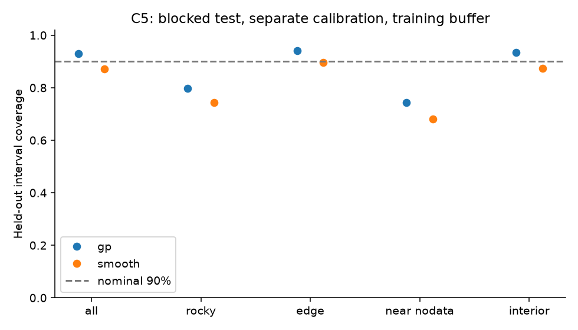

# C5 · Independent spatial checks of X1 uncertainty and route sensitivity

Owner: Sebas (`@Seredial0326`) · Issue: #120 · Status: review, not merged · Last update: 2026-11-15

## Question

Do the existing X1 predictive intervals cover held-out teacher rock cover better than a simple smoother, especially at boundaries? How sensitive are closed routes to an explicitly assumed rock price? This study validates the existing fitter and risk function; it does not introduce a new GP or enable a nominal rock cost.

## Data

The reference is `data/e9/teacher_cover_1m.tif`, the orbital BoulderNet output documented in [E9](E9_boulders.md), not independently labelled ground truth. Route experiments use `rocks_mean.tif` and `rocks_std.tif` from release `x1-rocks-gp-v1` (PR #132), the local E3 base graph, and manual/E8 stations. The GP code remains `src/dl_rocas/rocks_gp.py`; the risk function remains `src/grafos/rock_risk.py`. Input, cached-edge, script and imported-module hashes are recorded by `src/fisica/rocks_validation.py` → `data/robustness/c5/manifest.json`. Data and numerical outputs stay outside git.

## Method

The validation unit is a spatial block, never a raster pixel treated as an independent observation. Reuse X1's block aggregation, tile-fold construction, square-root transform, windowed hyperparameter fitting, exact refit and back-transform. Use the following declared protocol (`rocks_validation.py` → `validation.json.settings` and `per_fold`):

- Aggregate teacher cover to 20 m blocks. Assign 400 m tiles to five outer folds using seed 1205.
- For each outer fold, hold out its test tiles and reserve the next fold as a separate calibration group. Remove a 20 m band around both groups from training. The calibration group is withheld from both mean predictors, making their training information equal.
- Choose the smoother's Gaussian width from 1, 2, 3, 5 and 10 blocks using inner spatial folds of training data only, with the same buffer rule. Fit its mean on training blocks. Calibrate an absolute-residual envelope on the separate calibration group using its empirical 90th percentile, clipping the lower bound at zero. This is not a guaranteed spatial conformal interval.
- Fit the unchanged X1 GP only on the training partition; obtain predictive standard deviations and nominal 90% bounds using X1's existing transformed-space back-transform. Do not substitute symmetric mean ± 1.645 × exported standard deviation: the inverse transform is nonlinear. Calibration data are unused by the GP.
- Save actual held-out predictions and partition masks in `fold_0.npz` through `fold_4.npz`. When inspecting an individual file, apply its `test` mask: arrays also contain predictions accumulated from earlier outer folds.
- Report all/positive-cover/zero-cover and X1's existing edge, near-nodata and interior groups. Edge and near-nodata can overlap; they are not additive partitions. Bootstrap complete 400 m tiles for descriptive coverage intervals, conditional on this map and fitted folds.

For route sensitivity, reuse the released full-fit maps only here, not as held-out predictions. Starting at the snapped map centre, compute E3-optimal outbound/return loops to all available stations. Multiply each directed arc by the existing arrival-cell factor `1 + k * (mean + lambda * std)` and replan. Cross `k ∈ {1, 3, 10}` with `lambda ∈ {0, 1.645}`, alongside the unchanged `k = lambda = 0` control. These are declared modelling assumptions; the latter lambda is a standard-deviation multiplier, not a demonstrated calibrated physical upper bound. Report E3 energy separately from the assumed priced objective. For illustration only, each loop gets a usable budget of 1.10 times its own nominal E3 energy (`rocks_validation.py` → `routes.json`). No E1 sand factor is included in this E3-controlled experiment, so it is not a reproduction of the full API's nominal plan.

## Results

All values in the following table come from `src/fisica/rocks_validation.py` → `data/robustness/c5/validation.json.scores` (also `table.md` and `fold_*.npz`). RMSE and interval widths use percentage points of cover, not relative percent errors. Nominal interval coverage is 90%.

| Held-out group | Blocks | GP coverage | Smoother coverage | GP RMSE | Smoother RMSE |
|---|---:|---:|---:|---:|---:|
| All | 10,000 | 93.03% | 87.15% | 1.3064 | 1.3874 |
| Positive teacher cover | 3,446 | 79.80% | 74.46% | 2.1680 | 2.2042 |
| Zero teacher cover | 6,554 | 99.98% | 93.82% | 0.3645 | 0.6184 |
| Box edge | 784 | 94.01% | 89.67% | 0.9957 | 1.0229 |
| Near nodata | 219 | 74.43% | 68.04% | 3.6388 | 3.7779 |
| Interior | 9,010 | 93.36% | 87.36% | 1.2237 | 1.3077 |

Overall mean widths are 1.3425 percentage points for the GP and 1.2880 for smoothing. Whole-tile bootstrap 95% coverage intervals are [90.81%, 95.14%] and [81.69%, 91.72%], respectively (same script → `validation.json.scores.*`). They overlap; this is not a formal superiority test. Aggregate coverage conceals substantial undercoverage on rocky and near-nodata blocks, consistent with the warning in the original X1 note. A GP interval is not a guarantee of safe terrain.

These held-out tiles are 400 m wide, so this is **extrapolation** across tiles, not interpolation. Here the GP beats a smoother tuned on training data only (RMSE 1.3064 vs 1.3874), which agrees with X1's own tile results (1.280 vs 1.309). X1's statement that the GP does not beat a 20 m smoother refers to **random blocks** (1.154 vs 1.142, `x1-gp-rmse-random`). This study does not test that setting, so it does not contradict it (Aaron's review, PR #161).



Figure source: `rocks_validation.py:draw` → `paper/figures/c5_fig1_spatial_coverage.png`, using `validation.json`.

The route table below comes from the same script → `data/robustness/c5/routes.json.summary`. Each case contains 28 station loops. The teacher-cover sum adds sampled cell fractions along overlapping/repeated loop paths; it is a relative exposure index, not unique mapped area or an independent sample count. Maximum changes are over goals, not confidence bounds. The margin uses the assumed priced objective and artificial budget described above.

| Assumed k | Assumed lambda | Max E3 increase (%) | Max added length (m) | Summed teacher-cover index | Minimum priced margin (Wh) |
|---:|---:|---:|---:|---:|---:|
| 0 | 0 | 0 | 0 | 31.3091 | 2.2282 |
| 1 | 0 | 0.00549 | 0.0000 | 29.4270 | 2.1855 |
| 1 | 1.645 | 0.00940 | 1.1716 | 28.5400 | 2.0863 |
| 3 | 0 | 0.00940 | 1.1716 | 29.2765 | 2.1001 |
| 3 | 1.645 | 0.20539 | 9.0294 | 21.1279 | 1.8026 |
| 10 | 0 | 0.33654 | 11.7157 | 20.6936 | 1.8013 |
| 10 | 1.645 | 0.86692 | 12.3015 | 13.7404 | -0.1606 |

Stronger assumed caution diverts these routes away from teacher detections with a modest E3 increase, but it can exhaust an artificially tight priced budget. This demonstrates sensitivity to the price assumption; it does not estimate an astronaut's actual cost or justify enabling a rock penalty.

## Checks

`tests/fisica/test_rocks_validation.py` checks disjoint buffered partitions, invariance of baseline tuning/mean/width to changes in outer-test labels, separation of calibration from mean fitting/tuning, explicit missing metrics for empty groups, and the existing default-off risk factor. A mocked fitter records every training label supplied by the orchestrator and verifies persisted test masks. The real run refits the unchanged X1 fitter and saves fold-level evidence; no final full-fit raster is counted as a held-out prediction. Both route rasters must match the graph's shape and transform. Review the generated coverage figure against the score table.

## Limitations

- The teacher has detector bias and misses unresolved boulders; its coverage cannot establish physical ground-hazard coverage. The validation target is block-average teacher cover, not individual rocks or one-metre hazards.
- Coverage conditional on positive teacher cover and proximity to nodata is poor despite satisfactory aggregate coverage. Treat these as subgroup diagnostics, not calibrated per-cell safety probabilities.
- The smoother's interval is an envelope with one width for every block, while the GP's width changes from place to place. Part of the coverage gap on rocky blocks (positive teacher cover: 79.80% vs 74.46%) therefore comes from the shape of the interval, not only from the mean predictor.
- The separate calibration holdout and training buffer differ from Aaron's original CV, so these scores should not be compared as identical-protocol benchmarks. The smoother has additional calibration labels for its envelope; neither mean predictor receives them.
- A single spatial fold assignment and finite map support limit generalisation. Whole-tile bootstrap summaries do not remove dependence between fitted folds or prove geographic transfer.
- The exported full-fit standard deviation is not itself scored in sample. Validation concerns the same fitting procedure under honest holdout; routes use the released maps. This distinction must survive any presentation of the results.
- Risk weights and the illustrative budget have no metabolic calibration. NaN risk values follow the existing risk function's zero-risk convention; this does not make unobserved terrain safe. Closed E3 loops omit time, O2, station dwell, E1 costs and an operational acceptance controller.

## What other pieces can use

Aaron (`@aahg1105`) can use the saved fold masks/predictions for independent checks of the released X1 procedure. JB (`@JavierBonilla2004`) and the product agents should retain the rocky/near-nodata undercoverage warning when showing uncertainty. E3 and route owners can use the sensitivity table as an explicitly conditional experiment. Production stays `k = lambda = 0`; no `src/grafos/`, `src/dl_rocas/`, API or GUI contracts change. The existing [E9 note](E9_boulders.md) and its bibliography remain the source for X1 and BoulderNet methods.

## Reproduce

Use an existing scientific environment with NumPy, SciPy, scikit-learn, threadpoolctl, rasterio, GeoPandas and Matplotlib; installation requires Sebas's approval. Obtain the teacher/base/station inputs through the team's data channel and the GP maps from the existing release. From the repository root:

```powershell
python src/fisica/rocks_validation.py --data data --layers data/robustness/c5-inputs/extracted --out data/robustness/c5 --figure paper/figures/c5_fig1_spatial_coverage.png
python -m pytest tests/fisica/test_rocks_validation.py
```

The local worktree run used an absolute `--data` path to the shared data directory. Inspect `manifest.json` for the input versions and cached E3 edges used. This command creates validation artifacts only and does not modify input layers or run a deployment.

## Outputs

Local, outside git: `data/robustness/c5/{validation.json,table.md,fold_0.npz,fold_1.npz,fold_2.npz,fold_3.npz,fold_4.npz,routes.json,manifest.json}`. Committed: this note, the experiment/test source and the code-generated figure. No new data release is uploaded by this task.
