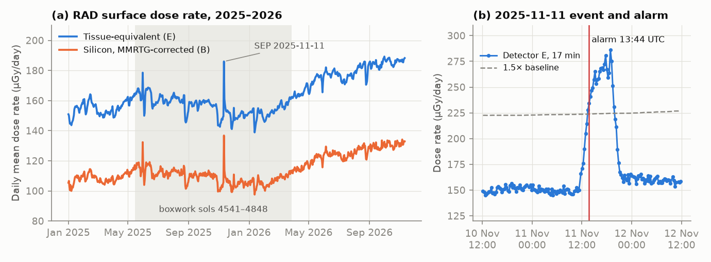
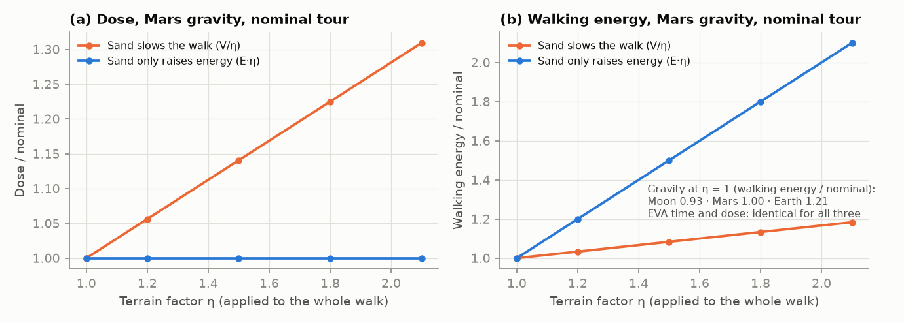
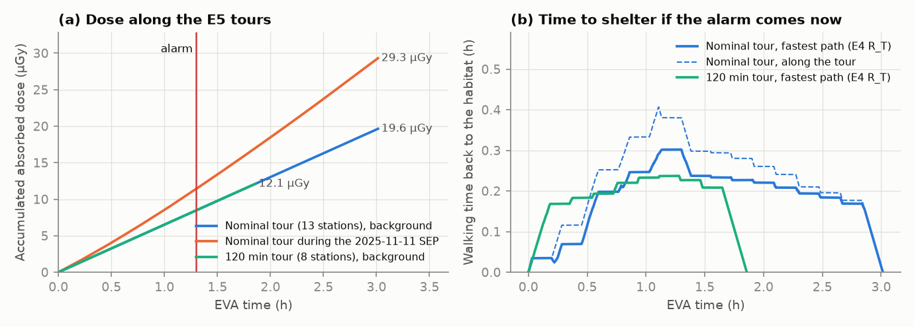
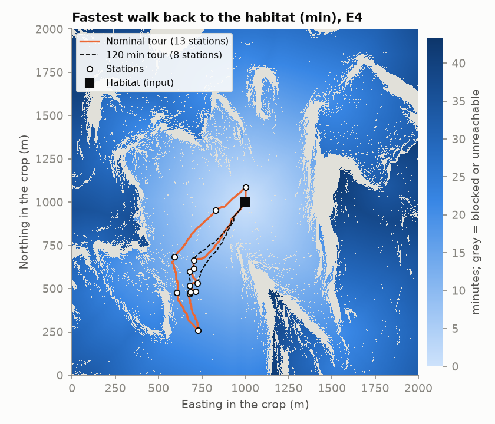

# E12 · Radiation dose along the EVA timeline and the solar-storm alert

Owner: Juan (`@JuanCorredor2023`) · Issues: #13, #144 · PRs: #35 (first version), this PR (E5 tours and E4 return map, #144) · Status: done on E5's two tours from the habitat at the box centre, with E4's return-time raster. The first version used a provisional route (Curiosity's traverse out and back), now kept only as a comparison line · Last update: 2026-11-15

## Question
How much radiation does an astronaut receive during an EVA in the boxwork, and when does radiation (not energy) change the plan? Following the original plan, the answer is a dose budget along the EVA timeline plus an alert for solar particle events (SEP) that triggers a return to the habitat. It is not a per-pixel radiation map: the background barely depends on position.

## Data
- **RAD dose rates** [RAD-L2]: the CDAWeb `MSL_RAD_OBS-L2` dosimetry listing, 11 CSV files, 57,843 observations from 2025-01-01 to 2026-11-11, one every ~17 min (`src/radiation/rad_data.py` → `data/e12/rad_summary.json`). We use the good-quality columns. The 1,717 flagged observations carry the CDF fill value −1e31 and are dropped.
- **Columns:** absorbed dose rate in tissue-equivalent plastic (detector E, *not* corrected for the rover's MMRTG power source) and in silicon (detector B, raw and MMRTG-corrected). Nominal: detector E. It is the closest to human tissue, and it is conservative because it still contains the MMRTG background. In detector B the MMRTG makes up 33.9 % of the raw rate (`mmrtg_share_of_b`).
- **Units:** µGy per Earth day, as the CSV header says. The PDS label of the same field says µGy/hour. Only per day is consistent with the published surface rate of 0.21 mGy/day [Hassler2014]: our median is 0.76 of it, while per hour would give 18.3 times it (`unit_check`).
- **Sols:** the CSVs have no sol column, so each observation gets a sol from the `START_SOL`/`START_TIME` anchors in the file headers (good to ±0.5 sol). The boxwork sols 4541–4848 map to 2025-05-15 → 2026-03-27, which matches `data/README.md`.
- **Terrain:** JB's base grid (`dem_1m.tif`, `slope_deg.tif`) [Parker2016].
- **EVAs: E5's two tours** (Diana, [E5 note](E5_orienteering.md)), computed with `src/orienteering/run.py` from the habitat at the box centre, 1000 Wh budget and 10 % margin, plain E3 cost, the 13 manual stations:
  - **nominal:** all 13 stations, 180.9 min (`data/e5/tour_nominal.gpkg`);
  - **120 min limit:** 8 stations, 111.4 min (`--max-duration-min 120`, `data/e5/tour_120min.gpkg`).

  They are the tours of the E5 note and of the paper (same stations, order and energy: 723.6 Wh and 445.1 Wh). Each GeoPackage has the tour's cell path (layer `route`) and the visited stations with their service time (layer `stops`).
- **Return-time raster:** E4's `rv_time_s.tif` (Aaron, `src/grafos/build_rv.py`, [E4 note](E4_walkback.md)) for the same habitat → `data/e4/rv_time_s.tif`.
- **Habitat:** a user input, the same one E4 receives (team decision on the board, 2026-11-14). E12 never chooses its own: it takes `--habitat X Y` in DEM metres, or the habitat point inside the route file (the `start` point of `/plan`, a `base` point, a point with `type`/`tipo` = habitat, or the habitat stop of an E5 tour), and it stops if there is none. Here it is the box centre, (8143537.99, −284463.58), the same illustrative choice as the E4 and E5 notes.
- **Walking model:** E3 (`src/fisica`, Sebas) is used unchanged: Apollo speed V(α) = 0.75 − 0.01·α and Santee 2001 power.
- **First version (#13):** before the planner existed, Curiosity's traverse from E2 (`data/e2/trajectory.geojson`, 3,900 m) [PLACES], walked out and back, stood in as the EVA, with the habitat at its start (8144537.415, −283494.006). Its outputs are the files of release `e12-dose-v1` at the top of `data/e12/`, which the HUD still reads (see *What other pieces can use*).

## Method
1. **Background rate** (`rad_data.py`): median of the good-quality detector-E observations over the boxwork sols. For figures and checks: daily means, monthly medians, the within-day coefficient of variation, and isolated spikes. An isolated spike is a single observation above 1.5× the trailing 3-day median while both neighbours stay below 1.2×.
2. **Dose along the route** (`route_dose.py`):
   - Steps of the route. If the route is a chain of neighbouring cells through cell centres (what E4/E5 produce), each step is one E3 edge: d_h = 1 or √2 m and α = atan(dz/d_h) between the two cells, exactly as `fisica.edge_cost`. Any other line (Curiosity's traverse is a list of rover poses) is resampled every 1 m with the DEM read bilinearly. Both tours are cell chains.
   - For each step, apply the E3 edge formulas, vectorised: dt = d_h / (V cos α) and E = P(α, V, g)·dt.
   - Each station adds its `service_time_min` at its route point. Only the stations the tour visits count (layer `stops`). They are matched in visiting order, each at or after the point of the previous one, because a tour can pass a station's cell on another leg. Stations more than 25 m from the route are ignored and listed.
   - The energy is the walking energy only. E5 adds the work at each station at 205 W, which E12 does not count.
   - Dose = ∫ rate dt. The rate is either the constant background or the real RAD series from a start time; the series is piecewise linear and is integrated exactly. Equivalent dose is reported as an *estimate* with the GCR quality factor Q = 3.05 [Hassler2014].
   - Every point gets `return_s`, the fastest walking time back to the habitat, read from the return-time raster R_T. `return_route_s` is the walk back along the route itself: the shorter of retracing it and going on to its end (a tour is a loop).
   - **Return-time raster R_T.** E4's `rv_time_s.tif`, passed with `--return-raster`: a reverse Dijkstra from the habitat over the E3 directed edges, weighted by **time** because dose is rate × time, with the E3 limits (20° per edge, cells steeper than 30° blocked). For routes without an E4 raster, E12 still has its own copy of the same recipe (`return_time.py`, cached in `data/e12/return_time_s_e12_fallback.tif`). For this habitat the two are identical (Checks).
3. **Sensitivity to G and η** (`sensitivity.py`, nominal tour), with G ∈ {1.62, 3.71, 9.81} m/s² and η ∈ {1.0, 1.2, 1.5, 1.8, 2.1}. The η values are Pandolf/Soule terrain factors, where 2.1 is loose sand [Soule1972, Pandolf1977]. Santee 2001 has no terrain factor, so η is tested two ways that bracket the effect:
   - "energy" mode: E × η, time unchanged;
   - "speed" mode: V / η, so the walking time grows by η and the power is taken at the slower speed. The time at the stations does not change.

   Until `sand.tif` (E8) is used here, η applies to every walking step, which is the worst case for the sand share. The script also computes a third reading, a fixed energy budget; it is not reported for the tours (Limitations).
4. **SEP alert** (`sep_alert.py`):
   - **Rule:** the baseline is the trailing 3-day median of past observations only. The alarm fires when the detector-E rate stays above k_on = 1.5× the baseline for n_on = 2 consecutive observations. The event ends after 2 observations below 1.2×. Isolated spikes are kept in the input, because the rule itself must reject them. A sweep over k_on ∈ {1.2, 1.3, 1.5, 2.0} and n_on ∈ {1, 2, 3} counts the alarms.
   - **Return time:** the same R_T raster as in step 2, for the same habitat input.
   - **Replay** (`--no-out-and-back`: a tour already returns to the habitat): each tour is placed so that the real alarm of the strongest event arrives at the farthest point (largest R_T on the tour), at 25 % of the EVA time and at 75 %. "Ignore" finishes the plan; "return now" takes the fastest walk back (R_T). Only the dose received outside is counted. Storms ×10 and ×50 scale the excess over the baseline and are hypothetical.

## Results
Every number below comes from `src/radiation/paper_figures.py` → `data/e12/e12_summary.json`, which collects `rad_summary.json` and, for each tour, `data/e12/tours/<tour>/route_dose_summary.json` and `sep_alert.json` (route_dose.py and sep_alert.py), plus `tours/nominal/sensitivity.json` (sensitivity.py).

**Background.**
- The boxwork background is **156.4 µGy/day = 6.52 µGy/h** (detector E). The daily means over the 317 boxwork days run from p05 145.8 to p95 166.1 µGy/day. The MMRTG-corrected silicon rate is 109.0 µGy/day.
- Within one day the rate varies by 1.8 % (median coefficient of variation).
- The monthly median rises from 149–163 µGy/day in 2025 to 186 µGy/day in October–November 2026 (Figure E12-1a), consistent with the declining phase of the solar cycle letting in more cosmic rays.
- The equivalent-dose estimate is ≈ 0.48 mSv/day, below the 0.64 mSv/day measured in 2012–2013 [Hassler2014].
- Three isolated spikes exist in 22 months, single observations up to 315 µGy/day.


*Figure E12-1. (a) Daily mean RAD dose rate in tissue-equivalent plastic (E) and in silicon corrected for the MMRTG (B), 2025–2026; the grey band marks the boxwork sols. (b) The 2025-11-11 event at full cadence, the alarm level (1.5× the trailing baseline) and the alarm.*

**Dose of the two tours** (`route_dose_summary.json` of each tour):

| Tour | Length | EVA time (walking + stations) | Walking energy | Absorbed dose | Equivalent dose (estimate) |
|---|---|---|---|---|---|
| Nominal, 13 stations | 2,252 m | 3.01 h (0.85 h + 2.17 h) | 279 Wh | **19.6 µGy** | ≈ 60 µSv |
| 120 min limit, 8 stations | 1,391 m | 1.86 h (0.52 h + 1.33 h) | 172 Wh | **12.1 µGy** | ≈ 37 µSv |

- The dose is the background rate times the time outside. On the nominal tour 72 % of that time is station work (2.17 of 3.01 h), so the dose follows the plan's duration, not its length.
- No step of either tour is steeper than the 20° edge limit (`steps_steeper_than_edge_limit` = 0).
- If the nominal EVA had run during the 2025-11-11 storm (alarm at the farthest point, ignored), it would have received 29.3 µGy (Figure E12-2a).
- *Comparison with the first version:* the provisional route (Curiosity's traverse out and back, 7,800 m) took 2.97 h and gave 19.4 µGy (`old_provisional_route`). The route changed completely and the dose barely moved, because the rate is the same everywhere and the two EVAs last about the same.

**G and η (nominal tour, Figure E12-3).**
- *Gravity:* on a fixed route, G changes the walking energy (Moon 0.93×, Earth 1.21× the Mars value) but **not the time, so not the dose**. The E3 speed does not depend on G. This is a property of the model, not a bug.
- *Terrain, "energy" mode:* the walking energy is 2.1× at η = 2.1, the dose does not move.
- *Terrain, "speed" mode:* only the walk slows down, not the station work. At η = 2.1 the EVA time and the dose grow 1.31× and the walking energy 1.18×.

On Mars the dose ranges from 1.0× to 1.31× of the nominal across the two readings. On the provisional route, which had no stations, the "speed" mode gave 2.1×: on a tour most of the time is spent at the stations, so the terrain matters less.


*Figure E12-3. Sensitivity of dose (a) and walking energy (b) to the terrain factor η on Mars, nominal tour, under the two readings of η; the gravity numbers are in the inset text.*

**SEP alert.**
- **The rule finds exactly one event in 22 months:** onset 2025-11-11 13:27 UTC and alarm 13:44 (17 min later). It lasted 7.1 h, peaked at 286 µGy/day (1.92× its baseline of 149) and gave an excess of 31.9 µGy.
- In the sweep, with n_on = 1 every threshold up to 1.5 also fires on the isolated spikes. At k_on = 1.5 and 2 consecutive observations there is no false alarm. k_on = 1.3 also catches a smaller real enhancement on 2025-05-31 (peak 1.45×, 8.3 µGy excess). k_on = 2.0 misses everything.
- **Return-time map** (E4, Figure E12-4; `return_time_map_e4`): the habitat cell (row 1000, col 1000) is already in the main component (84.4 % of the grid), so it is not moved. 84.4 % of the grid can reach the habitat; the rest is blocked by the slope limits. The median walk back is 0.40 h and the longest 0.72 h.
- **Along the tours:**
  - The longest fastest walk back is 0.30 h (18 min) on the nominal tour, at station C2, and 0.24 h on the 120 min tour, at station R0.
  - On the nominal tour the fastest walk back is 0.79× the tour's own way back (median). On the 120 min tour it is the same (1.00×).
  - Every tour point has a return time. The provisional route had 134 points on cells the E3 graph blocks.
- **Replay** (`replay` of each tour):

| Tour | Alarm when the astronaut is at | Plan left | Time back: along the tour / fastest | Dose saved by returning: real storm | ×10 | ×50 |
|---|---|---|---|---|---|---|
| Nominal | 25 % of the EVA (at H3) | 2.25 h | 0.25 h / 0.20 h | 21.7 µGy | 102 µGy | 458 µGy |
| Nominal | farthest point (at C2) | 1.71 h | 0.38 h / 0.30 h | 14.9 µGy | 70 µGy | 315 µGy |
| Nominal | 75 % of the EVA (at R1) | 0.74 h | 0.24 h / 0.21 h | 5.4 µGy | 24 µGy | 109 µGy |
| 120 min | 25 % of the EVA (at R2) | 1.32 h | 0.19 h / 0.18 h | 11.8 µGy | 54 µGy | 243 µGy |
| 120 min | farthest point (at R0) | 0.58 h | 0.24 h / 0.24 h | 3.4 µGy | 15 µGy | 68 µGy |
| 120 min | 75 % of the EVA (at R4) | 0.40 h | 0.23 h / 0.23 h | 1.7 µGy | 8 µGy | 33 µGy |

- What sets the dose saved is how much of the plan is left when the alarm comes, not the distance. From every point of both tours the walk back takes less than 20 minutes.


*Figure E12-2. (a) Accumulated absorbed dose along the two E5 tours at the boxwork background, and along the nominal tour with the real RAD series during the 2025-11-11 storm (alarm at the farthest point). (b) Walking time back to the habitat at each moment: by the fastest path (E4's R_T) for both tours, and along the nominal tour itself.*


*Figure E12-4. Fastest walk back to the habitat at the box centre from every cell (minutes), E4's `rv_time_s.tif` (reverse Dijkstra on the E3 time edges), with the two E5 tours and the 13 stations; grey cells are blocked by the slope limits or unreachable.*

## Checks
- **Same clock as E5** (`check_tours_against_e5`). On both tours, E12's EVA time, walking time, length and walking energy equal E5's:
  - nominal: 180.85 min, 3,051.11 s, 2,252.31 m, 279.392 Wh;
  - 120 min: 111.43 min, 1,885.70 s, 1,391.30 m, 171.814 Wh.

  The time at which the astronaut leaves each station agrees within 3 µs. So E12 times the tour with the same E3 edges and puts each station's service time on its visit.
- **Same return time as E4** (`return_time_map_e4`): E4's `rv_time_s.tif` and E12's own recipe for the same habitat have the same 3,374,988 reachable cells and a largest difference of 0 s.
- **Same costs as E3** (`check_against_e3_edges`, on E2's cell sequence because it is a long real path; a check of the method, not a route number):
  - Each step's time and energy match `fisica.metabolic.segment_cost` (unit test).
  - On a cell chain, E12 gives exactly the E3 edge sum. E2's 8-connected cell sequence (4,686 moves) takes 1.8875 h both ways, a relative difference of 7.6 × 10⁻¹⁰ (also a unit test on a random DEM).
  - On Curiosity's free line, the resampled time per metre, 1.4118 s/m, matches the edges' 1.4120 s/m (−0.01 %).
- **Units:** per-day reading confirmed against [Hassler2014] (see Data).
- **Sol anchors:** the boxwork sols fall on the dates of `data/README.md`.
- **26 unit tests** in `tests/radiation/` (`python -m pytest tests/radiation -q`):
  - fill values and header check;
  - sol from the anchors;
  - spike and storm detection, consecutive-observation rule and excess dose;
  - time on flat ground = L / 0.75;
  - station dwell, and stations far from the route ignored;
  - stations of a tour matched in visiting order, and an E5 tour GeoPackage read with its visited stops and habitat;
  - G changes energy but not time;
  - both η modes;
  - retrace and loop return times along the route;
  - habitat taken from `--habitat`, from a `start` or `tipo = habitat` point, and a stop when it is missing;
  - fallback R_T on flat ground (= distance / 0.75) and the snap of a habitat placed on an isolated island;
  - the fallback is cached per habitat, and E4's raster is preferred when given;
  - cell chains use the exact E3 edges, free lines are resampled, and `return_s` is read from the raster;
  - exact integration of a linear rate;
  - budget cut-off.

## Limitations
- **Two tours, one habitat.** The numbers are for E5's two tours from the box centre. Another habitat or other stations change the EVA time and the walk back, not the rate.
- **Detector E is not MMRTG-corrected**, so the background is an upper estimate. The silicon corrected rate is 30 % lower, but silicon is not tissue.
- **Equivalent dose is an estimate.** Q = 3.05 is the GCR mean of 2012–2013 [Hassler2014]. For SEP protons Q is lower, so the µSv numbers during storms are upper bounds. RAD sits on the rover deck: a suit adds little shielding, and a habitat adds some. The habitat dose is not modelled. "Dose saved" counts only the dose outside.
- **The real storm in our window is weak at the surface** (1.9×, 32 µGy in total). The ×10 and ×50 storms are hypothetical scalings, not measured events. Stronger events may exist outside the downloaded window (2025-01 → 2026-11). The full mission series is on CDAWeb (`radiacion_rad/FUENTES.md`), and it is small to download.
- **η is not part of E3.** Both readings are assumptions that bracket the effect. Until `sand.tif` is used here, η covers every walking step.
- **E12 counts only the walking energy.** On the nominal tour that is 279 Wh; E5 adds 444 Wh of station work at 205 W (723.6 Wh in total). The dose does not depend on energy. But the fixed-energy-budget reading of `sensitivity.py` (the EVA stops when a budget equal to the nominal energy is spent) would use the walking energy alone, so it would mislead on a tour; it stays in `sensitivity.json` but is not reported.
- **The alarm uses RAD itself,** with a 17 min delay at the 2-observation rule. A real crew would also have forecasts from orbit. The threshold k_on = 1.5 was chosen on 22 months of data with one event and is not validated beyond that.
- **The return map assumes walking at the E3 speed** during a storm, with the same slope limits as the planner.

## What other pieces can use
- **Sebas (product, HUD):**
  - The HUD's radiation panel still reads the first version (release `e12-dose-v1`, top of `data/e12/`: Curiosity's traverse out and back). Nothing there changed in this PR.
  - The tour files are `data/e12/tours/nominal/` and `data/e12/tours/max120/`. `route_dose.geojson` has the same fields as before: one Point every 5 m (and one at each station) with `t_s`, `energy_wh`, `rate_ugy_h`, `dose_ugy`, `dose_usv_est`, `dwell_s`, `return_s` (fastest walk back to the habitat, s) and `return_route_s` (back along the tour). The summary, with the habitat and the R_T source, is in the FeatureCollection properties.
  - Showing a tour in the panel would need a new data package and is not done here; to coordinate on the board.
  - Alert rule: rate > 1.5× the trailing 3-day median for 2 consecutive RAD observations.
- **Aaron (E4) and Diana (E5):** E12 now reads an E5 tour GeoPackage directly. For another habitat or tour: `python src/radiation/route_dose.py --route <tour.gpkg> --habitat X Y --return-raster rv_time_s.tif`, with E4's raster built for the same habitat. It also accepts the `/plan` FeatureCollection (LineString + station Points with `service_time_min`; its `start` point is taken as the habitat). Radiation is not the binding constraint of a normal EVA (≈ 20 µGy for 3 h); energy and time are. It only matters through the SEP return, and from the tours the walk back is under 20 min.
- **JB (E8):** `--sand-raster sand.tif` applies η only on sand (probability ≥ 0.5).
- **Sebas (E3):** dose is insensitive to G because the Apollo speed has no G. If E3 adds a gravity-dependent speed (e.g. Froude scaling), rerun `sensitivity.py`.
- **Team results table (#16):** the E12 numbers, with script, file, commit and checksum, are posted there.

## Reproduce
From the repo root. Needs `data/base/` (release `base-grid-v2`), `data/stations/stations_manual.gpkg` (release `stations-v1`), `data/e2/` (release `e2-trajectory-v1`, for the method check), `data/e12/` from release `e12-dose-v1` (or `rad_data.py` with the RAD folder `03_curiosity/radiacion_rad/`, `data/README.md`; found through `MARTIAN_DATA`, `data/` or `../data`) and `route_dose_summary.json` of the first version for the comparison line.
```bash
python src/radiation/rad_data.py
python src/grafos/build_rv.py --habitat 8143537.99 -284463.58 --budget-wh 1000 --margin 0.1
python src/orienteering/run.py --habitat 8143537.99 -284463.58 --out data/e5/tour_nominal.gpkg
python src/orienteering/run.py --habitat 8143537.99 -284463.58 --max-duration-min 120 --out data/e5/tour_120min.gpkg
python src/radiation/route_dose.py --route data/e5/tour_nominal.gpkg --habitat 8143537.99 -284463.58 --return-raster data/e4/rv_time_s.tif --out data/e12/tours/nominal/route_dose.geojson
python src/radiation/sep_alert.py --route data/e5/tour_nominal.gpkg --habitat 8143537.99 -284463.58 --return-raster data/e4/rv_time_s.tif --no-out-and-back --out-dir data/e12/tours/nominal
python src/radiation/route_dose.py --route data/e5/tour_120min.gpkg --habitat 8143537.99 -284463.58 --return-raster data/e4/rv_time_s.tif --out data/e12/tours/max120/route_dose.geojson
python src/radiation/sep_alert.py --route data/e5/tour_120min.gpkg --habitat 8143537.99 -284463.58 --return-raster data/e4/rv_time_s.tif --no-out-and-back --out-dir data/e12/tours/max120
python src/radiation/sensitivity.py --route data/e5/tour_nominal.gpkg --out-dir data/e12/tours/nominal
python src/radiation/paper_figures.py
python -m pytest tests/radiation -q
```
The first version (provisional route): `route_dose.py --habitat 8144537.415 -283494.006 --out-and-back`, `sensitivity.py` and `sep_alert.py --habitat 8144537.415 -283494.006`, with the default outputs at the top of `data/e12/`.

## Outputs
- `data/e4/rv_time_s.tif` and `data/e5/tour_nominal.gpkg`, `tour_120min.gpkg`: inputs, written by E4's and E5's scripts.
- `data/e12/rad_dose_rate.csv`: one row per RAD observation with sol, rates and the quality and spike flags.
- `data/e12/rad_summary.json`
- `data/e12/tours/<tour>/` for `nominal` and `max120`: `route_dose.geojson`, `route_dose_summary.json`, `sep_alert.json`, `sep_thresholds.csv`; `nominal` also has `sensitivity.csv` and `sensitivity.json`.
- `data/e12/e12_summary.json`
- Figures `paper/figures/e12_fig1…4`.
- Release `e12-dose-v1` (top of `data/e12/`: the first version on the provisional route, read by the HUD) is unchanged.
