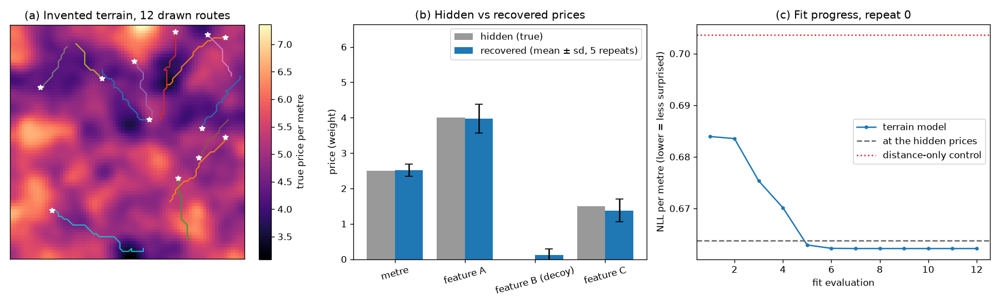
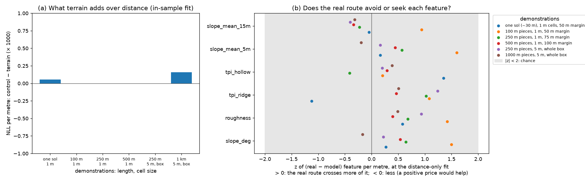
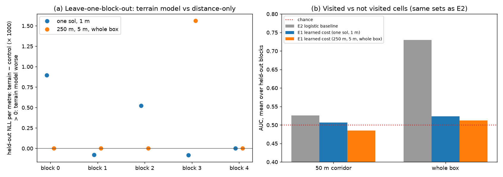
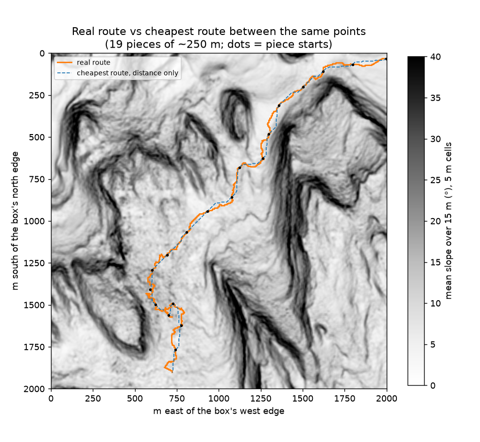
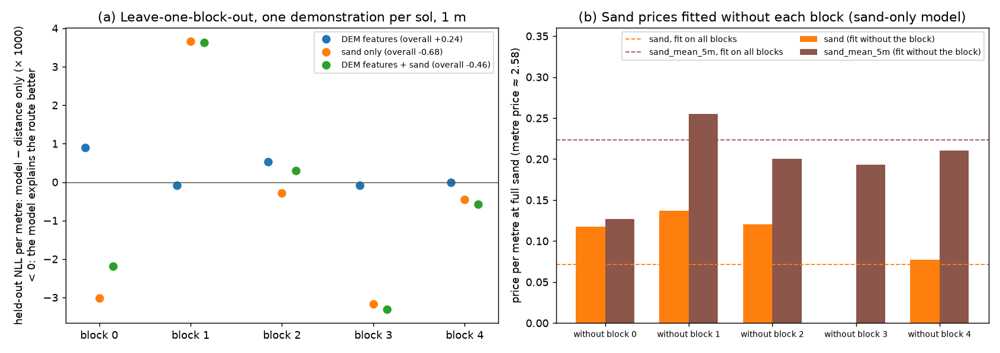
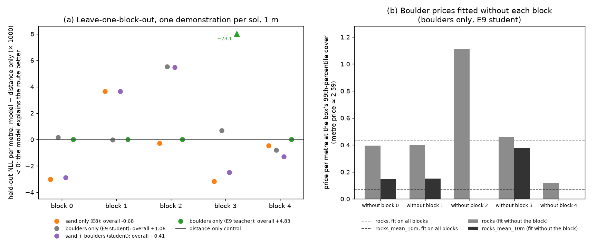

# E1 · Terrain cost learned from Curiosity's route (MaxEnt IRL)

Owner: Juan (`@JuanCorredor2023`) · Issue: #5 · PRs: #50 (DEM features), #57 (E8 sand), #108 (E9 boulders) · Status: DEM features give no price (negative result); E8 sand gives a small price that holds out of sample and is handed to E3; E9 boulders give a price in sample that does not hold out of sample (negative result), so the hand-off stays sand-only · Last update: 2026-11-15

## Question
Given where Curiosity started and where it stopped, which terrain prices make the route its drivers actually chose the most likely one? If the learned prices explain the route better than distance alone, they become the terrain part of the astronaut's cost (combined with E3); if not, the planner uses E3 alone.

## Data
- **Demonstrations:** E2's cell sequence (`data/e2/cell_sequence.csv`, release `e2-trajectory-v1`): Curiosity's route inside the bbox from PLACES [PLACES], cell by cell on the 1 m base grid, 8-connected, sols 4369–4868.
- **Terrain:** JB's base grid (release `base-grid-v2`): `slope_deg.tif`, `roughness.tif`, `tpi.tif` from `dem_1m.tif` [Parker2016], plus the mean slope in 5 × 5 and 15 × 15 m windows, the same five features as E2's baseline. No cell of the box is nodata.
- **Sand:** E8's `sand.tif` (JB, release `e8-v0`, PR #49): the fraction (0–1) of each 1 m cell that E8's U-Net marks as sand on the 0.25 m orthophoto [HiRISE-Gale]. Same grid as the DEM (checked: CRS, transform, 2000 × 2000), no nodata; 10.3 % of the box has some sand and the 99th percentile is 1 (`data/e1/e1_summary.json` → `sand.sand_layer`). JB reports the U-Net as conservative: 91 % of what it marks as sand is sand, but it misses much of it.
- **Boulders:** E9's `rocas.tif` (Aaron, release `e9-rocks-v1`, PR #99, note `paper/notes/E9_boulders.md`): the fraction (0–1) of each 1 m cell covered by boulders, from a small CNN distilled from BoulderNet [Prieur2023] on the 0.25 m greyscale orthophoto [HiRISE-Gale]. Same grid as the DEM (checked in `irl_data.read_on_grid`: transform and 2000 × 2000). Numbers below from `data/e1/e1_summary.json` → `rocks.rock_layer`.
  - 266 cells are NaN (orthophoto nodata); E1 counts them as 0.
  - The student is a soft density: it is above 0 in every valid cell, above 0.01 in 4.4 % of the box and above 0.25 in 0.29 %. Mean 0.0039, median 0.0004, 99th percentile 0.0869, maximum 0.925.
  - For the sensitivity check, the teacher's own cover (`teacher_cover_1m.tif`, same format) is above 0 in 1.5 % of the box and above 0.25 in 0.51 %; mean 0.0037, 99th percentile 0.0980, maximum 1.0. Averaged over 10 × 10 m, the two layers correlate at r = 0.73 over the box.
  - E9 reports that the student agrees with the teacher at r = 0.66 on held-out blocks, reads best averaged to 10 m and does not see boulders below about 1 m.

## Method

### Model [Ziebart2008]
- **Route probability.** Between a start and a goal, a route ζ has probability P(ζ) = exp(−C(ζ)) / Z, where C is the sum of its move costs. Cheap routes are exponentially more likely than expensive ones, but every route is possible, so detours for reasons the model does not see (science stops, operations) do not break it.
- **Move cost.** Moves go to the 8 neighbours in the order of E3's `NEIGHBOURS` (`src/fisica/edge_cost.py`). The cost of the move u → v is d · (c(u) + c(v)) / 2, with d = 1 or √2 cell lengths and c(cell) = w · φ(cell).
- **Features φ, all ≥ 0:** `metre` (a constant 1, so its weight is the price of one cell length), `slope_deg`, `roughness`, `slope_mean_5m`, `slope_mean_15m`, and TPI split by sign into `tpi_ridge` = max(TPI, 0) and `tpi_hollow` = max(−TPI, 0). Each terrain feature is divided by its 99th percentile over the box (values in `data/e1/e1_summary.json` → `feature_scale_p99`). Weights are kept ≥ 0 so that no cell pays the rover to cross it; splitting TPI lets ridges and hollows each have their own non-negative price.
- **Backward pass (soft value iteration).** V(goal) = 0 and V(u) = −log Σ_k exp(−(cost(u → v_k) + V(v_k))). V is a soft minimum of the cost to reach the goal: Aaron's R(v) is the hard version (min instead of log-sum-exp). The model's policy is π_k(u) = exp(−(cost(u → v_k) + V(v_k)) + V(u)).
- **Forward pass.** Mass 1 starts on the start cell and is pushed with π until the goal absorbs it; this gives the expected metres the model drives over each cell, and from them the expected feature counts E[f].
- **Fit.** The negative log-likelihood of a demonstration is NLL = C(ζ) − V(start) and its gradient is f(ζ) − E[f]: if the model's routes cross more of a feature than the real one, that feature's price goes up. The NLL is convex in w; we minimise the mean NLL per metre with L-BFGS-B [SciPy] under the bounds below. The two passes run on the GPU with PyTorch [PyTorch] in float64.
- **Price floor.** With 8 neighbours the number of walks grows exponentially with their length; if moves are too cheap, Z diverges. For a uniform price c per cell length, Σ_k exp(−c·d_k) = 4e^−c + 4e^−√2c ≥ 1 when c ≤ 1.78, so we keep w_metre ≥ 2.0. No fit ended on this floor (`w0_at_floor` is false in every `irl_fit_*.json`).
- **Control model.** Distance only: every terrain price held at 0, only `metre` fitted. It knows each demonstration's start and goal too, so it already predicts a lot ("go roughly straight"). Terrain explains the route only if the terrain model beats this control. This mirrors Pflueger et al. [Pflueger2019], who learn rover path costs with soft value iteration, but here the costs are linear in interpretable terrain features.

### Demonstrations and scales
- **One per sol** (`irl_data.drives`): each sol's drive starts where the rover was parked (last cell of the previous sol) and ends where it parked; drives shorter than 10 m are skipped. Window: the drive's bbox plus 50 m.
- **Route pieces** of about 100, 250 and 500 m (`irl_data.pieces`), with 50, 75 and 100 m margins on the 1 m grid.
- **Whole box at 5 m:** features averaged over 5 × 5 m cells (400 × 400 grid), pieces of about 250 and 1000 m, and the whole box as the window, so the model can route through any valley or over any wall.
- A demonstration that touches its goal cell earlier is cut there (the goal absorbs); NLL per metre uses the length after the cut.

### Feature sets with E8 sand (`--features`)
- `dem`: the seven features above (the PR #50 result).
- `sand`: `metre`, `sand` (the cell's sand fraction) and `sand_mean_5m` (its mean over 5 × 5 m), both already in 0–1.
- `dem_sand`: the DEM set plus the two sand features.
- All three are fitted and validated on the per-sol demonstrations at 1 m, the scale where a rover would dodge sand inside a valley.

### Feature sets with E9 boulders (`--features`, `--rocks-layer`)
- `rocks`: `metre`, `rocks` (the cell's boulder cover from `rocas.tif`, NaN counted as 0) and `rocks_mean_10m` (its mean over a 10 × 10 m window, `scipy.ndimage.uniform_filter` [SciPy], because E9 reports that the layer reads best averaged to 10 m).
- `sand_rocks`: `metre`, the two sand features and the two boulder features.
- Like every other feature, both boulder features are divided by their 99th percentile over the box, so a weight is the price of a metre over a cell at the box's 99th-percentile cover. A NaN cell counts as no boulders, the same rule as `fisica.human_cost.terrain_factor`.
- Sensitivity check: `--features rocks --rocks-layer teacher` repeats the `rocks` model with BoulderNet's own cover (`teacher_cover_1m.tif`) instead of the distilled student.
- All of them are fitted and validated like the sand models: per sol, 1 m cells, 50 m margin.

### Hand-off rule (`src/ml/export_e1_weights.py`)
- **Which model:** a model's prices go to E3 only if it beats the distance-only control on held-out blocks; among those, the lowest held-out NLL wins.
- **Same cost in E3:** `fisica.human_cost` scales a feature as clip(x / max, 0, 1). We export max = the feature's true maximum over the box and weight = w · max / p99, so the clip never acts and E3 computes exactly E1's w · x / p99.
- **Candidates:** the per-sol models `dem`, `sand`, `dem_sand`, `rocks` and `sand_rocks` (boulders from the E9 student, the layer E9 publishes). The teacher run is only a sensitivity check.
- **Extra rasters:** the window means have no file of their own, so the script writes them when the chosen model uses them: `data/e1/sand_mean_5m.tif` and `data/e1/rocks_mean_10m.tif` (float32, base grid). The boulder maximum ignores NaN cells.

### Validation
- **Leave-one-block-out** with E2's 5 consecutive blocks of the route (`src/ml/cell_features.py`); a demonstration belongs to the block of its middle step. Both models are fitted on four blocks and scored on the fifth.
- **Metrics:** held-out NLL per metre; the cheapest route between the same start and goal under the learned prices (`skimage.graph.route_through_array`, geometric move costs, which are the same d · (c(u) + c(v)) / 2 [skimage]) against the real route: Hausdorff distance and share of the real route within 5 and 10 m; and the AUC of the learned cell cost −w·φ on E2's comparison sets (50 m corridor and whole box), next to E2's logistic baseline.

### Synthetic check before the real data (`src/ml/irl_toy_check.py`)
- Invented 80 × 80 terrain with three smooth features in 0–1 (one a decoy with price 0), hidden prices w = (2.5, 4.0, 0, 1.5), 60 routes drawn from that model in windows with a 10-cell margin, 5 repeats with new terrain and routes.
- The gradient is checked three ways on 5 routes: the two-pass formula, PyTorch autograd through the unrolled backward pass, and central finite differences.

## Results

### Synthetic check: the method recovers hidden prices
Source: `src/ml/irl_toy_check.py` → `data/e1/toy_check.json`.

| Price | Hidden | Recovered, mean ± sd of 5 repeats |
|---|---|---|
| metre | 2.5 | 2.514 ± 0.169 |
| feature A | 4.0 | 3.972 ± 0.407 |
| feature B (decoy) | 0 | 0.122 ± 0.171 (exactly 0 in 3 of 5) |
| feature C | 1.5 | 1.374 ± 0.320 |

- **Gradient:** largest relative difference from the two-pass formula 5.3 × 10⁻¹⁴ against PyTorch autograd and 8.9 × 10⁻¹⁰ against finite differences.
- **Fit quality:** in every repeat the fit explains the drawn routes slightly better than the hidden prices themselves (repeat 0: NLL per metre 0.6622 vs 0.6638), as a maximum-likelihood fit on a finite sample should. It is clearly better than the distance-only control (0.5924–0.6622 against 0.6347–0.7036 across repeats).
- **Speed:** each fit takes 2.0–2.3 s on the GPU.



*Figure E1-1. (a) Invented terrain coloured by its hidden price per metre, with 12 of the 60 routes drawn from the model (stars = goals). (b) Hidden and recovered prices (mean ± sd over 5 repeats with new terrain and routes). (c) NLL per metre during the fit of repeat 0, against the value at the hidden prices and the distance-only control.*

### Curiosity's route at every scale: no terrain price
Sources: `src/ml/fit_irl.py` → `data/e1/irl_fit_<tag>.json`, gathered by `src/ml/irl_paper_figures.py` in `data/e1/e1_summary.json`.

- **Demonstrations:** 129 drives (sols with at least 10 m), 4,688.6 m of grid route after the goal cut. The 8-connected grid route is longer than E2's 3,900.3 m line through the poses because grid steps zigzag.
- **Feature scales (99th percentile over the box):** slope 49.0°, roughness 0.815, TPI ridge 1.197 and hollow 1.066, mean slope 44.8° (5 m) and 39.5° (15 m).

| Demonstrations | n | NLL per metre: terrain | NLL per metre: control | Largest terrain price (relative to the metre price) | Metre price | Largest \|z\| |
|---|---|---|---|---|---|---|
| One per sol, 1 m, 50 m margin | 129 | 1.17997 | 1.18002 | `tpi_ridge` 0.049 (0.019) | 2.589 | 1.35 |
| 100 m pieces, 1 m, 50 m margin | 48 | 1.34766 | 1.34766 | 0 | 2.316 | 1.60 |
| 250 m pieces, 1 m, 75 m margin | 19 | 1.42311 | 1.42311 | 0 | 2.213 | 1.03 |
| 500 m pieces, 1 m, 100 m margin | 10 | 1.48642 | 1.48642 | 0 | 2.121 | 0.54 |
| 250 m pieces, 5 m cells, whole box | 19 | 0.28263 | 0.28263 | 0 | 2.178 | 1.24 |
| 1000 m pieces, 5 m cells, whole box | 5 | 0.29981 | 0.29997 | `slope_mean_15m` 0.083 (0.040) | 2.070 | 0.51 |

NLL per metre is lower on 5 m cells because one move covers 5 m; compare the two models within a row, not rows of different cell size.

- **No feature is avoided or sought.** "Largest |z|" is the preference check at the control's fit: for each feature, the real route's amount per metre minus the model routes', over its standard error across demonstrations. No feature at any scale reaches |z| = 2 (fig. E1-2b): the real route crosses as much slope, roughness, ridge and hollow per metre as the routes of a model that only minimises distance.
- **The only non-zero prices are small.**
  - Per sol, `tpi_ridge` costs 0.049: 1.9 % of the metre price at the box's 99th percentile ridge.
  - On 1000 m pieces over the whole box, `slope_mean_15m` costs 0.083: 4.0 % of the metre price at its 99th percentile.
  - The second points the same way as E2's whole-box result (steep areas avoided at large scale), but it rests on 5 demonstrations and has no held-out test.
- **The metre price falls with demonstration length,** from 2.59 (one sol) to 2.07 (1000 m pieces). Longer stretches of the route wander more relative to their cheapest path, so the fitted route distribution gets softer. It stays above the 2.0 floor.



*Figure E1-2. (a) In-sample gain in NLL per metre of the terrain model over the distance-only control at each demonstration scale (× 1000; all below 0.0002). (b) Preference check at the control's fit: z of the real-minus-model amount of each feature per metre. The grey band |z| < 2 is chance.*

### Held-out validation: the terrain model does not beat distance
Source: `src/ml/validate_irl.py` → `data/e1/validation_per_sol_cell1m_margin50m.json` and `validation_piece250m_cell5m_box.json`.

| Held-out metric | One sol, 1 m: terrain | One sol, 1 m: control | 250 m, 5 m, whole box: terrain | 250 m, 5 m, whole box: control |
|---|---|---|---|---|
| NLL per metre | 1.18373 | 1.18349 | 0.28492 | 0.28462 |
| Hausdorff, median | 3.6 m | 4.0 m | 29.2 m | 30.0 m |
| Real route within 5 m of the predicted one | 92.0 % | 90.4 % | 30.0 % | 31.2 % |
| Real route within 10 m | 99.0 % | 98.8 % | 45.2 % | 47.1 % |
| AUC of the learned cost, 50 m corridor (E2 logistic: 0.526) | 0.506 | 0.5 by construction | 0.485 | 0.5 by construction |
| AUC of the learned cost, whole box (E2 logistic: 0.730) | 0.524 | 0.5 by construction | 0.513 | 0.5 by construction |

- **Held-out NLL is slightly worse with terrain at both scales.**
  - Per sol, the difference per block is +0.90, −0.08, +0.52, −0.08 and 0.00 × 10⁻³ (test sets of 24, 24, 22, 33 and 26 drives).
  - Over the whole box it is 0 in every block except block 3 (+1.56 × 10⁻³), the only block where the fit put a price on `slope_mean_15m` (0.135).
  - Per sol, the training fits gave `tpi_ridge` 0.040–0.091 in 4 of 5 blocks; that price does not carry over to the held-out block.
- **Route metrics:** the differences (a few per cent) are within the tie noise of single cheapest routes (see Limitations).
- **AUC:** the learned cost does not beat E2's logistic baseline in the corridor (0.506 vs 0.526) and is far below it over the whole box (0.524 vs 0.730). Its terrain weights are almost all 0, so it scores cells nearly uniformly. The logistic model learns where in the box the route lies, which a goal-conditioned model does not try to learn.
- **Hand-off:** `src/ml/export_e1_weights.py` therefore writes every weight as 0 in `data/e1/e1_weights.json`.



*Figure E1-3. (a) Held-out NLL per metre of the terrain model minus the distance-only control, per E2 block, for one-sol demonstrations at 1 m and 250 m pieces over the whole box at 5 m (above 0 = terrain worse). (b) AUC of the learned cell cost on E2's comparison sets, next to E2's logistic baseline.*

### Why: the waypoints already lie in the valley
On the whole-box grid, the cheapest route between the start and end of each 250 m piece, with distance only, follows the same valley floor as the real route and stays off the steep walls (fig. E1-4). The real route departs from that cheapest route by a median Hausdorff distance of 30 m, but terrain from the DEM does not explain those departures.



*Figure E1-4. Real route (orange) and the cheapest distance-only route between the same points (dashed blue) for the 19 pieces of about 250 m, over the mean slope at 15 m on 5 m cells.*

### With E8 sand: a small price that holds out of sample
Sources: `src/ml/fit_irl.py` and `src/ml/validate_irl.py` with `--features sand` and `--features dem_sand` → `data/e1/irl_fit_per_sol_cell1m_margin50m_<set>.json` and `validation_per_sol_cell1m_margin50m_<set>.json`, gathered in `data/e1/e1_summary.json` → `sand`. One demonstration per sol, 1 m cells, 50 m margin.

| Model | Held-out NLL per metre (control 1.18349) | Blocks where it beats the control | Held-out AUC of the cost, 50 m corridor / whole box | Prices fitted on all drives |
|---|---|---|---|---|
| DEM features (PR #50) | 1.18373 | 2 of 5 | 0.506 / 0.524 | `tpi_ridge` 0.049 |
| **Sand only** | **1.18281** | **4 of 5** | 0.525 / 0.499 | `sand` 0.072, `sand_mean_5m` 0.224 |
| DEM features + sand | 1.18303 | 3 of 5 | 0.531 / 0.531 | `tpi_ridge` 0.063, `sand` 0.073, `sand_mean_5m` 0.226 |

- **First terrain price that generalises.** The sand-only model explains held-out drives better than distance alone: overall −0.68 × 10⁻³ NLL per metre. By block: −3.01, +3.66, −0.28, −3.17 and −0.45 × 10⁻³, so it loses only in block 1 (fig. E1-5a). In sample it explains 70 of the 129 drives better than the control (1.17879 vs 1.18002).
- **The price is stable.** Fitted without each block, `sand_mean_5m` costs 0.13–0.26 in all five folds and `sand` 0.08–0.14 in four of them (0 without block 3; fig. E1-5b).
- **Direction:** at the control's fit the real route crosses 8 % less sand per metre than the model's routes (0.0634 vs 0.0690; preference z −1.06 for `sand` and −1.27 for `sand_mean_5m`). Each z alone is within chance; the held-out NLL is the stronger evidence.
- **Size: small.** With the metre price 2.578, a cell that is all sand inside an all-sand 5 × 5 m patch costs 11.5 % more per metre than bare ground ((0.072 + 0.224) / 2.578). The rover dodges sand a little; it does not avoid it at any cost.
- **The DEM features still add only noise:** adding them to sand makes the held-out NLL worse (1.18303 vs 1.18281).
- **Cell-level AUC stays near E2's:** 0.525 in the corridor against E2's 0.526. A per-cell score cannot see the trade-off "detour vs crossing sand" that MaxEnt scores on whole routes.
- **E2's logistic baseline with sand** (`src/ml/logistic_sand.py` → `data/e2/logistic_baseline_sand.json`): 0.526 → 0.531 in the 50 m corridor, 0.730 → 0.726 in the whole box. Sand alone gives 0.524 and 0.446; the whole-box value is below 0.5 because some stretches of the route run through sandier ground than the box average, so it measures where the route is, not avoidance.
- **Hand-off:** `export_e1_weights.py` picks the sand-only model and writes `sand` 0.07177 and `sand_mean_5m` 0.22352 (distance weight 2.57767) to `data/e1/e1_weights.json`.
  - The script also runs Sebas's own reader on it (`fisica.human_cost`, PR #41) and records the result in `e1_weights.json` → `terrain_factor_check`.
  - The terrain factor is 1.0 on bare ground and at most 1.115, with p95 1.091 and 8.4 % of the box above 1.05.
  - It matches E1's own price to 2.2 × 10⁻¹⁶.



*Figure E1-5. (a) Held-out NLL per metre of each model minus the distance-only control, per E2 block (below 0 = better than distance). (b) Sand prices of the sand-only model fitted without each block (bars) and on all drives (dashed lines).*

### With E9 boulders: a price in sample that does not hold out of sample
Sources: `src/ml/fit_irl.py` and `src/ml/validate_irl.py` with `--features rocks`, `--features sand_rocks` and `--features rocks --rocks-layer teacher` → `data/e1/irl_fit_per_sol_cell1m_margin50m_<set>.json` and `validation_per_sol_cell1m_margin50m_<set>.json` (`<set>` = `rocks`, `sand_rocks`, `rocks_teacher`), gathered by `src/ml/irl_paper_figures.py` in `data/e1/e1_summary.json` → `rocks`. One demonstration per sol, 1 m cells, 50 m margin; the 129 drives and the distance-only control are the same as for sand.

| Model | Held-out NLL per metre (control 1.18349) | Blocks where it beats the control | Held-out AUC of the cost, 50 m corridor / whole box | Prices fitted on all drives |
|---|---|---|---|---|
| Sand only (E8, the current hand-off) | **1.18281** | **4 of 5** | 0.525 / 0.499 | `sand` 0.072, `sand_mean_5m` 0.224 |
| Boulders only, E9 student | 1.18455 | 2 of 5 | 0.535 / 0.542 | `rocks` 0.432, `rocks_mean_10m` 0.073 |
| Sand + boulders, E9 student | 1.18390 | 3 of 5 | 0.543 / 0.531 | `sand` 0.074, `sand_mean_5m` 0.222, `rocks` 0.444, `rocks_mean_10m` 0.065 |
| Boulders only, E9 teacher (sensitivity) | 1.18832 | 0 of 5 (4 ties) | 0.502 / 0.513 | none (both 0) |

- **In sample, boulders look like a price.** With the student layer, the boulder model explains the 129 drives better than distance alone (NLL per metre 1.17962 against 1.18002, better on 78 drives).
  - At the control's fit the real route crosses 9.5 % less boulder cover per metre than the model's routes (`rocks` 0.0156 against 0.0172 in units of the 99th percentile; preference z −0.91 for `rocks` and −1.17 for `rocks_mean_10m`). Each z alone is within chance.
  - Read as a price, the fit says a metre over a cell fully covered by boulders costs 1.92 times the metre price on top of it, plus 0.46 times for a fully covered 10 × 10 m window (`price_at_full_cover_relative_to_metre`).
  - Applied to the box, that would give a terrain factor up to 2.97, with p95 1.024 and 3.0 % of the box above 1.05 (`terrain_factor`).
- **Held out, it does not generalise.** The boulder-only model is worse than distance alone: +1.06 × 10⁻³ NLL per metre overall. By block: +0.17, −0.01, +5.53, +0.69 and −0.81 × 10⁻³, so it beats the control in 2 of 5 blocks (fig. E1-6a).
- **Boulders also spoil the sand price.** Sand + boulders is worse than the control (+0.41 × 10⁻³) and than sand alone (1.18390 against 1.18281). In every block its difference is close to the sum of the sand-only and boulder-only differences; block 2 (+5.48 × 10⁻³) carries the boulders' loss.
- **The prices are unstable.** Fitted without each block, `rocks` costs 0.40, 0.40, 1.11, 0.46 and 0.12, and `rocks_mean_10m` 0.15, 0.15, 0, 0.38 and 0 (fig. E1-6b). Compare sand, whose `sand_mean_5m` stayed within 0.13–0.26.
- **Where the held-out loss comes from** (`held_out_drives`, a diagnostic after the fact, not a model choice):
  - Most held-out drives do get slightly better with the boulder price (76 of 129), but a few get much worse.
  - One drive, sol 4544 in block 2 (21.8 m), adds 5.27 nats, more than the whole net loss of 4.98 nats. The fit without block 2 priced `rocks` at 1.11, and along this drive the student marks a mean cover of 0.035 and a maximum of 0.093 (above the box's 99th percentile), while the teacher marks no boulder at all.
  - Without that drive the boulder model would be at −0.06 × 10⁻³ per metre: still no real gain, against −0.68 × 10⁻³ for sand on all drives.
- **The teacher gives no price at all.** With BoulderNet's own cover, the fit on all drives sets both boulder prices to 0.
  - At the control's fit the real route crosses *more* teacher cover per metre than the model's routes (0.0205 against 0.0098 in units of the 99th percentile; z +1.00 and +1.18). In total it crosses 2.3 times the teacher cover the model's routes expect (127.6 against 55.9 in `feature_counts_real` and `feature_counts_model`), but only 3.1 % of drives cross more `rocks`, so a few drives carry it.
  - Held out, the prices are 0 in four folds, which tie with the control. The fold without block 3 priced `rocks` 0.149 and `rocks_mean_10m` 0.235, and block 3 got much worse (+23.1 × 10⁻³).
  - Two drives in block 3, sols 4680 and 4673, add 12.3 and 9.5 nats; along them the teacher marks a mean cover of 0.107 and 0.096 and a maximum of 0.79. The rover's route, as rebuilt on the 1 m grid from PLACES, runs over cells that BoulderNet calls boulders (see Limitations for why).
  - So the in-sample price of the student is not a price on the boulders the teacher sees; it comes from the student's soft cover.
- **Cell-level AUC is the highest of any E1 model** in the 50 m corridor (0.535 with boulders, 0.543 with sand and boulders; E2's logistic baseline 0.526). The route does lie on cells with less student cover than its surroundings, but that is a statement about where the route is, which the goal-conditioned model does not reward: it scores how the rover went between its own start and goal, and there the boulder price does not carry over to unseen drives.
- **Hand-off: unchanged.** Neither boulder model beats the control, so `export_e1_weights.py` still picks the sand-only model. `data/e1/e1_weights.json` keeps the same weights and terrain factor; its `candidates` now also list `rocks` (held-out 1.18455) and `sand_rocks` (1.18390), both with `beats_control` false. The file from before this block is kept as `data/e1/e1_weights_sand_v1.json`.



*Figure E1-6. (a) Held-out NLL per metre of each model minus the distance-only control, per E2 block (below 0 = better than distance), for sand only, boulders only (E9 student), sand + boulders and boulders only with the E9 teacher's cover. The teacher's block 3 (+23.1) is drawn at the edge. (b) Boulder prices of the boulder-only student model fitted without each block (bars) and on all drives (dashed lines), per metre at the box's 99th-percentile cover.*

## Checks
- **Gradient:** three independent computations agree (synthetic check above), and 6 unit tests in `tests/ml/test_maxent_irl.py` cover it, including padded batches (`python -m pytest tests/ml -q`).
- **Policy:** sums to 1 at every cell but the goal (test).
- **Route cost:** w · f(ζ) equals the step-by-step sum of move costs (test).
- **Move order:** identical to E3's `NEIGHBOURS` (test), so E1 prices can multiply E3 edges directly.
- **Feature matching:** at every optimum, for every feature whose weight is not at its bound, the model's expected counts equal the real ones to the stored precision of 0.01 (`feature_counts_real` vs `feature_counts_model` in `irl_fit_*.json`). Every fit reports L-BFGS-B success.
- **Coarse grid:** 4 tests in `tests/ml/test_irl_data.py` (block means, 8-connected coarse routes, lengths in metres).
- **Boulder features:** 5 more tests in the same file: the feature sets, NaN counted as 0, the 10 × 10 m mean equal to the plain mean of the window, `--rocks-layer teacher` refused without a boulder feature set, and a missing or off-grid layer refused with a clear message.
- **Boulder fits:** every boulder fit reports L-BFGS-B success, and for every weight not at its bound the model's feature counts match the real ones (`irl_fit_*_rocks*.json`).
- **Hand-off scaling with boulders:** the exported `max` is the largest value E3 reads from the float32 raster (NaN ignored), so `human_cost`'s clip never acts; this matters for boulders, whose maximum (0.925) is far above the 99th percentile (0.0869). Not exercised by the current hand-off, which has no boulder feature.

## Limitations
- **The goal is given.** E1 explains how the rover went between two points, not where it went. The drivers' terrain choice is mostly in the waypoints themselves (on the valley floor, away from the walls; fig. E1-4), which this model takes as data. E2's whole-box AUC of 0.73 measures that choice of place; a goal-conditioned model cannot learn it.
- **Features are from a 1 m DEM whose effective resolution is coarser** (base grid note): sand, boulders and the boxwork ridges, which a rover actually avoids, are not in them. A null weight means "not explained by these features", not "terrain does not matter".
- **Single cheapest routes are not unique.** With nearly uniform prices, many 8-connected routes have the same cost, and which one the solver returns changes with tiny changes in the numbers. In held-out blocks where both models had only the metre price, the route metrics still differed by a few per cent, so differences of that size are noise; the NLL is the fair comparison.
- **Few long demonstrations.** 19 pieces of 250 m and 5 of 1000 m; the 1000 m whole-box fit has no held-out test.
- **Linear prices, ≥ 0.** A feature the rover sought out would show up as a positive preference z, not as a weight; the preference check shows none.
- **5 m cells average away 1 m detail;** they are only used for the whole-box scale.
- **The sand effect is small and not uniform.**
  - The held-out gain is 0.68 × 10⁻³ NLL per metre; one block of five (block 1) gets worse with sand.
  - In the last block the route touches no sand at all, so sand cannot help there.
  - Sand was only tested per sol at 1 m.
- **The sand layer is a first version.** E8's U-Net v0 misses much of the sand (JB), so the price is learned from the sand it does mark.
  - **Image date** (E8 note, `paper/notes/E8_boxwork_sand.md`, confirmed by JB from the USGS record): the orthophoto's detail comes from HiRISE images of 2006–2011, all before landing, so it shows no rover tracks. Sand patches may have moved in the roughly 13 years before the boxwork campaign, which adds noise but cannot create the measured avoidance.
  - **Colour:** the U-Net recognises sand by colour, and the LRGB colour was fused onto the mosaic in 2025 from HiRISE colour strips whose dates are not published.
- **Boulders: what the layer can and cannot show.**
  - **Student against teacher.** The student is a soft density that agrees with the teacher at r = 0.66 (E9 note) and spreads cover into halos around clusters and onto some ridge edges where the teacher found nothing. The drive that carries the held-out loss (sol 4544) has student cover along its whole length and no teacher boulder, which fits that pattern; we did not check it on the image.
  - **Small boulders are not seen.** BoulderNet does not detect boulders below about 1 m (E9: 95 % of detections are at least 1.26 m). Smaller rocks can still matter to a rover's wheels, and no orbital layer used here resolves them.
  - **Finer avoidance than the layer and the route.** A single boulder can be avoided with a detour of a metre or two. E2 rebuilds the route from PLACES poses joined by straight lines on 1 m cells, and the rover is about 3 m wide. A detour of that size, or a boulder beside the wheels, falls inside the route's own cells, so the demonstrations cannot show it. This also explains how the route can run over cells the teacher marks as boulders (sols 4673 and 4680) without the rover having driven over a boulder; localisation offsets between PLACES and the orthophoto, or teacher false positives on bright bedrock, would do the same. We did not check these drives on the image.
  - **Image date.** The orthophoto is the same 2006–2011 mosaic as for sand. Boulders move far less than sand, so the date matters less here.
  - **A boulder is a hazard more than a price per metre.** A linear price on cover is the only form tried; a threshold or blocking rule was not.
- **Rover preferences applied to a person.** The sand price is how much Curiosity's drivers avoided sand. Using it as a relative price for an astronaut follows the team plan ("keep what was learned about roughness and sand"), but it is an assumption, not a measurement.

## What other pieces can use
- **E3 and product (Sebas):** the DEM features and E9 boulders give no price that holds out of sample, but E8 sand does. `data/e1/e1_weights.json` (`src/ml/export_e1_weights.py`, format agreed in #2, read by `fisica.human_cost`, PR #41) hands over the sand-only model, with the same weights as before the boulder runs (the earlier file is kept as `data/e1/e1_weights_sand_v1.json`).
  - Prices: `sand` 0.07177 and `sand_mean_5m` 0.22352, with distance weight 2.57767, giving a terrain factor from 1.0 on bare ground to 1.115 in full sand.
  - Rasters: `../e8/sand.tif` and `../e1/sand_mean_5m.tif`, relative to `data/base/`.
  - The file keeps every candidate's held-out NLL and the check with E3's own reader.
- **E8 (JB):** sand is the first layer that helps E1 out of sample; ridges were not tried (E8 reports them at chance).
- **E9 (Aaron):** Curiosity's route gives no validated boulder price, so the weight k of E9's sensitivity sweep (`src/dl_rocas/route_effect.py`) still has no source and stays a stated modelling choice.
  - In sample, the student fit corresponds to k ≈ 1.92 per unit of cell cover (plus 0.46 for the 10 × 10 m mean) relative to the metre price, but it fails on held-out drives, and the teacher's cover gives no price at all (fig. E1-6).
  - The held-out failures point to specific drives worth a look on the orthophoto: sol 4544 (student cover, no teacher boulder) and sols 4673 and 4680 (route over teacher boulders).
  - A new layer version is one command away: `fit_irl.py` and `validate_irl.py` with `--features rocks` (or `--rocks-layer teacher`), then `export_e1_weights.py`.
- **E4 and E5 (Aaron, Diana):** at 250 m the cheapest route between the rover's consecutive positions already follows the valley floor like the real route (fig. E1-4). Steep walls are avoided by where the waypoints are, which E4/E5 decide through E3's cell block and slope cost.

## Reproduce
From the repo root, with the `martian` environment, `data/base/` from release `base-grid-v2`, `data/e2/` from E2, `data/e8/` from release `e8-v0` and `data/e9/` from release `e9-rocks-v1`:
```bash
python -m pytest tests/ml -q
python src/ml/irl_toy_check.py
python src/ml/fit_irl.py --chunk 32
python src/ml/validate_irl.py --chunk 32
python src/ml/fit_irl.py --piece-m 100 --chunk 16
python src/ml/fit_irl.py --piece-m 250 --margin 75 --chunk 8
python src/ml/fit_irl.py --piece-m 500 --margin 100 --chunk 4
python src/ml/fit_irl.py --piece-m 250 --cell 5 --whole-box --chunk 8
python src/ml/fit_irl.py --piece-m 1000 --cell 5 --whole-box --chunk 5
python src/ml/validate_irl.py --piece-m 250 --cell 5 --whole-box --chunk 8
python src/ml/fit_irl.py --features sand --chunk 32
python src/ml/fit_irl.py --features dem_sand --chunk 32
python src/ml/validate_irl.py --features sand --chunk 32
python src/ml/validate_irl.py --features dem_sand --chunk 32
python src/ml/fit_irl.py --features rocks --chunk 32
python src/ml/validate_irl.py --features rocks --chunk 32
python src/ml/fit_irl.py --features sand_rocks --chunk 32
python src/ml/validate_irl.py --features sand_rocks --chunk 32
python src/ml/fit_irl.py --features rocks --rocks-layer teacher --chunk 32
python src/ml/validate_irl.py --features rocks --rocks-layer teacher --chunk 32
python src/ml/logistic_sand.py
python src/ml/irl_paper_figures.py
python src/ml/export_e1_weights.py
```
About 110 minutes on an NVIDIA T1000 (4 GB); most of it is the whole-box runs. The six boulder runs add about 35 minutes (each validation 7–12 min, `seconds` in `validation_*.json`; each fit 1.5–3 min). Run them one at a time on a 4 GB card.

## Outputs
In `data/e1/` (not in git):
- `toy_check.json`;
- `irl_fit_<tag>.json` for the six scales, the two sand sets and the three boulder runs;
- `validation_per_sol_cell1m_margin50m[_sand|_dem_sand|_rocks|_sand_rocks|_rocks_teacher].json` and `validation_piece250m_cell5m_box.json`;
- `e1_summary.json`;
- the hand-off to E3: `e1_weights.json` and `sand_mean_5m.tif` (`rocks_mean_10m.tif` is written only if a boulder model is chosen);
- `e1_weights_sand_v1.json`: the hand-off as it was before the boulder runs (same weights).

In `data/e2/`: `logistic_baseline_sand.json`. In `paper/figures/`: `e1_fig1_toy_check.png` to `e1_fig6_rocks.png`. Column and file reference: `src/ml/README.md`.
