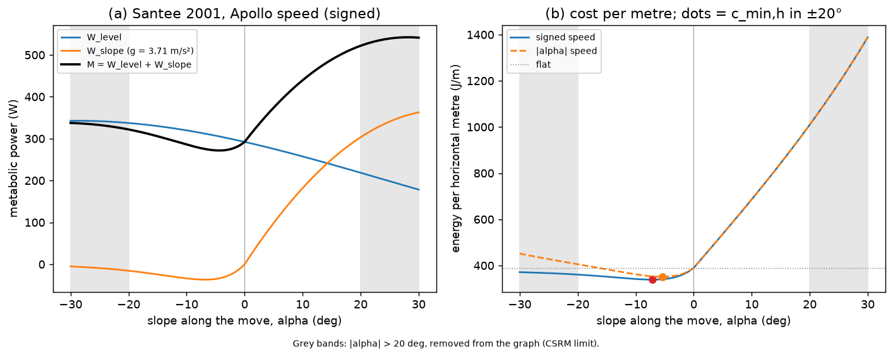
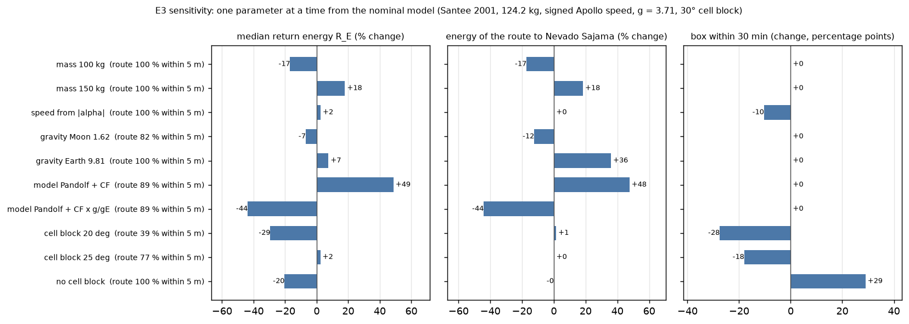

# E3 · Metabolic and O2 cost of walking under Mars gravity

Owner: Sebas (`@Seredial0326`) · Issue: #6 (closed) · PRs: #21, #26, #30, #40, #41, #58 · Status: done; the human cost (E3 × E1 sand price) is live in `/plan`, the walkback and the guide · Last update: 2026-11-15

## Question
How much energy, time and metabolic O2 does a suited astronaut spend on each move across the 1 m base grid, under Mars gravity? The answer is the cost the planner uses: E4 (return energy R(v) and walkback) and E5 (orienteering) plan on it.

## Data
- **Model and reference values:** the team's zero-to-hero guide, technical revision 3 [Guide-REV3], which reproduces Santee et al. (2001) as given in the MIT SEXTANT paper [Johnson2010], Pandolf with the Santee (2003) correction as given in the NASA CSRM [Kim2025], and the Apollo speed regression of the CSRM.
- **Terrain:** JB's base grid (release `base-grid-v2`): `dem_1m.tif` [Parker2016] (2000 × 2000 cells of 1 m) and `slope_deg.tif` (steepest slope per cell, degrees).

## Method

### Power: Santee (2001) as the nominal model (`src/fisica/metabolic.py`)
M = W_level + W_slope, with m the total equipped mass (kg), v the speed parallel to the surface (m/s), alpha the slope along the move and g the local gravity:
- W_level = (3.28 m + 71.1)(0.661 v cos alpha + 0.115). **Does not depend on g.**
- W_slope = 3.5 m g v sin alpha uphill; 2.4 m g v sin alpha · 0.3^(|alpha|/7.65) downhill; 0 on flat ground.

Why not Pandolf scaled by g_Mars/g_Earth (the CSRM's whole-power scaling)? It fails a lunar consistency check: on flat ground it drops to about 52 W on the Moon, against about 292 W from Santee's level term and the ~290 W inferred for Apollo 14 walking [Carr2003]. So gravity enters only the slope term. Pandolf + CF is kept only as a sensitivity branch and is never mixed with Santee 2001 (that would count the downhill correction twice).

### Speed, time and energy
- Speed: Apollo regression V = 0.75 − 0.01·alpha (m/s, alpha in degrees, **signed**: downhill is faster). The CSRM does not say whether alpha is signed; we declare signed and report both in the checks.
- A move of horizontal length d_h runs d_h / cos(alpha) over the surface, so dt = d_h / (V cos alpha) and E = M · dt (J). Metabolic O2 = E[kJ] / 20.1 kJ/L.
- Parameters: m = 124.2 kg, the Apollo 14 commander's 76.4 kg plus a 47.8 kg suit (cooling garment, suit and life support) [Carr2003]; g = 3.71 m/s². The Pandolf branch uses the same split, W = 76.4 kg and L = 47.8 kg. Until 2026-11-15 it used W = 75 kg (so L = 49.2 kg), as in the guide's section 6; corrected after tracing the 124.2 kg to Carr et al. (2003).

### Directed edge costs on the grid (`src/fisica/edge_cost.py`)
- 8-neighbour graph; diagonal moves are √2 m. For each cell and neighbour k: alpha = atan(Δz / d_h) from the DEM, then dt and E as above. Arrays `time_s`, `energy_j`, `alpha_deg` of shape (8, 2000, 2000), float32, NaN = no edge. The graph is **directed**: going up an edge costs more than coming back down.
- **Why the DEM difference and not `slope_deg.tif`:** `slope_deg.tif` is the steepest slope of the cell, without sign or direction. It cannot tell uphill from downhill, and it overstates the slope of a move that crosses a hillside diagonally.
- **Edge limit:** an edge is removed if |alpha| > 20° (CSRM limit; beyond it the model is extrapolated).
- **Cell block (team decision):** a cell is blocked (no edge in or out) if `slope_deg.tif` > 30°. It stands in for the cross-slope risk that Santee does not model. It can be disabled or moved in the HUD and in `POST /plan` (`max_cell_slope_deg`, null = off).
- **Guard:** `edge_costs` refuses `max_slope_deg ≥ 75°` and warns above 25° (see Limitations).
- Display layer for the HUD: `costo_e3.tif`, the mean Wh to cross each cell over its valid outgoing edges. Planning uses the directed edges, never this layer.

### Tried and dropped
- **Smoothing the DEM before taking slopes** (3 × 3 and 5 × 5 m mean filters), as the guide suggests against orbital DEM noise. It barely changes the share of steep edges (table below): the steep edges are real scarps and butte walls, not noise. We kept the 1 m DEM unsmoothed.

## Results
Source for every number: `src/fisica/paper_figures.py` → `data/e3/e3_summary.json`.

### Model checks against the guide
| Quantity | Value | Guide [Guide-REV3] |
|---|---|---|
| Flat power, v = 0.75 m/s (Earth, Moon and Mars) | 292.23 W in all three | 292.23 W |
| Pandolf flat on Earth → whole-power scaling on the Moon | 316.63 W → 52.29 W (W = 76.4 kg, L = 47.8 kg) | 315.87 → 52.16 W (the guide uses W = 75 kg) |
| Toy route 5 km (4.1 km flat + 0.9 km horizontal at +10°) | 2215.5 kJ = 615.4 Wh; 110.2 L O2 eq.; 1.91 h | 2215.5 kJ, 615.4 Wh, 110.2 L, 1.91 h |
| Minimum cost per horizontal metre in ±20°, signed speed | 338.75 J/m at −7.10° | 338.75 J/m at −7.10° |
| Same with speed from \|alpha\| | 351.00 J/m at −5.41° | 351.00 J/m at −5.41° |
| Flat cost per horizontal metre | 389.64 J/m | 389.64 J/m |



*Figure E3-1. (a) Santee 2001 power and its two terms against the slope along the move, Mars gravity, signed Apollo speed. (b) Energy per horizontal metre; the minimum lies on a gentle descent, not on flat ground. Grey bands are removed from the graph.*

### Slopes on the grid
| Quantity | Steepest slope per cell (`slope_deg.tif`) | Slope along each move (edges) |
|---|---|---|
| Mean | 16.2° | 10.9° |
| Share above 20° | 29.6 % of cells | 15.8 % of edges |
| Share above 30° | 12.4 % of cells | 5.8 % of edges |

| DEM smoothing before taking slopes | none (1 m) | 3 × 3 m | 5 × 5 m |
|---|---|---|---|
| Edges above 20° | 15.8 % | 14.2 % | 13.1 % |

### Cost on the grid
| Configuration | Walkable cells | Largest 4-connected walkable area | Edge energy (min–max) |
|---|---|---|---|
| Edge limit 20° only | 99.9 % | 99.9 % of the box | 338.8–1427.8 J |
| Edge limit 20° + cell block 30° (default) | 87.5 % | 85.0 % of the box | 338.8–1427.8 J |

The minimum edge energy on the real DEM (338.75 J for a 1 m move) equals the analytic c_min,h, which is an independent check of the vectorised code.

### Human cost: E3 combined with E1 (`src/fisica/human_cost.py`)
Ready before E1's weights arrive (hours 20–24), following the original plan: for the human, the slope term of the learned cost is replaced by the metabolic cost, and what E1 learns about terrain is kept.

cost_human(u → v) = energy_E3(u → v) × factor(v), with factor(v) = 1 + scale · Σ_k w_k f_k(v) over the non-slope features.

- Slope features (`slope_deg`, `slope_mean_5m`, `slope_mean_15m`, or any marked `"slope": true`) are dropped, because E3 already charges slope with physics.
- The factor is taken at the arrival cell, so each arc keeps its own directed E3 energy (up ≠ down).
- E1 fits weights ≥ 0 on features scaled to [0, 1], so factor ≥ 1 and costs stay positive. A negative weight is rejected.
- The output stays in joules, so R(v), walkback and E5's checks keep their meaning. If E1 learns a per-step (distance) weight, scale = 1 / w_dist turns the learned cost into a price per step relative to bare rock.
- `build_cost_layers.py --e1-weights data/e1/e1_weights.json` writes `edges_human.npz` (energy_j = human cost, time_s unchanged, terrain factor) and `costo_humano.tif`.
- Pipeline check with **placeholder** weights (not E1 results): the factor ranges 1.0–1.8 and the route to Nevado Sajama moves up to 50 m to avoid rough cells and ridges. The numbers will be reported only with E1's learned weights.
- **E1 v1 weights (Juan, #2): all zero.** MaxEnt found no DEM terrain price that explains Curiosity's route better than distance on held-out data, so factor = 1 everywhere and **the human cost is E3 alone** for now. The file loads unchanged in `human_cost`. This matches E2 (AUC 0.53 in the boxwork corridor) and the base-grid finding that the 1 m DEM does not resolve the boxwork. E1 will be refit with E8's `sand.tif` and E9's `rocks.tif`; rerunning `build_cost_layers.py --e1-weights` is the only step needed.

- **E1 v2 weights (Juan, release `e1-sand-v1`): a sand price.** With E8's `sand.tif`, the "sand only" MaxEnt model beats the distance-only control on held-out blocks (4 of 5). The weights are `sand` 0.072 and `sand_mean_5m` 0.224 with `distance_weight` 2.578, so the terrain factor runs from 1.0 (no sand) to 1.115 (full sand). The DEM features still do not help.
- **Live in the planner** (`api/planner.py`): when the weights are present, the shared E4 graph used by `/plan`, `/walkback` and the guide carries the human cost. The HUD can switch it off (`human_cost`). Effect, with the habitat at the box centre and 1,000 Wh:

  | | E3 | Human (E3 × E1 sand) |
  |---|---|---|
  | Round trip to Nevado Sajama | 162.5 Wh, 30.0 min, 1,332 m | 165.3 Wh (+1.8 %<!-- r:e3-human-cost-sajama -->), 30.0 min, 1,331 m |
  | Route shape | — | 65 % within 5 m of the E3 route, up to 23 m away |
  | E5 tour, 120 min, 13 stations | 8 stations, prize 37, 483 Wh | the same 8 stations and order, 487 Wh |

  Source for the Nevado Sajama row: `src/fisica/human_cost_effect.py` → `data/e3/human_cost_effect.json` (it runs `/plan`'s code with and without the human cost). An earlier version of this table printed 162.4 Wh and lengths rounded down; the file gives 162.462 Wh, 1,331.8 m and 1,330.6 m.

  The learned sand price moves routes locally by tens of metres but changes neither the time nor which stations are visited, so the plan is robust to it. Time is unchanged by design: E1 prices energy, not speed. Assumption to declare: what Curiosity's drivers avoided is applied to an astronaut, as the original plan asks ("keep what was learned about sand").

### Sensitivity (`src/fisica/sensitivity.py` → `data/e3/e3_sensitivity.json`)
One parameter at a time from the nominal model (Santee 2001, 124.2 kg, signed Apollo speed, g = 3.71 m/s², 30° cell block). The habitat is at the box centre. The route goes to Curiosity's drilled ridge, Nevado Sajama, about 665 m away. The Pandolf + CF branch (`pandolf_cf_power`, guide sections 5–7) is implemented only for this comparison, with its own tests (315.87 W on flat ground).

| Scenario | Toy 5 km (energy / time) | Median R_E (Wh) | Cells that can return | Box within 30 min | Route energy / time | Route within 5 m of nominal (max offset) |
|---|---|---|---|---|---|---|
| nominal | 2215 kJ / 1.91 h | 135.0 | 84.4 % | 63.4 % | 93.4 Wh / 15.7 min | 100 % (0 m) |
| mass 100 kg | 1841 kJ / 1.91 h | 112.3 | 84.4 % | 63.4 % | 77.3 Wh / 15.7 min | 100 % (0 m) |
| mass 150 kg | 2615 kJ / 1.91 h | 159.3 | 84.4 % | 63.4 % | 110.5 Wh / 15.7 min | 100 % (0 m) |
| speed from |alpha| | 2215 kJ / 1.91 h | 138.4 | 84.4 % | 53.1 % | 93.5 Wh / 15.9 min | 100 % (1 m) |
| gravity Moon 1.62 | 2071 kJ / 1.91 h | 125.6 | 84.4 % | 63.4 % | 81.8 Wh / 15.7 min | 82 % (17 m) |
| gravity Earth 9.81 | 2636 kJ / 1.91 h | 145.1 | 84.4 % | 63.4 % | 127.0 Wh / 15.8 min | 100 % (2 m) |
| model Pandolf + CF | 2840 kJ / 1.91 h | 200.8 | 84.4 % | 63.4 % | 137.8 Wh / 15.8 min | 89 % (16 m) |
| model Pandolf + CF x g/gE | 1074 kJ / 1.91 h | 75.9 | 84.4 % | 63.4 % | 52.1 Wh / 15.8 min | 89 % (16 m) |
| cell block 20 deg | 2215 kJ / 1.91 h | 95.3 | 42.9 % | 35.9 % | 94.8 Wh / 16.0 min | 39 % (57 m) |
| cell block 25 deg | 2215 kJ / 1.91 h | 138.2 | 70.4 % | 45.4 % | 93.6 Wh / 15.8 min | 77 % (17 m) |
| no cell block | 2215 kJ / 1.91 h | 107.5 | 99.1 % | 92.4 % | 93.3 Wh / 15.7 min | 100 % (1 m) |



*Figure E3-2. Change against the nominal model of the median return energy, the energy of the route to Nevado Sajama, and the share of the box within 30 min. Labels give the share of each route within 5 m of the nominal route.*

What it shows:
- **Energy follows mass and model, not time.** Mass changes energy almost proportionally (±17–18 %), and the route stays identical. The metabolic model is the largest energy uncertainty: Pandolf + CF gives +48–49 % and its g-scaled version −44 %, a factor of 2.6 between them. Gravity applied only to the slope term moves the route energy by −12 % (Moon) to +36 % (Earth).
- **The 30 min line depends only on the speed convention and the cell block,** because E3's speed has no mass, gravity or model term. With speed from |alpha| the share within 30 min falls from 63.4 % to 53.1 %: downhill becomes slower. With the cell block it ranges from 35.9 % (20°) to 92.4 % (no block).
- **Routes are robust to the physiology, not to the block.** Under every mass, speed and gravity choice, 82–100 % of the route stays within 5 m of the nominal route, and both Pandolf branches keep 89 %. A 20° cell block reroutes it (39 % within 5 m, up to 57 m away) and leaves only 42.9 % of the box able to return.
- Caveat on the median R_E column: changing the block changes *which* cells can return, so the median is over a different set (20° gives a lower median because only cells near the habitat remain). Read it together with the reachable share.
- The toy route time is 1.91 h in every scenario: the toy route has no downhill, so even the |alpha| speed convention leaves it unchanged.

## Checks
- 20 unit tests in `tests/fisica/` (`python -m pytest tests/fisica -q`): every reference value above, gravity changing only W_slope, downhill W_slope < 0 with M > 0, up/down asymmetry, grid borders, nodata, both slope limits, cell block on/off, and positive costs right up to the 75° guard.
- Aaron reviewed the edges against the real DEM for E4: `NEIGHBOURS` orientation correct (N = row − 1), no edge leaving the grid, energies 339–1428 J, largest strongly connected component 84.4 % of the grid with the default configuration.
- Visual: in the HUD the cost layer is low on valley floors and high on scarps, and the 20° and 30° block masks fall on the scarps of the orthophoto.

## Limitations
- **Not validated on Mars.** Santee 2001 comes from Earth and lunar lineage; applying g = 3.71 m/s² in the slope term is our extrapolation. The ~290 W Apollo 14 value is an inference from the reports, a plausibility check, not a validation [Carr2003].
- **Speed convention.** Signed or |alpha| Apollo speed changes the downhill costs (c_min,h 338.75 against 351.00 J/m) and the 30 min zone (63.4 % against 53.1 % of the box, see Sensitivity). We use signed; the choice must be declared.
- **Negative result: the Apollo regression breaks on steep climbs.** V = 0.75 − 0.01·alpha reaches 0 at +75°. Without a slope limit, the real DEM has 107 climbing edges at or above 75°; their time is negative and 91 of them gave negative energy, which breaks Dijkstra (non-negative weights). The regression was fitted on gentle slopes and must not be extrapolated; hence the guard.
- **Cross-slope is not modelled.** Santee only sees the slope along the move. The 30° cell block is a design choice, not a physiological threshold.
- **The DEM does not see the boxwork.** The base grid note shows that the 1 m DEM does not resolve the 1–3 m ridges that the 0.25 m orthophoto shows clearly, so inside the boxwork the metabolic cost misses the up-and-down of crossing ridges and is probably an underestimate. This matches E2: terrain features from the DEM do not explain the route inside the boxwork (AUC about 0.53). The fix has to come from the image (E8 `sand.tif`, ridge/hollow masks) and the E1 weights.
- **Only one terrain factor, and a small one.** Santee 2001 has no surface factor (eta). The only terrain term that held up on unseen data is E1's sand price (1.0–1.115, from E8's sand); it moves the route to Nevado Sajama by up to 23 m (+1.8 % energy) and leaves the 120 min tour's stations unchanged. Boulders wait for E9's `rocas.tif`. The price is learned from a rover's route and applied to an astronaut, which is an assumption.
- **O2 is a metabolic equivalence** (20.1 kJ/L, 1–7 % uncertainty), not a PLSS tank reading. E3 covers walking only; time at stations is charged by the planner at E4's service power (205 W) unless the request gives another, not by this model.

## What other pieces can use
- **E4 and baselines (Aaron):** `data/base/edges_e3.npz` or `edge_costs()` directly; J and s inside the engine. Dijkstra on the reversed graph must keep the cost of the original arc. Use `time_s` for the 30 min contingency line (R_T = 1800 s) and `energy_j` for R_E.
- **E5 (Diana):** the station cost matrix must come from these directed costs (one Dijkstra per station), plus R_E and R_T for the final return check.
- **E1 (Juan):** `fisica.human_cost` combines E3 with your weights. It expects `data/e1/e1_weights.json` with, per feature, `weight` (≥ 0), the `raster` name, `min`/`max` (the same scaling you fit with), an optional `transform` (`positive`/`negative` for the ridge/hollow split of TPI) and `slope: true` on slope features. Optionally add `distance_weight`. Slope features are dropped because E3 already charges slope. E2 showed that slope explains the valley choice but not the path inside the valley, so sand and rocks are the missing terms.
- **A\* (Aaron):** admissible heuristic h = horizontal Euclidean distance × 338.75 J/m (signed speed, slopes within ±20°); with |alpha| speed use 351.00 J/m.

## Reproduce
From the repo root, with `data/base/` from release `base-grid-v2`:
```
python -m pytest tests/fisica -q
python src/fisica/build_cost_layers.py data/base/dem_1m.tif data/base --slope-raster data/base/slope_deg.tif
python src/fisica/paper_figures.py
python src/fisica/sensitivity.py
python src/fisica/build_cost_layers.py data/base/dem_1m.tif data/base --slope-raster data/base/slope_deg.tif --e1-weights data/e1/e1_weights.json   # human cost (release e1-sand-v1)
```

## Outputs
- `data/base/edges_e3.npz` (185 MB): directed `time_s`, `energy_j`, `alpha_deg`; not in git, regenerated in about 3 s.
- `data/base/costo_e3.tif`: Wh per cell, display only.
- `data/e3/e3_summary.json`: every number in this note.
- `paper/figures/e3_fig1_power_and_cost_vs_slope.png`, `paper/figures/e3_fig2_sensitivity.png`.
- `data/e3/e3_sensitivity.json`: every number in the Sensitivity table.
