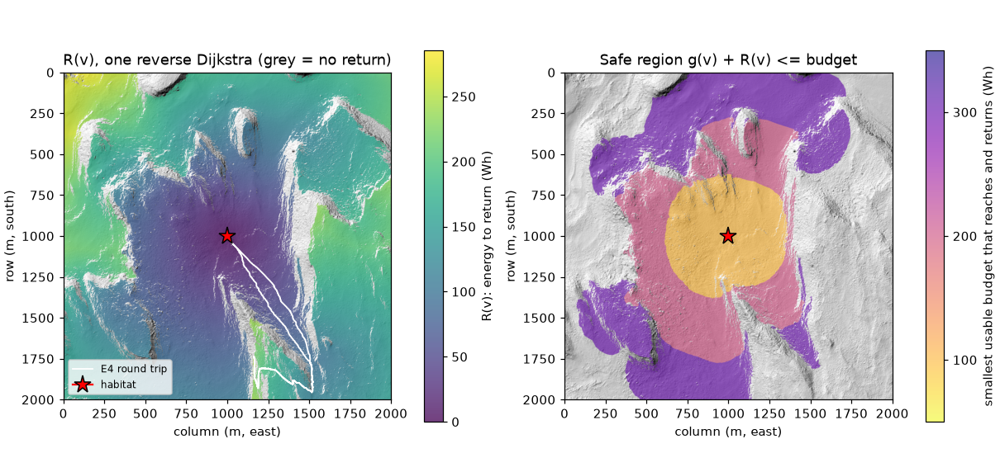
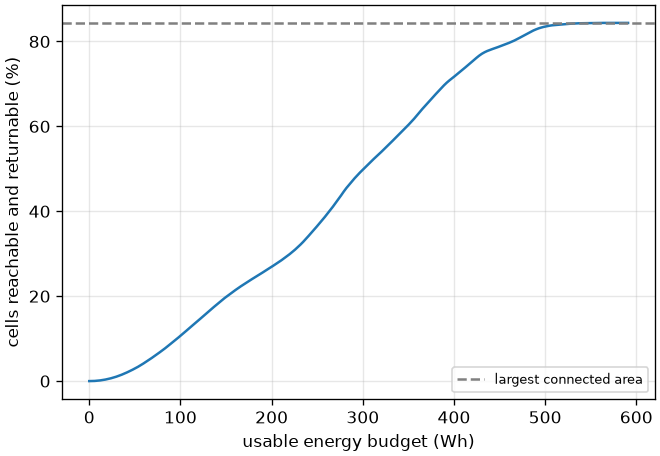
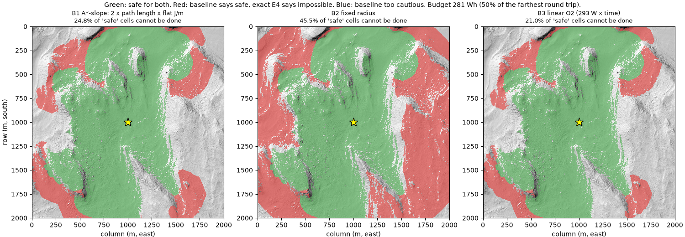

# E4 · Graph, return-energy layer R(v) and walkback routes

Owner: Aaron (`@aahg1105`) · Issues: #7, #8, #65 · PRs: #39 (E4), #56 (baselines), #90 (baselines with the human cost) · Status: E4 and baselines done · Last update: 2026-11-15

## Question
From any cell of the study box, what is the minimum metabolic energy needed to walk back to the habitat, R(v)? And what is the best round trip habitat → goal → habitat such that, at every point, what has been used plus what is still needed to get home fits the budget, now with energy, EVA duration and oxygen as limits at the same time?

## Data
- Base grid v2 (JB, release `base-grid-v2`): `dem_1m.tif`, `slope_deg.tif`, `grid.json`, `crs.wkt`. 2000 × 2000 cells of 1 m, 0 NaN cells. See [base grid note](base_grid.md) and [Parker2016].
- E3 directed edge costs (Sebas, `src/fisica/edge_cost.py`, PR #21): energy (J) and time (s) for the 8 moves of every cell, Apollo speed and Santee (2001) metabolic power. Defaults kept: an edge is removed if |slope along the move| > 20°, a cell is blocked if `slope_deg` > 30°. Stored as `data/base/edges_e3.npz`, or computed in memory if missing.
- Suit figures used to choose budgets (declared assumptions, not measured): see Method, step 5.

## Method
1. **Graph.** Node = `row * 2000 + col`. One directed arc per finite E3 edge; one sparse CSR matrix per weight (energy, time, length). Built from the (8, rows, cols) arrays in 0.67 s (`summary.json: graph_build_s`). Python with `scipy.sparse.csgraph` (compiled Dijkstra) was chosen over C++: one Dijkstra over the whole grid takes about 0.6 s, so C++ would gain little and add build friction on Windows for the team.
2. **R(v).** The graph is directed (going up costs more than going down), so R(v) is ONE Dijkstra from the habitat on the reversed graph, where each arc v → u keeps the cost of the original arc u → v. g(v), the cost to reach v from the habitat, is the forward Dijkstra. Both together take 1.89 s (`rv_and_g_s`).
3. **Habitat as user input.** Decided by the team on 2026-11-14. The position is given in metres of the DEM CRS. If it falls on a blocked cell or outside the largest strongly connected component, it is moved to the nearest valid cell (Euclidean distance transform) and the move is reported. For the numbers in this note the habitat is the box centre, an illustrative choice.
4. **Safe region.** Cells with g(v) + R(v) ≤ usable budget, for energy and time; the oxygen limit is checked on the combination. It is the set of goals the astronaut can reach and come back from. With several limits it is a necessary condition, and the round trip in step 6 is the exact test for one goal.
5. **Oxygen and duration.** E3 gives oxygen as `E / 20.1 kJ/L` (`fisica.metabolic.liters_o2`), so with that model alone an O2 limit is only a rescaled energy limit and adds nothing. Oxygen becomes a different constraint once a time term is added: `O2 = E / 20.1 kJ/L + q · t`, where `q` (L/min) stands for use that depends on time and not on effort (leakage, purge). The time term also covers the service time at a station, at a working metabolic power of 205 W by default, the upper end of the "low" band (≤ 700 BTU/h) in [NASA-xEMU-met]. Planning figures for budgets: an ISS EMU average of 1000 BTU/h ≈ 293 W [NASA-Mars-mass], about 7 h at 1000 BTU/h for the Shuttle/ISS EMU [AEMU-PLSS], and a 30-minute secondary O2 pack as an emergency reserve outside the budget [NASA-EMU]. For example, 7 h × 293 W = 7.4 MJ ≈ 367 L of metabolic O2. `q` has no source yet and is 0 by default.
6. **Round trip with walkback** (`src/grafos/labels.py`). Resources (E, t); objective energy, time or O2. Three steps:
   - **dijkstra:** the best route for the objective alone (two Dijkstras). If it fits every limit, it is the exact optimum.
   - **lagrangian:** otherwise, sweep the routes that minimise a weighted sum `cos θ · E/E0 + sin θ · t/t0`, refine the feasible/infeasible boundary by bisection and keep the best route that fits. These are the supported Pareto routes.
   - **label_setting:** exact resource-constrained search with Pareto labels (E, t) per (node, phase), where phase 0 is going out and phase 1 is coming back. Labels are expanded best-first by objective plus an exact lower bound, and pruned by the walkback limits and by the lagrangian value. If it expands more than 50,000 labels, the lagrangian route is returned with `exact = false` and a bound on the gap.
   - **Tried and dropped:** plain label-setting without the lagrangian bound ran for more than 10 minutes on the real grid when the time limit was binding and did not finish. Energy and time are almost tied along most routes, so the Pareto sets grow without limit.
7. **Walkback rule.** `used(v) + need(v) ≤ budget` at every point. For a fully planned round trip this follows from the totals, because R(v) ≤ the planned rest of the trip. The per-point check matters for open or partial routes (an E5 tour that is changed on the way, baselines), which `walkback.check_walkback` reports with the index of the first violating point.

## Results
All numbers come from `src/grafos/paper_figures.py` → `data/e4/summary.json` (habitat = box centre).

- **Graph:** 4,000,000 nodes and 25,296,494 arcs, which is 79.1 % of 8 per node. 12.5 % of the cells have no outgoing arc (blocked at > 30°).
- **Connectivity:** the largest strongly connected component holds 84.4 % of the grid, or 96.4 % of the walkable cells. The second one has 12,546 cells. Cells outside the main component cannot be a habitat or a goal.
- **R(v):** median 135.0 Wh, 99th percentile 259.7 Wh, maximum 285.5 Wh. 15.6 % of the cells cannot return (blocked or outside the main component).
- **Asymmetry:** R(v) / g(v) has percentiles 5/50/95 of 0.531 / 0.877 / 1.674. Coming back can cost half, or 1.7 times, what going out cost, so a symmetric "radius" is wrong in both directions.
- **Safe area vs usable energy:**

  | Usable energy (Wh) | 100 | 200 | 300 | 400 | 500 | ≥ 600 |
  |---|---|---|---|---|---|---|
  | Grid reachable and returnable (%) | 10.7 | 26.9 | 49.8 | 71.7 | 83.5 | 84.4 |

  (`safe_fraction_by_usable_wh`; Figure 2)
- **Farthest round trip:** 562.8 Wh, 91.1 min, 100.8 L of metabolic O2, 3,930 m, solved by `dijkstra` in 5.7 s. This is the most expensive cell to visit from the centre. A 7 h suit budget (7 h × 293 W ≈ 2,050 Wh of metabolic energy) is therefore far from binding inside a 2 × 2 km box: the box, not the suit, limits the EVA.
- **Binding time limit** (same goal):
  - The minimum-time route takes 90.93 min and 564.89 Wh; the minimum-energy route takes 91.1 min and 562.8 Wh.
  - With the limit halfway (91.03 min), the planner returns 563.31 Wh in 91.01 min (`lagrangian`, 29.4 s).
  - The exact search hit its 50,000-label cap, so the result has `exact = false` and a gap of at most 0.5 Wh (0.09 %).


*Figure 1. Left: R(v) over the hillshade, with the round trip to the farthest returnable cell. Right: smallest usable budget that reaches each cell and returns (100, 200, 300 Wh). Grey cells are blocked or cannot return.*


*Figure 2. Fraction of the grid that is reachable and returnable as a function of the usable energy budget.*

## Baselines (issue #8)
**Question.** How often does a simple planning rule call a round trip safe when, under the E3 cost, it does not fit the budget, and how much energy does it waste?

**Methods.** All four methods move on the same graph (E3 arcs, 20° per move, cells > 30° blocked), so only the cost model and the safety rule change. Code: `src/grafos/baselines.py`.

| Method | Route | "Safe" if |
|---|---|---|
| B1 A\*-slope | Shortest distance, A\* with the octile heuristic, under the slope limits; back along the same path | 2 × path length × flat-ground energy (389.6 J/m from E3) ≤ budget |
| B2 fixed radius | Same route as B1 | Straight-line distance ≤ r, with r = budget / (2 × 389.6 J/m) (Apollo-style walkback radius) |
| B3 linear O2 | Shortest E3 time out and back | 293 W × time ≤ budget, i.e. constant O2 rate (~0.87 L/min, ISS EMU planning rate [NASA-Mars-mass]) |
| MVP (E4) | Minimum E3 energy out and back | Exact: g(goal) + R(goal) ≤ budget |

- **Ground truth:** for every route, its E3 energy. A **false safe** is a goal that the method calls safe while its own route needs more than the budget. This is the dangerous error.
- **Budgets relative to the habitat:** because the habitat is a user input, budgets are fractions (25 / 50 / 75 %) of the most expensive exact round trip from that habitat.
- **Habitats and goals:**
  - Habitats: the box centre plus 20 random habitats in the main component (seed 8).
  - Goals: the 13 manual stations (Sebas, `stations-v1`) plus 2,000 random cells.
  - In total there are 42,273 evaluations per method and budget level.

**Results** (`src/grafos/evaluate_baselines.py --n-habitats 20` → `data/baselines/baselines_summary.json`):

| Budget (of farthest loop) | Method | Said safe | False safe (% of "safe") | Goals impossible for any route but called safe |
|---|---|---|---|---|
| 25 % | B1 A\*-slope | 10,977 | 3,735 (34.0 %) | 3,160 |
| | B2 radius | 16,819 | 9,577 (56.9 %) | 9,002 |
| | B3 linear O2 | 10,387 | 2,662 (25.6 %) | 2,570 |
| | MVP | 7,817 | 0 (0 %) | 0 |
| 50 % | B1 A\*-slope | 29,862 | 8,280 (27.7 %) | 7,115 |
| | B2 radius | 39,766 | 18,184 (45.7 %) | 17,019 |
| | B3 linear O2 | 28,682 | 6,129 (21.4 %) | 5,935 |
| | MVP | 22,747 | 0 (0 %) | 0 |
| 75 % | B1 A\*-slope | 42,036 | 6,643 (15.8 %) | 5,347 |
| | B2 radius | 42,273 | 6,880 (16.3 %) | 5,584 |
| | B3 linear O2 | 41,641 | 5,196 (12.5 %) | 4,952 |
| | MVP | 36,689 | 0 (0 %) | 0 |

- **None of the baselines is too cautious.** No baseline ever rejected a goal that the exact plan can do. The flat-ground and constant-rate calibrations always underestimate the real E3 cost.
- **Real / estimated energy** (median, with the 99th percentile that would be needed as a safety factor to avoid every false safe):

  | Method | Median | Safety factor needed (p99) |
  |---|---|---|
  | B1 | 1.29 | 1.42 |
  | B2 | 1.55 | 4.05 |
  | B3 | 1.21 | 1.32 |

  A fixed radius would need a margin of about 4× to be safe everywhere.
- **Wasted energy of the baseline routes vs the MVP route** (median): 3.9 % for B1/B2 (shortest distance is not cheapest) and 0.5 % for B3 (fastest is almost cheapest).
- **Stations only** (273 evaluations per level, `levels_stations_only`): at the 50 % budget, B2 calls all 273 safe and 86 of them are false safe (31.5 %). B1 has 57/244 false safe (23.4 %), B3 40/236 (16.9 %), and the MVP 0/198.
- **Figure 3** (habitat = box centre, 281 Wh = 50 %):
  - The exact safe region covers 45.3 % of the grid.
  - B2 declares 83.1 % of the grid safe, and 45.5 % of that cannot be done.
  - B1 declares 60.3 % (24.8 % of it impossible) and B3 57.4 % (21.0 % impossible).
  - The red areas are where the terrain rises away from the habitat, which is exactly where a symmetric rule fails (`src/grafos/paper_figures.py` → `summary.json: baselines_map`).


*Figure 3. What each baseline declares safe compared with the exact safe region of E4, habitat at the box centre, usable budget 281 Wh. Green: safe for both. Red: baseline says safe, no route fits. Blue: baseline too cautious (none).*

**Deliverable routes** to the reference station R0 (Nevado Sajama, the drilled ridge), from the box centre at the 50 % budget: `data/baselines/b1_astar_slope.geojson`, `b2_fixed_radius.geojson`, `b3_linear_o2.geojson` and `mvp_e4.geojson`. Each carries the real E3 energy, the exact R(v) and the slack per vertex, plus the baseline's own estimate and verdict. The per-goal table for the results table (#16) is `data/baselines/baselines_goals.csv`.

### With the human cost (issue #65)
**Question.** The live planner prices sand since PR #58: arc energy = E3 × E1's terrain factor of the arrival cell (`e1-sand-v1`, 1.0 on bare ground to 1.115 in full sand). If the terrain truth includes sand, do the baselines fail more?

**Set-up.**
- **Graph:** `evaluate_baselines.py --human-cost` builds it with `api.planner.graph(base, 30, human=True)`. On the real grid this factor multiplies arc energy by 1.0095 on average (max 1.1146); time is unchanged. With `human=False` the same function gives exactly the graph above (same arcs, 0 difference).
- **What changes:** the terrain truth and the MVP use the human cost. The baselines keep their flat-E3 calibration (389.6 J/m, 293 W): they plan as someone who knows nothing about sand.
- **Budget levels:** they stay fractions of the farthest round trip on the graph in use, so they keep their meaning (the human farthest loop is slightly larger).
- **Goals:** the 15 sand-rock contact stations of E8 (JB, `stations-e8-v0`) are added to the 13 manual ones and the 2,000 random cells. These are the places where sand should matter most.
- **Two runs:** E3 (`_e8`) and human (`_human_e8`), same habitats, goals and seed, 42,588 evaluations per method and level.

**Results** (`src/grafos/compare_baselines.py` → `data/baselines/baselines_compare_human.json`). False safes as % of "safe", E3 → human:

| Budget | B1 A\*-slope | B2 radius | B3 linear O2 | MVP |
|---|---|---|---|---|
| 25 % | 34.0 → 35.1 | 57.0 → 57.5 | 25.6 → 27.1 | 0 → 0 |
| 50 % | 27.7 → 28.5 | 45.6 → 45.5 | 21.4 → 22.4 | 0 → 0 |
| 75 % | 15.7 → 15.8 | 16.2 → 16.1 | 12.4 → 12.8 | 0 → 0 |

- **Real / estimated energy (median):** B1 1.290 → 1.307, B2 1.552 → 1.572 and B3 1.207 → 1.222. The safety factor needed (p99) becomes 1.44 for B1, 4.13 for B2 and 1.35 for B3.
- **E8 contacts only:**
  - The median real/estimated ratio rises a little more: B1 1.272 → 1.299, B3 1.195 → 1.213.
  - At the 25 % budget, B1's false safes go from 33.3 % to 37.4 %.
- **The MVP stays at 0 false safes.** It plans on the same cost that is used as the truth.
- **Reading:** sand makes every baseline slightly worse, but the effect is about 1 percentage point. The E1 factor averages 1 %, while slope makes the real cost 20–55 % higher than the flat estimate. The case for the exact planner rests on slope and asymmetry, not on sand.
- **Small B2 changes:** B2's rate barely moves, and drops by 0.1 points at 50 %. Its own budget grows with the human farthest loop and its radius rule ignores the cost.
- **Figure 3 is not redrawn:** with differences of about 1 point it would look the same.

**Limitations of the baselines.**
- They are calibrated on E3's own flat-ground numbers, the most favourable choice for them. A real planner with a different metabolic model would be off by a different amount.
- Only energy is the limit here. Duration and O2 limits are in the MVP (`labels.py`) but were not added to this comparison.
- The human cost is only as good as E1's sand factor (one feature, factor ≤ 1.115). Rocks (E9 `rocas.tif`) are not in it.

## Checks
- **E3 contract** (checked on the real DEM before use): `NEIGHBOURS` points to `dem[r + dr, c + dc]` with N = row − 1. There are 0 finite arcs leaving the grid, and all energies with the default limits are positive (339–1,428 J per arc).
- **Unit tests** in `tests/grafos/`, 15 of them on synthetic DEMs:
  - arc count on a flat grid and Chebyshev distances;
  - the reversed graph keeps the original arc cost, and a ramp is cheaper down than up;
  - a round trip at 1.02 × its own energy is feasible with 0.02 slack, and at 0.98 × it is rejected;
  - a time limit returns a route within the limit, never cheaper than the free optimum;
  - O2 = E / 20.1 kJ/L + q·t, with the service added at the turn;
  - the planner matches **brute-force enumeration** of all simple out-and-back paths on a 4 × 4 grid, for 4 time limits.
- **Visual check:** in Figure 1, R(v) grows away from the habitat and jumps across the ridges, and the safe areas follow the valleys and stop at the steep walls.

## Limitations
- **Costs come from the 1 m DEM only.** Its effective resolution does not resolve the boxwork ridges ([base grid note](base_grid.md)), and E2 found that DEM features do not explain the route inside the boxwork (AUC ≈ 0.53, [E2 note](E2_curiosity_traverse.md)). The numbers in Results use E3 only; sand enters through the human cost (E1 × E8, PR #58), compared for the baselines in "With the human cost".
  - Rocks (E9) are not in the nominal cost. `src/grafos/rock_risk.py` (X1, #102) can multiply arc energy by 1 + k · (mean + λ · std) of the boulder cover, but k = λ = 0 by default: E1 found no held-out price for boulders (#108).
  - The sensitivity of E4's round trips to that term is in the [E9 note](E9_boulders.md) (sections "Effect on the plan" and "Uncertainty layer").
- **Blocking and edge limits are E3 defaults** (30° cell, 20° move). The 3.6 % of walkable cells outside the main component are islands created mostly by the cell block.
- **Suit figures** are planning numbers taken from NASA conference papers seen through search summaries. They must be checked in the full texts before the paper cites them as facts. `q` (leakage/purge) has no source and is 0.
- **Exactness under binding limits:** with the limits binding, the exact search is capped at 50,000 labels (~30 s), and the result can be a lagrangian route with a reported gap. Pure-Python label-setting on 4 M nodes is the bottleneck. Numba or C++ for that loop only is the option if exact answers are needed in the HUD.
- **One goal per trip.** Several stations are E5's job (Diana); `check_walkback` validates her tours.
- **Box size:** inside a 2 × 2 km box a 7 h suit budget almost never binds. The energy limit matters for short EVAs, fatigue or reserve-driven budgets (≤ 500 Wh).

## What other pieces can use
- **E5 (Diana):** `Graph.cost_matrix(nodes, "energy_j")` gives the directed station-to-station matrix (one Dijkstra per station). `check_walkback(graph, path, rv_j, usable_j)` validates a tour and returns the first point of no return.
- **E12 (Juan):** read `data/e4/rv_time_s.tif` (minimum return time in seconds, same habitat and snap) instead of a separate Dijkstra. Agreed on the board on 2026-11-14. The route profile carries `t_s` per vertex.
- **API/HUD (Sebas):** `rv.tif` (Wh), `safe.tif` and `e4_route.geojson`, with per-vertex `used_wh`, `rv_wh`, `t_s`, `o2_used_l` and `slack_wh`.
  - `/plan` calls `labels.round_trip` live with the energy, `max_duration_min` and `o2_budget_l` limits (PR #48), on the same `Graph` with E3 or the human cost (PR #58).
  - `/walkback` draws the time analogue of baseline B2: fixed 1.35 km and 1.7 km circles against the 30 min red line (PR #60). About a third of what the circle calls safe cannot get back in time ([product note](product_api_hud.md)), consistent with B2 being the worst baseline here.
- **X2 adaptive walkback (JB, #101):** the reserve during the walk is k_p90 × R(v), with R(v) from this note's reversed Dijkstra. A uniform k scales every E3 arc, so the way home does not change ([X2 note](X2_adaptive_walkback.md)).
- **Results table (Juan, #16):** `data/baselines/baselines_summary.json` (false-safe counts per method and budget level) and `baselines_goals.csv` (one row per habitat × budget × goal × method). Human-cost version with E8 stations: `baselines_summary_human_e8.json` and `baselines_goals_human_e8.csv`, its E3 twin `_e8`, and the side-by-side `baselines_compare_human.json`.
- **Demo (Sebas):** Figure 3 is the one-picture argument: a fixed radius calls almost half of its "safe" area impossible at a 50 % budget.

## Reproduce
```powershell
gh release download base-grid-v2 --dir data; Expand-Archive data\base_grid_v2.zip data\base -Force; Remove-Item data\base_grid_v2.zip
python src/fisica/build_cost_layers.py data/base/dem_1m.tif data/base --slope-raster data/base/slope_deg.tif   # optional, ~3 s
python src/grafos/build_rv.py --habitat 8143537.99 -284463.58 --budget-wh 1000 --margin 0.1
python src/grafos/build_rv.py --habitat 8143537.99 -284463.58 --max-duration-min 420 --o2-budget-l 330 --service-min 30
gh release download stations-v1 --dir data/stations           # 13 manual stations (Sebas)
python src/grafos/evaluate_baselines.py --habitat 8143537.99 -284463.58   # one habitat, ~10 s
python src/grafos/evaluate_baselines.py --n-habitats 20                    # paper table, ~4 min
gh release download stations-e8-v0 --dir data/stations                    # 15 E8 contact stations (JB)
# human cost needs data/e1/ (release e1-sand-v1) and data/e8/ (release e8-v0), unzipped
python src/grafos/evaluate_baselines.py --n-habitats 20 --extra-stations data/stations/stations_e8.gpkg               # -> *_e8
python src/grafos/evaluate_baselines.py --n-habitats 20 --extra-stations data/stations/stations_e8.gpkg --human-cost  # -> *_human_e8
python src/grafos/compare_baselines.py
python src/grafos/paper_figures.py
python -m pytest tests/grafos
```

## Outputs
- `data/e4/`: `rv.tif` (Wh), `rv_time_s.tif` (s), `g.tif` (Wh), `safe.tif`, `e4_route.geojson` and `summary.json`.
- `data/baselines/`: `baselines_summary.json`, `baselines_goals.csv` (91 MB) and the four reference routes; the same files with suffixes `_e8` (E3, with E8 stations) and `_human_e8` (human cost), and `baselines_compare_human.json`.

Not in git; regenerate with the commands above.
