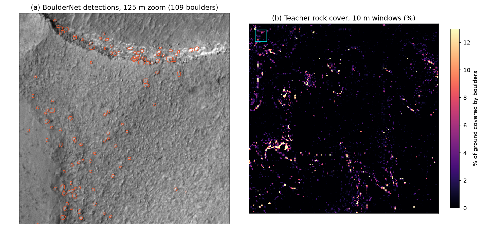
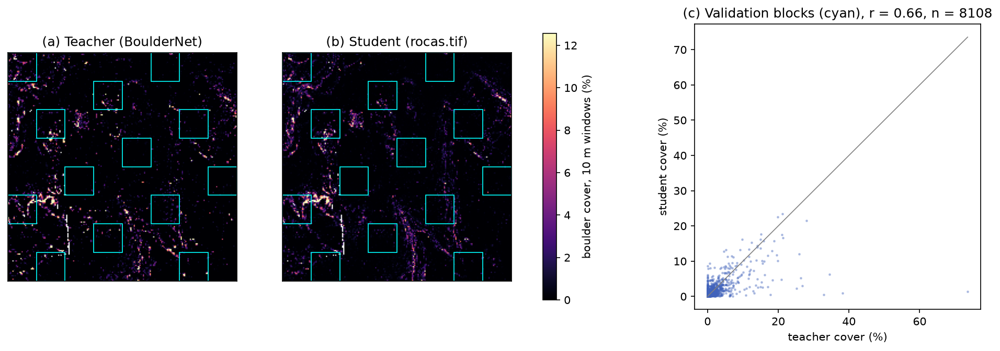
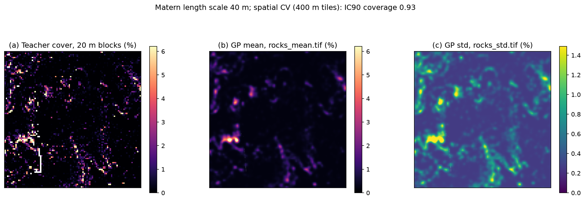

# E9 · Boulders: BoulderNet as teacher, distilled to a light CNN (`rocas.tif`)

Owner: Aaron (`@aahg1105`) · Issues: #12, #102 (X1, uncertainty) · PRs: #99 (E9), #132 (X1) · Releases: `e9-rocks-v1`, `x1-rocks-gp-v1` · Status: done · Last update: 2026-11-15

## Question
Where are the boulders in the 2 × 2 km study box, and can a CNN about 50 times smaller than a published boulder detector reproduce its map well enough to serve as a terrain layer (`rocas.tif`, fraction of each 1 m cell covered by boulders) for route costs and the HUD?

## Data
- **Image:** the 0.25 m greyscale HiRISE orthophoto of Gale [HiRISE-Gale], cropped to the study box by the base grid (`ortho_gray_025.tif` in release `base-grid-v2`, 8000 × 8000 px, uint8, 0 = nodata). Detail from 2006–2011 HiRISE images, before landing.
- **Teacher:** BoulderNet [Prieur2023], a Mask R-CNN with a ResNet-50 + FPN backbone [He2017] in Detectron2 [Wu2019], weights `model_0055999.pth` (the authors' recommended checkpoint) and `config.yaml` from Zenodo record 8171052 (CC-BY-4.0, md5 checked; `data/06_bouldernet/`). It was trained on 953 patches of 500 × 500 px from the Moon, Earth and Mars; only 49 are from Mars (HiRISE) and none is from Gale (`docs/enfoques.md`, correction 5).
- **Labels used for the check:** the authors' hand labels on those 49 Mars patches (39 train, 6 validation, 4 test), in the dataset JSON of the same record.
- Nothing was filtered from the image. Detections are kept from score 0.10 (the authors' inference value) and carried with their score, so the student sees the teacher's confidence.

## Method
1. **Teacher check** (`src/dl_rocas/teacher.py check`). The model is loaded with the authors' config. The loader compares every stored weight with the model and stops if one is missing or left over (it matched exactly). On each Mars patch, predictions with score ≥ 0.5 are matched one-to-one to the hand labels at mask IoU ≥ 0.5 (greedy in score order), giving precision and recall per split.
2. **Teacher over the box** (`teacher.py run`). The authors' inference settings: input resized to 1024 px, ROI score threshold 0.10, NMS 0.30, up to 2000 detections per image. Windows of 500 px (the training patch size) every 250 px. Each window keeps only the detections whose box centre lies in its own block. The blocks split each overlap in the middle and partition the image (checked in `tests/dl_rocas/test_e9.py`), so no boulder is counted twice or cut by a window edge: a kept boulder is ≥ 125 px (31 m) from the inner edges of its window. A final box NMS (0.30) removes rare duplicates at block borders. Each mask becomes a polygon in the DEM's CRS, with score, area and equivalent diameter 2√(A/π). We did not use the authors' graticule stitching from `MLtools.inference` because this ownership rule does the same job in a few lines on a single raster.
3. **Soft target** (`distill.py targets`). Knowledge distillation [Hinton2015]: each 0.25 m pixel takes the score of the teacher mask that covers it (the highest if several), 0 elsewhere. The student learns the teacher's confidence, not a 0/1 mask.
4. **Student** (`distill.py train`). A 3-level U-Net [Ronneberger2015] with widths 32/64/128, batch norm and one input channel: 0.93 M parameters, receptive field about 10 m. Loss is binary cross-entropy on logits against the soft target, with no positive weight. With soft targets the optimum of this loss is the teacher's expected value, so the student's mean cover stays calibrated; a positive weight would inflate it.
   - AdamW, one-cycle learning rate up to 3·10⁻³, 30 epochs × 100 steps × 16 random 256 × 256 crops, rotations by 90° and flips, seed 9.
   - **Spatial split:** the box is cut into 8 × 8 blocks of 250 m, and 13 of the 64 blocks (a fixed diagonal pattern, every 5th; ~20 %) are validation. Crops never straddle blocks. The checkpoint with the lowest validation loss is kept.
5. **`rocas.tif`** (`distill.py predict`). The student runs on the whole orthophoto in 1024 px tiles; a 32 px overlap is discarded so there are no seams. The per-pixel probability is averaged over each 4 × 4 px block, giving the fraction of each 1 m cell covered by boulders. It is written as float32 on the base grid, with NaN where any pixel of the cell is nodata.
6. **Tried and dropped:** a narrower student (widths 16/32/64, 0.23 M parameters, 20 epochs). It ran in 4.4 s, but it agreed less with the teacher on validation (r = 0.56 per 1 m cell, 0.60 at 10 m) and overestimated the mean cover (0.42 % against 0.33 %); outputs in `data/e9/w16/`.
7. **Longer training, kept aside:** the same student and settings trained for 60 epochs instead of 30 (`--epochs 60`, everything else equal, `pos_weight` 1). It is better at finding boulders and worse as a density map (Results). `rocas.tif` stays with the 30-epoch student; the 60-epoch one is in `data/e9/w32_e60/`.

## Results
Sources: `data/e9/summary.json` (written by `src/dl_rocas/paper_figures.py`), `data/e9/teacher_check_mars.json`, `data/e9/boulders_teacher.json`, `data/e9/student_metrics.json`, `data/e9/rocas.json`.

**Teacher against the authors' Mars labels** (score ≥ 0.5, mask IoU ≥ 0.5):

| Split | Patches | Boulders | Precision | Recall |
|---|---:|---:|---:|---:|
| train | 39 | 5536 | 0.75 | 0.58 |
| validation | 6 | 904 | 0.73 | 0.57 |
| test | 4 | 386 | 0.65 | 0.68 |
| all | 49 | 6826 | 0.74 | 0.59 |

**Teacher over the box:**
- 961 windows in 362 s on an NVIDIA T1000 (4 GB).
- 8380 boulders with score ≥ 0.10, and 2525 with score ≥ 0.5 (631 per km²).
- Equivalent diameter: median 1.7 m, 95th percentile 3.8 m.
- Boulders cover 0.37 % of the box in score-weighted area (mean of `data/e9/teacher_cover_1m.tif`). They concentrate in debris at the foot of scarps and along some ridges (Figure 1).

**Student against teacher** (rock cover, validation blocks only, never seen in training):

| | Per 1 m cell | 10 m windows |
|---|---:|---:|
| Pearson r | 0.66 | 0.66 |
| Mean absolute error (cover fraction) | 0.0040 | 0.0030 |
| Mean cover, teacher / student | 0.33 % / 0.35 % | |

On the training blocks the values are similar (r = 0.68 per cell, 0.74 at 10 m), so the student is limited by capacity rather than overfitting.

**Student as a classifier** (`src/dl_rocas/evaluate_student.py` → `data/e9/student_classification.json`). Positive = teacher score ≥ 0.5; student threshold 0.25 (best pixel F1); student boulders are connected regions ≥ 4 px; objects are matched one-to-one at mask IoU ≥ 0.5.

| Level | Reference | ROC-AUC | AP (random) | Precision | Recall | F1 |
|---|---|---:|---:|---:|---:|---:|
| Pixel, validation blocks | teacher | 0.986 | 0.47 (0.003) | 0.49 | 0.47 | 0.48 |
| 1 m cell (cover ≥ 0.25), validation blocks | teacher | 0.987 | 0.52 (0.005) | | | |
| Boulder, validation blocks | teacher | | | 0.26 | 0.46 | 0.33 |
| Boulder, 49 Mars patches | human labels | | | 0.24 | 0.31 | 0.27 |
| Boulder, 49 Mars patches (teacher, score ≥ 0.5) | human labels | | | 0.74 | 0.59 | 0.66 |

- **Ranking versus finding:** the student ranks rock against ground very well (AUC 0.99), but boulders are rare (0.3 % of pixels), so AUC flatters it. Average precision (0.47–0.52, against 0.003–0.005 for chance) and F1 are the honest measures.
- **Mars patches:** on the authors' patches, never seen by the student, it finds 31 % of the hand-labelled boulders, against 59 % for the teacher. The validation + test patches alone give F1 0.28 for the student and 0.65 for the teacher.
- **What it is good for:** the student is a usable **density** map, not a boulder detector. Use `boulders_teacher.gpkg` when individual boulders matter.

**More epochs: better detection, worse calibration.** Same student (0.93 M parameters) and settings, 30 against 60 epochs. Sources: `data/e9/w32/` and `data/e9/w32_e60/` (`student_metrics.json` from `distill.py train`, `student_classification.json` from `evaluate_student.py`). All on validation blocks or on the authors' Mars patches.

| | 30 epochs (`rocas.tif`) | 60 epochs |
|---|---:|---:|
| Best validation loss (soft BCE) | 0.0095 | 0.0088 |
| Boulder F1 vs human labels (49 Mars patches) | 0.27 (P 0.24, R 0.31) | **0.41** (P 0.37, R 0.47) |
| Boulder F1 vs teacher | 0.33 (P 0.26, R 0.46) | **0.37** (P 0.27, R 0.55) |
| Pixel AP vs teacher (ROC-AUC) | **0.47** (0.986) | 0.45 (0.986) |
| Cover r vs teacher, 1 m / 10 m | **0.66 / 0.66** | 0.65 / 0.64 |
| Cover MAE per 1 m cell | 0.0040 | **0.0034** |
| Mean cover (teacher 0.33 %) | **0.35 %** | 0.24 % |
| Whole box | 8.6 s | 8.7 s |

- **Why detection improves:**
  - With more steps at a falling learning rate, the student draws tighter, better separated blobs. On the validation blocks it splits the same ground into 792 boulder regions against 704 at 30 epochs (393 teacher boulders): neighbouring boulders that were merged come out as separate ones.
  - Recall and precision of single boulders both rise, so F1 against human labels goes from 0.27 to 0.41. It is still well below the teacher's 0.66.
- **Why calibration gets worse:**
  - The tighter blobs drop the doubtful pixels at boulder edges and in clusters. Some of those are boulder in the teacher's soft target.
  - The mean cover falls from 0.35 % to 0.24 %, about 27 % below the teacher's 0.33 %. The per-cell error is smaller (MAE 0.0034), because the many empty cells get closer to 0. But the rocky cells are underestimated: pixel AP and cover correlation drop slightly.
- **Choice:** `rocas.tif` is used as a density (HUD layer, possible cost factor), where a calibrated mean matters more than separating boulders. It therefore keeps the 30-epoch student.
  - If single boulders are needed, the teacher's polygons remain the better source.
  - The trade-off itself is a result: in this distillation, training longer moves the student from a density estimator towards a detector.

**Cost:** 0.93 M parameters against 43.9 M (47 times fewer). The whole box takes 8.6 s against 362 s for the teacher (42 times faster).

**Effect on the plan** (`src/dl_rocas/route_effect.py` → `data/e9/route_effect.json`).
- **Set-up:**
  - E4's graph, with the habitat at the box centre.
  - 28 goals: the 13 manual stations and the 15 E8 contacts.
  - Minimum-cost round trips with arc energy E3 × (1 + k · cover of the arrival cell).
  - k has no source; it is a sensitivity sweep, and k = 0 is the E4 route.

| k | Route cells with cover ≥ 0.25 | Goals whose route crosses one | Boulder area stepped on (m², sum of cover) | E3 energy vs k = 0, median / max | Length vs k = 0, max |
|---|---:|---:|---:|---:|---:|
| 0 (E4) | 15 | 3 | 45.2 | 0 / 0 | 0 m |
| 1 | 5 | 1 | 30.9 | +0.00 % / +0.12 % | +1 m |
| 3 | 5 | 1 | 24.9 | +0.01 % / +0.53 % | +8 m |
| 10 | 3 | 1 | 21.1 | +0.06 % / +1.22 % | +16 m |

- **Cheap to avoid:** the E4 routes already cross few boulders, and pricing them removes most of the rest for almost no energy. With k = 10, the boulder area along the 28 round trips halves (45 → 21 m²) for a median energy change of +0.06 % and at most +16 m of walking.
- **Low cost for planning:** boulders are a hazard that costs very little to avoid in this box. Pricing them changes local detours, not which stations fit the budget.
- **Unknown weight:** the right k is unknown, which is why `rocas.tif` is offered as a layer and not wired into the cost.


*Figure 1. (a) BoulderNet detections on a 125 m zoom at the north-west corner (scarp with debris). (b) Teacher rock cover over the box, 10 m windows; the cyan square is the zoom. `src/dl_rocas/paper_figures.py`.*


*Figure 2. Rock cover at 10 m from (a) the teacher and (b) the student (`rocas.tif`); cyan squares are the validation blocks. (c) Student against teacher on validation blocks only. White cells in (a) and (b) are orthophoto nodata. `src/dl_rocas/paper_figures.py`.*

## Uncertainty layer (X1, issue #102)
**Question.**
- Can a Gaussian process (GP) turn the boulder cover into a smoothed mean with a usable uncertainty (`rocks_mean.tif`, `rocks_std.tif`)?
- Does it beat a plain smoothing?
- Does pricing the uncertainty change routes?

**Method** (`src/dl_rocas/rocks_gp.py`).
- **Input:** the teacher's cover (`teacher_cover_1m.tif`), the original signal. The student would add its own imitation error on top of the teacher's.
- **Blocks:**
  - The input is averaged over 20 × 20 m blocks (10,000 blocks).
  - 65.5 % of the blocks have no boulder; the mean is 0.37 % and the 99th percentile 6.3 %. The values are very skewed (skewness 8.1).
  - The GP therefore models z = √(cover %), which brings the skewness down to 2.9.
  - It is mapped back exactly: E[z²] = μ² + σ² and Var[z²] = 4μ²σ² + 2σ⁴. Interval bounds are squared (a lower bound below 0 becomes 0).
- **GP:** kernel C · Matérn(ν = 1.5) + White in scikit-learn [sklearn], `normalize_y`.
  - The hyperparameters are fitted on about 2,000 training blocks taken from random 320 m windows of contiguous blocks. The GP is then refitted exactly on all training blocks (~8,000) with them fixed.
- **The std is predictive:** the published and validated std is the spread of the cover the teacher would measure in that block, noise included.
- **Spatial CV, two schemes:**
  - **Extrapolation, as asked in #102:** 5 × 5 tiles of 400 m, 5 tiles per fold at random (seed 102).
  - **Interpolation:** single blocks at random to 5 folds. This is what the final map does, since every block has data around it.
- **Rivals:** the training mean, and a normalised Gaussian smoothing of the training blocks (σ 1–10 blocks; falls back to the training mean where it reaches no data).
  - The best σ is picked on the test folds themselves, which favours the rival.
- **Metrics:** RMSE and MAE in cover %, and for the GP the coverage of its 90 % intervals.
- **Groups (#120, C5):** errors are also split by box edge (outer 40 m, 784 blocks), blocks touching orthophoto nodata (219) and the interior (9,010).
- **Tried and dropped:** hyperparameters on a scattered random subsample. Points ~45 m apart hide the 20 m neighbours, the GP learned a length scale of ~80 m and over-smoothed (interpolation RMSE 1.188; `data/e9/rocks_gp_scattered_subsample.json`).

**Results** (`data/e9/rocks_gp.json`). Held-out blocks, cover in %:

| | Extrapolation, 400 m tiles: RMSE / MAE | Interpolation, random blocks: RMSE / MAE |
|---|---:|---:|
| Training mean (no spatial information) | 1.315 / 0.562 | 1.310 / 0.557 |
| Gaussian smoothing, best σ | 1.309 / 0.546 (σ = 100 m) | **1.142 / 0.427** (σ = 20 m) |
| GP on √cover | **1.280 / 0.544** | 1.154 / 0.466 |
| GP on raw cover | 1.313 / 0.567 | — |
| GP coverage of the 90 % interval | 0.93 (empty blocks 0.99, rocky blocks 0.80) | 0.92 (empty 0.98, rocky 0.81) |

- **Fitted kernel** (all blocks): Matérn length scale 40 m, and the noise term (0.52) is about the size of the spatial variance (0.49), both on normalised √cover. Half of the block-to-block variation is noise at this scale.
- **Negative for the mean:**
  - Extrapolating into a 400 m tile, the GP beats both rivals, but only by about 2–3 % in RMSE. Far from data every method falls back to the mean.
  - Interpolating, a 20 m Gaussian smoothing is slightly better than the GP (RMSE 1.142 against 1.154; MAE 0.427 against 0.466). The GP's mean adds nothing over a simple filter.
- **Partly positive for the uncertainty:**
  - Overall, the 90 % intervals contain 92–93 % of the held-out blocks, close to nominal.
  - But they are too narrow where there are boulders: 80–81 % coverage on blocks with any boulder, against 98–99 % on empty blocks. The √ transform makes the std grow with the mean, but not enough for the rocky tail.
- **By group** (400 m tiles):
  - Edge blocks behave like the interior: RMSE 1.01 and coverage 0.93, against 1.20 and 0.93 in the interior.
  - Blocks next to orthophoto nodata are much worse: RMSE 3.51 and coverage 0.69. They are also five times rockier (mean cover 1.65 % against 0.34 %), and only 41 of the 8,380 boulders lie within 2 m of a nodata pixel. The error here is confounded with rockiness, not clearly an edge effect.
- **Student + GP:**
  - The same GP on the student's cover, scored against the teacher (400 m tiles), gives RMSE 1.273 and coverage 0.90 (rocky blocks 0.78). That is as good as the GP on the teacher itself.
  - Cheap student + GP recovers the teacher's block-scale map. This supports the distillation, not the detector.
- **Drives flagged by E1 (#108):**
  - **Sol 4544:** the teacher shows no boulder, while the student's cell cover averages 4.2 %. The GP on the student brings it down to 0.47 % ± 0.39 %, close to the GP on the teacher (0.19 % ± 0.27 %). The block-scale GP absorbs the student's halo.
  - **Sols 4673 and 4680:** the teacher's cell cover averages 10–12 % (max 79 %), while the GP gives 0.55–0.57 % ± 0.55–0.57 % at block scale. These are a few isolated teacher cells, too small for a 40 m correlation to carry. A 20 m layer cannot flag single boulders.

**Effect on routes** (`src/dl_rocas/route_effect.py --layer gp` → `data/e9/route_effect_gp.json`).
- **Set-up:** same 28 round trips as above, with arc energy E3 × (1 + k · (mean + λ · std)) built by `src/grafos/rock_risk.py`.
- **Boulders counted on the teacher's cover.** This is why k = 0 differs from the student-based table above.

| k | λ = 0: boulder m² / rocky cells | λ = 1.645: boulder m² / rocky cells | E3 energy vs k = 0, median / max (λ = 1.645) | Length vs k = 0, max |
|---|---:|---:|---:|---:|
| 0 (E4) | 31.3 / 57 | 31.3 / 57 | 0 / 0 | 0 m |
| 1 | 29.4 / 55 | 28.5 / 53 | +0.00 % / +0.01 % | +1 m |
| 3 | 29.3 / 55 | 21.1 / 32 | +0.00 % / +0.21 % | +9 m |
| 10 | 20.7 / 33 | 13.7 / 22 | +0.01 % / +0.87 % | +12 m |

- **Pricing the uncertainty pays off:** with the same k, adding one-sided 95 % caution (λ = 1.645) avoids clearly more boulder.
  - At k = 10 the routes cross 56 % less teacher boulder area than the E4 routes, against 34 % with the mean alone.
  - The energy cost stays below 1 % and detours below 12 m.
- **k and λ are assumptions.** E1 found no held-out price for boulders (#108, negative). Both stay at 0 by default, and nothing enters the nominal cost.


*Figure 3. (a) Teacher boulder cover in 20 m blocks (white: blocks touching orthophoto nodata). (b) GP mean (`rocks_mean.tif`) and (c) GP predictive std (`rocks_std.tif`), on the base grid. The std is highest where the mean is high, because of the √ transform. Every block has data, so it does not mark data gaps. `src/dl_rocas/paper_figures.py`.*

**What the std is and is not** (#120, C5).
- **What it is:** the GP std covers block-to-block interpolation and the teacher's apparent noise at 20 m.
- **What it is not:**
  - **BoulderNet's own bias:** about 4 in 10 labelled boulders are missed on Mars patches (R 0.59, P 0.74). That is a systematic undercount, which a GP on the teacher's output cannot see.
  - **Unresolved boulders:** boulders below ~1 m are not in the data at all.
  - **Single boulders:** the layer is a 20 m-scale density, not a cell-level hazard map.
- **Conclusion:** treat `rocks_std.tif` as the uncertainty of the interpolated orbital density, not as a guarantee about the ground.

## Checks
- **Weights:** every stored weight matches the model (the loader stops otherwise).
- **Teacher against labels:**
  - Precision and recall on the Mars validation and test patches are close to the training ones.
  - The teacher is not memorising Mars.
  - It misses about 4 in 10 labelled boulders at mask IoU 0.5; we did not break the misses down by size.
- **Visual review:** on the zoom, detections sit on blocks of debris and on isolated boulders. The fine texture of the ground is not marked (Figure 1a).
- **Tiling:** the kept blocks partition the image for sizes that are and are not multiples of the stride (`tests/dl_rocas/test_e9.py`). This test found and fixed a gap for the second case, which does not occur in this 8000 px box.
- **Calibration:** the student's mean cover (0.35 %) matches the teacher's (0.33 %) on validation.
- **Independence:** validation blocks are spread over the whole box (every block row and column has one; test).

## Limitations
- **Detection floor:** boulders below about 1 m (4 px at 0.25 m) are not detected; 95 % of the detections are ≥ 1.26 m. `rocas.tif` is a density of the boulders that can be seen from orbit, not a guarantee that a cell is free of rock.
- **Domain:** the teacher saw 49 Mars patches and none from Gale. Its precision and recall here are unknown (no labels in the box). The numbers in the check table are for the authors' Mars patches only.
- **Distillation is relative:** the student is scored mainly against the teacher; its errors add to the teacher's. Against human labels on Mars it reaches boulder F1 0.27, against 0.66 for the teacher (Results).
  - It agrees moderately (r = 0.66). It spreads cover into a halo around clusters and marks some linear ridge edges where the teacher found nothing (Figure 2b).
  - Longer training improves boulder detection but costs calibration (60 against 30 epochs, Results). A larger student or more pseudo-labels from outside the box, where the teacher can run, are the untested options.
- **Age of the image:** detail from 2006–2011 imagery; boulders that moved since then are not represented.
- **Unequal timing:** the teacher's time includes polygonising the masks and covers every pixel about four times (50 % overlap). The student's time is inference on the GPU only. The speed-up compares the two pipelines as used, not the two networks on equal input.
- **No validated route cost:** no boulder layer is in the nominal route cost. The risk term (`src/grafos/rock_risk.py`) exists with k = λ = 0 by default. How much a given cover should slow or block a walker has no source: E1 found no held-out price (#108).
- **Uncertainty layer (X1):**
  - Its mean is no better than a 20 m Gaussian smoothing.
  - Its 90 % intervals under-cover rocky blocks (80 %).
  - Its std leaves out the detector's bias and unresolved boulders (Uncertainty layer section).

## What other pieces can use
- **`data/e9/rocas.tif`** (Juan, Sebas): float32 on the base grid, 1 m, NaN nodata. Values are the fraction of the cell covered by boulders (0–1; median 0.0004, 99th percentile 0.087).
  - As a HUD layer, it reads best at 10 m (Figure 2b). It is in the HUD: `GET /layers/rocks.png` and the "Boulders" toggle draw it as a halftone per 10 m square, as context only and not in the route cost (Sebas, PR #106).
  - **E1 (Juan, PR #108)** tried it as a learned route cost against Curiosity's traverse. In sample the boulders look priced, but on held-out blocks neither the student's layer (2 of 5 blocks better than distance alone) nor the teacher's (0 of 5) beats the control. E1's weights stay sand-only, so no boulder price is validated ([E1 note](E1_maxent_irl.md)).
  - As a cost, it could multiply E3's energy like the E1 sand factor in `api/planner.graph(human=True)`. Its weight is a modelling choice to be stated, not a measured number.
- **`data/e9/rocks_mean.tif`, `rocks_std.tif`** (Sebas, X1): float32 on the base grid, fraction 0–1, NaN nodata.
  - These are a 20 m-scale GP mean and predictive std of the teacher's cover, for a HUD uncertainty layer.
  - For a risk term, use `grafos.rock_risk.rock_factor(mean, std, k, lam)` with `apply_to_energy`. It keeps the same arrival-cell convention as the E1 sand factor; k and λ are assumptions, 0 by default.
- **`data/e9/boulders_teacher.gpkg`** (layer `boulders`): one polygon per boulder with `score`, `area_m2` and `diameter_m`. Filter by `score` (0.5 is a reasonable default).
- **E11 (JB):** with the suit radio at 1.7 m, the largest boulders (≥ 3.8 m for the top 5 %) can block line of sight at short range, and the DEM does not see them.
- **E12 / results table (Juan):** the numbers in Results come from `data/e9/summary.json`.

## Reproduce
Detectron2 needs its own conda env (it does not install in the API env); exact versions in `src/dl_rocas/requirements_bouldernet.txt`:
```
conda create -n bouldernet python=3.11 -y
<env>/python -m pip install torch==2.5.1 torchvision==0.20.1 --index-url https://download.pytorch.org/whl/cu124
# Detectron2 from source (commit 247691a), CPU ops built with MSVC 2022; Mask R-CNN runs on the GPU through torchvision's ops
git clone https://github.com/facebookresearch/detectron2 && cd detectron2
(vcvars64.bat; set DISTUTILS_USE_SDK=1; set FORCE_CUDA=0) <env>/python -m pip install --no-build-isolation .
<env>/python -m pip install rasterio geopandas shapely opencv-python-headless scikit-image pandas
```
Inputs: `gh release download base-grid-v2` into `data/base/`, and `data/06_bouldernet/` (`python data/_scripts/clonar_desde_lan.py <host> --solo 06_bouldernet`). Then, from the repo root:
```
<env>/python src/dl_rocas/teacher.py check     # 1 min
<env>/python src/dl_rocas/teacher.py run       # 6 min on a T1000
<env>/python src/dl_rocas/distill.py targets
<env>/python src/dl_rocas/distill.py train     # 45 min on a T1000
<env>/python src/dl_rocas/distill.py predict   # 9 s
<env>/python src/dl_rocas/evaluate_student.py  # classification metrics, 2 min
python src/dl_rocas/route_effect.py            # effect on E4 round trips, any env with scipy + geopandas
# 60-epoch comparison (overwrites data/e9/student.pt; keep the 30-epoch one aside first)
<env>/python src/dl_rocas/distill.py train --epochs 60     # 90 min on a T1000
<env>/python src/dl_rocas/distill.py predict --out data/e9/w32_e60/rocas.tif
<env>/python src/dl_rocas/evaluate_student.py --student data/e9/student.pt --out data/e9/w32_e60/student_classification.json
python src/dl_rocas/rocks_gp.py                # X1 GP + spatial CV, ~15 min on CPU (scikit-learn)
python src/dl_rocas/route_effect.py --layer gp # X1 routes with mean + lam * std
python src/dl_rocas/paper_figures.py           # any env with rasterio, geopandas, matplotlib, torch
```
If GDAL plugin errors show up, the API env's `GDAL_DRIVER_PATH` is leaking into the `bouldernet` env; unset it.

## Outputs
In `data/e9/` (not in git):
- `boulders_teacher.gpkg` and `.json`
- `teacher_check_mars.json`
- `teacher_soft_025.tif`
- `teacher_cover_1m.tif`
- `student.pt`
- `student_metrics.json`, `student_classification.json`
- `route_effect.json`, `route_effect_gp.json`
- `rocks_mean.tif`, `rocks_std.tif`, `rocks_gp.json` (X1), `rocks_gp_scattered_subsample.json` (dropped variant)
- **`rocas.tif`** and `rocas.json`
- `summary.json`
- `w16/`: the dropped student
- `w32/`: the delivered student (copy of the files above)
- `w32_e60/`: the 60-epoch student, kept aside

Figures: `paper/figures/e9_fig1_teacher.png`, `paper/figures/e9_fig2_student.png`, `paper/figures/e9_fig3_gp.png`.
