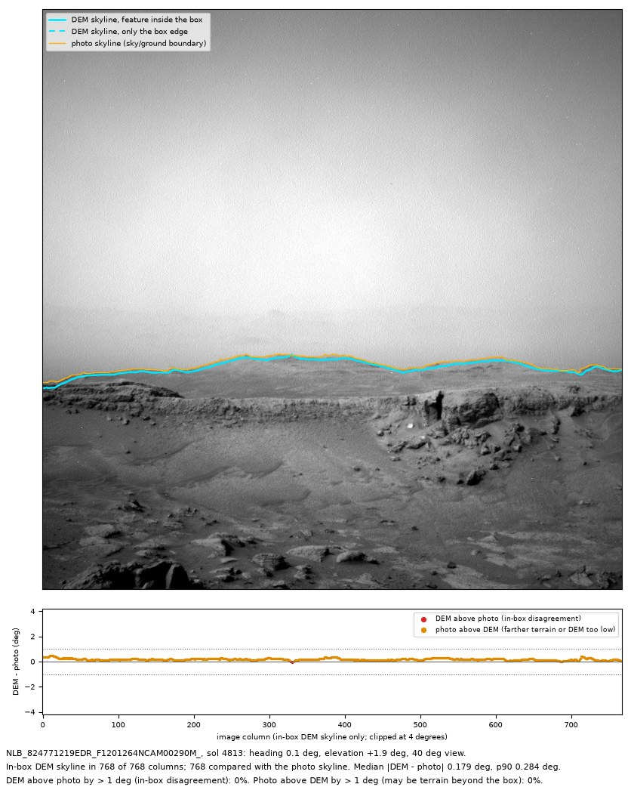

# P3 · Curiosity ground photographs in the 3D map and the 2D HUD

Owner: Juan (`@JuanCorredor2023`) · Issues: #46 (P3), #103 (P3b) · PRs: #80 (block 1), #95 (block 2), #98 (block 3); #130 (P3b, 2D HUD, #103) · Status: P3 done (catalogue and poses, photos in the 3D page with a visual check of three sols, station previews); P3b done (photo layer, photo card and station photo lines in the 2D HUD), merged in #130 · Last update: 2026-11-15

## Question

Can a real Curiosity photograph be placed at its measured camera position and direction in the P1 terrain, and help an astronaut understand the surroundings of a planned station? Block 1 prepared the catalogue, the camera geometry and the local images. Block 2 puts the photographs in the 3D page and checks, for photographs of different sols, whether the terrain model agrees with them. Block 3 adds, to each station's card and to each rehearsal stop, the nearest photograph and whether the station lies in its field. P3b (#103) shows the same photographs in the 2D HUD, where the stations are chosen and the walk is planned.

## Data

- Curiosity raw-image index downloaded by the team on 2026-11-13 [MSL-raw]: `03_curiosity/imagenes_crudas/indice_soles_4450_4848/page_*.json`, 140,755 items of all cameras, sols 4450–4848. Each selected photograph keeps its source URL and `image_credit`.
- Full-resolution Navcam photographs (1024 × 1024, monochrome): 10 of the selected ones were already in `imagenes_crudas/muestra_navcam/`; the other 373 were downloaded on 2026-11-15 into `imagenes_crudas/navcam_p3/` (181,424,448 bytes, 0 failures; `src/viz3d/fetch_rover_photos.py` → `navcam_p3/_download_log.json`). The count and an estimated size were approved by Juan before the download.
- PLACES `places_pds/data_localizations/localized_interp.csv` [PLACES]. Its easting/northing are in the DEM CRS, as in E2. The `_demv2` table belongs to another DEM and is refused by the code.
- The team's `data/base/dem_1m.tif` [Parker2016] and the box in `docs/contracts/grid.json`. P1's terrain assets are not changed.
- Filtered out: thumbnails, subframes and downsampled frames, other cameras, and one "full" Navcam frame whose metadata say it is cropped (`NRB_803470978EDR_F1162562ACS_00000M_`). All 6,504 remaining full Navcam frames lie inside the box.
- Source files and generated media stay outside git. Only small metadata fixtures used by the tests are committed.
- P3b uses no new data: the HUD reads the same catalogue and images as the 3D page.

## Method

### Positions and camera geometry

`src/viz3d/rover_photo_geometry.py` holds the camera mathematics; `src/viz3d/build_rover_photos.py` the join, selection and generated assets. Both take explicit input paths.

- **Frames.** The CAHVOR model of the raw-image metadata is in the rover navigation frame (x forward, y right, z down): the API's `camera_vector` agrees with the mast azimuth and elevation in that frame. The image `attitude` (scalar first) rotates rover vectors into the site frame (north, east, down), the direction given in the PLACES SIS [PLACES]. The CAHVOR projection and its inverse follow the VICAR camera model library [VICAR-CAHVOR]. The full rotation is used: adding the rover yaw to a mast angle would lose pitch and roll.
- **Join to PLACES.** Images join to PLACES rover rows by site and drive. When a site/drive has several poses, the pose whose quaternion is closest to the image attitude is used. Poses whose attitude ties within the API's 6-decimal rounding (1e-5 rad) must agree in position within 1 cm; then the highest pose is kept, the SIS's rule of thumb. Otherwise the image is rejected as ambiguous and listed. The PLACES clock is the earliest clock of the site/drive whatever the pose, so it is not used to choose a pose.
- **Camera pose.** Camera centre = PLACES rover origin + the attitude-rotated CAHVOR C vector, as easting, northing and elevation in metres. Heading is clockwise from north and pitch positive below the horizon, both in radians (P1's `flyTo`); field of view in degrees. The view direction is the ray through the physical image centre (pixel 511.5, 511.5), with the lens distortion inverted. Elevations are kept as computed and compared with the DEM, never adjusted to fit it.
- **Comparison image.** A 768 × 768, 40° square seen from the camera with the same heading and pitch and no roll, sampled through the source CAHVOR model (bilinear), transparent where the photograph has no pixels. It removes lens distortion and camera roll. An unchanged copy of the photograph is kept for the card (`unwarped`), and a 320 px thumbnail.

### Selection

Stops are grouped by the rover position: each group's representative is the first real PLACES position in a stable order, and a photo joins the nearest representative within 10 m (horizontal); otherwise it starts a new group. There is no chaining and no averaging. Each group keeps at most one photo per 90° heading sector (0–90°, 90–180°, …, from north): the one closest to the horizon, then closest to the representative, then by image id. Every selected photo keeps its own exact position. Items are processed in image-id order, so the result does not depend on how the index is paged.

### Photos in the 3D page (block 2)

`web/3d/photos_model.js` (pure, tested in Node) reads the catalogue; `web/3d/photos.js` draws one orange camera pin per stop on its own marker layer, the stop's card (photo, one button per view, UTC date, sol, LMST, direction, credit, link to the NASA original) and the photo view. Pins that overlap on screen offer a list of stops. "View from here" flies P1's camera to the photograph's pose: the camera's horizontal position, its height above the DEM at relief ×1 (catalogue elevation minus DEM, never forced onto the ground), heading and pitch, and a vertical field such that the centred square of the canvas spans 40° on both axes. The Sun is set to the photograph's own sol and local true solar time at its longitude (`sunOf`, from the UTC time). The comparison image is laid over that square without stretching, with an opacity slider. A pose under the ground, less than 0.5 m or more than 4 m above it, or outside the box is stated in the bar, not corrected. Exit gives back camera pose and field, relief, near plane and Sun. Pins are hidden while rehearsing; `?photo=<id>` opens a photo view and `?check=photos` measures it.

### Station previews (block 3)

`nearestPhoto` (`web/3d/photos_model.js`) takes the published photographs (images available) whose camera is within 150 m of the station, horizontally. Those within 10 m of the nearest (a stop's radius) count as equally near; among them the one pointing most towards the station wins, then the nearer, then the image id. It reports the distance, the side of the station the photo was taken from, the direction it looks, the station's angle off the photo's centre, and whether the station is inside the 40° field: horizontally always, vertically when the DEM gives the station's ground (relief ×1). The card says this as orientation and adds that the terrain may still hide the station; it never claims visibility. With no photograph within 150 m it says so, with the distance of the nearest. A station card in free flight adds "View the rover photo" (the photo view). At a rehearsal stop the same preview is added to the stop card through a `stationMedia` option of the rehearsal: no button, and the walker, clock, tasks and controls are untouched. Photo pins are hidden while rehearsing.

### Keyboard access to photo stops (issue #124, part of block 3)

The question is whether a photo stop can be opened without picking its pin. The existing
parsed catalogue supplies `photoStopList`, a pure export of `web/3d/photos.js`. It returns
the same nonempty stops as the marker layer, in catalogue order, labelled by stop number,
sol and view count. A stop with missing images remains available because its existing card
explains the absence. The folded *Rover photos → Photo stops* list uses native buttons;
activation ticks *Show photo stops*, shows the pins and calls `PhotoLayer.openGroup`.
The card's *View from here* remains the way into photo view. Both this list and the station
list disable with a reason while another mode owns the camera, then restore on exit.

`tests/viz3d/photos_model.test.mjs` checks the list against `photos_catalog.json`, including
missing images, empty stops and multiple sols. `ui_controls.test.mjs` checks the controls,
card wiring and mode restrictions; the combined test result is recorded in P1's
"Keyboard stop lists" section. No browser or server was started, so actual keyboard and
screen reader behavior, `?check=photos` and `?check=stations` remain unverified for this
change. Photo poses, images and scientific results are unchanged. Juan and Sebas can reuse
the pure helper and the keyboard path for the demo and HUD.

### Photograph against terrain (block 2)

`src/viz3d/photo_skyline.py` ray-casts the 1 m DEM from each camera for every column of the 768 px comparison frame (same pinhole, heading and pitch, zero roll, curvature drop included) and finds the DEM skyline, marking whether it is a terrain feature inside the box or only the box edge. It detects the photograph's sky/ground boundary per column (bright smooth sky at the top; transparent pixels ignored) and compares the two only where the DEM skyline is an in-box feature. The test is one-sided: a DEM skyline above the photograph's means the model puts ground where the photograph shows sky, an in-box disagreement; a photograph skyline above the DEM can be farther terrain beyond the box (or rover hardware) and is not counted as an error. Where farther terrain rises behind an in-box crest, it checks that the crest still shows as a brightness step within ±3 px.

The build never downloads. It lists the selected photos without a local file in `download_manifest.json`, with an estimated size from the local sample. Products go to `data/tiles/3d/photos/` under an immutable generation folder; the root `catalog.json` points to it.

### Photos in the 2D HUD (P3b, #103)

The HUD (`web/index.html`) reads the same catalogue (`/tiles/3d/photos/catalog.json`) with the same logic as the 3D page. `web/hud_photos.js` (no DOM, tested in Node) reuses `parseCatalog`, `photoMarkers`, `viewsOf`, `photoFacts`, `nearestPhoto` and `previewText` from `web/3d/photos_model.js`, so both maps say the same thing. The HUD only draws. There is no new endpoint and no contract change. Sebas and JB handed over the HUD parts this needed (#103).

- **Layer.** *Rover photos* in *1 Terrain*, off by default so it does not hide the stations. It draws one orange dot per stop with a photo, under the stations, and its note gives the counts.
- **Photo card.** A click on a dot opens the stop's card. It has one button per view (by heading, from north clockwise), the photo, and the rows of the 3D card: UTC date, sol, local time (LMST), camera, where it looks and its tilt, and credit. *Open in 3D* opens `/3d/?photo=<id>`, the 3D photo view. The card ends with "Photos show the view, not a promise that a station is visible." If the card would cover its stop, or come within 40 px of it, the map pans with the zoom unchanged. The stop then sits in the largest strip of map the card leaves free (`keepStopInView`).
- **View wedges.** While a card is open, each of its views has a wedge on the map, from the camera along the photo's own field (`fov` in the catalogue, 40° for all 383). The selected view is drawn stronger. The wedge is drawn out to 150 m (`WEDGE_RADIUS_M`, equal to `PREVIEW_MAX_M`, the reach of a station's photo line). That is a drawing length, not a visibility range.
- **Station photo lines.** In *2 Stations*, each station of the list has a line under it (`stationPhotoLine`). It gives the nearest photo within 150 m (the block 3 rule), with its distance, the side of the station it was taken from and where it looks, for example "Photo 87 m south-west, looking south-west". It adds "· station in its field" when that holds. With no photo that near it reads "No photo nearby (nearest N m)". The 3D card's full sentence is the line's tooltip. A click on the line opens that stop's card on that photo and moves the focus into the card; closing it (Esc or the close button) brings the focus back to the line. The photo chosen is the one the 3D card names, because the choice uses only horizontal distance and direction.
- **Side to side only.** The 2D map has no ground elevation, so the station's field check is side to side only, and the sentence says so: "inside its field from side to side (not checked up and down; the terrain may still hide it)".
- **Without the catalogue.** The module and the catalogue load in the background, so the map does not wait for them, and `loadCatalog` never throws. If either fails, the box is disabled and its note says "Unavailable: <reason>. The rest of the map works without them." Nothing else changes.
- **Placing modes keep the click.** While a map-click mode is on (for example adding a station), a click on a dot does what the mode says, here placing the station, instead of opening the card.

**What stays in the 3D page only, and why** (from #103):
- The photo laid over the terrain: it needs the 3D camera at the photo's pose.
- The Sun and shadows: the HiRISE image already has its own, and P6's departure time covers the useful part.
- The exaggerated relief.
- The first-person rehearsal.

The same preview on the arm tablet's station cards (`web/guide_core.js`) was optional and is left out of this PR.

## Results

All numbers: `src/viz3d/build_rover_photos.py` → `data/tiles/3d/photos/catalog.json` and `report.json` (generation `9d2e6fb0bc52df508447d619`), unless stated.

| Quantity | Value |
|---|---|
| Full Navcam frames in the index / eligible | 6,505 / 6,504 (241 site/drive keys) |
| PLACES rover rows / repeated site/drive keys | 49,194 / 113 |
| Eligible photos joined to a repeated key / ambiguous rejections | 321 / 0 (largest tied-position spread 0 m) |
| Stops (groups) | 100: 92 with four sectors, 2 with three, 3 with two, 3 with one |
| Selected photos | 383 (379 right, 4 left Navcam), from 122 sols, 2025-02-11 to 2026-03-27 UTC |
| Largest distance from a photo to its representative | 9.88 m |
| Selected pitch | median 16.9° below the horizon (−15.2° to 36.1°); 379 within 25° |
| Credit | "NASA/JPL-Caltech" for all 383; none missing |
| Generated products | 383 thumbnails, card images and comparison images, 362 MB |

Geometry diagnostics over the 6,504 eligible photos (`report.json`, `geometry_diagnostics` and summaries):

| Check | Mean | p95 | Max |
|---|---|---|---|
| Image attitude vs joined PLACES quaternion | 0.018° | 0.146° | 1.09° |
| Image yaw vs PLACES yaw | 0.0002° | 0.0006° | 1.09° |
| API `camera_vector` vs ray through the image centre | 0.033° | 0.033° | 0.033° |
| Source field of view (horizontal) | 45.46° | 45.52° | 45.52° |
| Camera above the DEM | 1.92 m | 2.29 m | 3.48 m (min −0.32 m) |
| PLACES rover origin above the DEM | −0.02 m | 0.32 m | 1.39 m (min −2.27 m) |
| Comparison image covered by the photograph (383 selected) | 99.93 % | 100 % | min 97.8 % |

The 0.033° between `camera_vector` and the centre ray is the half-pixel between the API's pixel 512 and the physical centre 511.5. The selected cameras are 0.97–2.46 m above the DEM (median 1.93 m), close to the Navcam's height on the mast.

**Photograph against terrain** (`src/viz3d/photo_skyline.py` → `data/tiles/3d/photos/skyline_check.json`, figures `../figures/p3_fig1_skyline_<sol>.jpg`). Three photographs of different sols that look near the horizon and into the box:

| Photo (sol, direction) | In-box columns compared | DEM above photo (error case) | Photo above DEM (not an error) | Reading |
|---|---|---|---|---|
| NLB_824771219EDR_F1201264NCAM00290M_ (4813, north, 1.9° up) | 768 | median 0.02°, max 0.04°, 0 % > 1° | median 0.18°, p90 0.29°, 0 % > 1° | the ridge line of the box follows the photograph across the frame |
| NRB_794593028EDR_F1140288NCAM00296M_ (4473, 160°, 7° down) | 251 | median 0.14°, p90 0.28°, max 0.55°, 0 % > 1° | 29 columns, ≤ 0.04° | the near hillside fills the top of 517 columns; where its crest is in the frame it agrees |
| NRB_806844774EDR_F1172730NCAM00722M_ (4611, 105°, 9.8° up) | 768 | median 0.04°, p90 0.10°, 0 % > 1° | median 1.88°, p90 3.41°, 55 % > 1° | right half within 0.1°; on the left a sunlit hill beyond the box's east edge (about 1.47 km) rises above the in-box crest, which still shows as a brightness step in 61 % of those columns (19 % by chance) |

Over all 23 selected photographs with |pitch| ≤ 12° (17 sols, 12,524 compared in-box columns): DEM above photo median 0.07°, p90 0.25°, max 0.69°, beyond 1° in no photograph. Photo above DEM: median 0.46°, p90 5.2°, 33.5 % beyond 1°, from distant landscape in hazy north-looking views and the rover arm in one sol-4822 frame. Where a constant shift fits (9 photographs), the photograph sits a median 0.22° to the left of and 1 px below the model; the north-looking views of sols 4808–4832 agree on about −0.25° horizontally. That hints at a heading or position error of about 0.2°, with zero inside its uncertainty; nothing points to an error of 0.5° or more.



**Station previews** (`/3d/?check=stations`, 2026-11-15, low preset). The saved plan (E4 round trip, 13 stations drawn), the E4 fixture and the E5 tour fixture (`tests/viz3d/fixtures/plan_e4.json`, `plan_tour_e5.json`) each draw the same 13 stations: all 13 have a published photograph within 150 m (the farthest 103.7 m, station R3), and 7 of them lie inside its field. At the 8 stops of the E5 tour and the single stop of the E4 round trip, the stop card shows the preview, the rehearsal clock and the walker do not move while it is shown, the tasks and "Done, continue" stay, there is no photo-view button, and the photo pins are hidden. A point near the box's south-west corner gets "No rover photo within 150 m of this station (the nearest is 734 m away)".

**Photos in the 2D HUD** (P3b). With the real catalogue (`data/tiles/3d/photos/catalog.json`, generation `9d2e6fb0bc52df508447d619`), the HUD shows 100 stops and 383 photos, and the layer note reads "100 stops, 383 photos taken from the ground by Curiosity. Click a dot to see them." The counts come from `loadCatalog` in `web/hud_photos.js`. `photoCount` counts the photos with images (all 383). `stopCount` counts the stops with at least one photo, which are the 3D page's pins (all 100). The count was repeated for this note by running `loadCatalog` in Node on that file. Station lines name the same photo, at the same distance, as the 3D station cards of block 3. Only "in its field" can differ, because the 2D check is side to side only.

## Checks

- `tests/viz3d/test_rover_photo_geometry.py`: known rotations, camera-centre translation, pitch sign, distortion forward and inverse, roll removal by ray mapping, transparent corners, rejection of unsupported metadata, and real metadata from six sols (frame agreement with mast angles and PLACES).
- Physical checks on real data, independent of the module's formulas (`tests/viz3d/fixtures/rover_photo_real_checks.json`, made by `src/viz3d/make_photo_check_fixture.py`): a Navcam stereo pair from sol 4711 is 0.423 m apart, 0.421 m of it to the right of the view and 0.017 m along it, both cameras 1.99–2.02 m above the PLACES origin; 20 real drives inside the box go within 1.4° of the attitude's forward axis, and 102° or more off it with the inverse rotation. A swapped axis, a mirrored image or an inverted attitude fails these tests.
- `tests/viz3d/test_build_rover_photos.py` (synthetic inputs): `_demv2` refused, repeated PLACES rows, ambiguous positions, bounds and camera filters, grouping without chaining, one photo per sector with each tie-break, independence from input order, exact positions, missing sectors, download manifest without network access, generated images and corrupt files, outputs only in the output folder, JSON without NaN.
- `tests/viz3d/test_fetch_rover_photos.py`: only NASA raw-image URLs and full 1024 × 1024 JPEGs, failures logged, resumable.
- An independent review by a separate agent repeated the frame checks over all local stereo pairs, drives and mast mosaics and found no convention error; it led to the highest-pose rule above and to the physical tests.
- Results on 2026-11-15: `python -m pytest tests/viz3d -q` 61 passed (with `MARTIAN_DATA` pointing at the data folder; 60 passed and 1 skipped without it); `node --test tests/viz3d/` 71 passed. No file of the page changed, so `?check=shading`, `route` and `rehearse` are unchanged.
- Block 2, `?check=photos` (photos of sols 4450, 4596 and 4848; 2026-11-15, high preset): camera position error 0 m, eye height equal to the catalogue's height above the DEM (1.778, 2.007, 1.924 m), heading, pitch and field errors 0°, relief ×1, the Sun at each photo's sol and solar time, the laid photo on the centred square to 0 px; after Exit, position, heading, pitch, field, relief and Sun as before. P1's `?check=shading`, `route` and `rehearse` give the same numbers as on main; the only change is one more marker layer in the scene list.
- Block 3: `?check=stations` as in Results. P1's `?check=route`, `shading` and `rehearse` give the same JSON on this branch as on main, and `?check=photos` the same as in block 2 (all errors 0). `?check=photos` and `?check=stations` step the camera flight themselves and pause on timers, so they also run in a hidden browser tab.
- Block 2 visual check: the three figures above, inspected by eye, and the aggregate over 23 photographs. Node tests: 86 passed (`node --test tests/viz3d/`), including 15 for `photos_model.js` (catalogue parsing, pose limits, the square view, and the photographs' own LMST reproduced from their UTC time within 4 s).
- P3b, Node: `tests/web/hud_photos.test.mjs`, 14 tests on the 3D page's photo fixture (`tests/viz3d/fixtures/photos_catalog.json`: 3 stops of the real catalogue, 7 photos). They check:
  - the catalogue address, and that the wedge radius equals `PREVIEW_MAX_M`;
  - the counts, and that a missing, unreadable or wrong catalogue gives one plain clause and never a throw;
  - that the dots are the 3D page's pins;
  - the wedge geometry (north = +y, edges one field apart, real photos);
  - the 3D link, which accepts only valid photo ids;
  - the stop card against `viewsOf` and `photoFacts`;
  - the station lines, against `previewText(nearestPhoto(...))`, including "no photo nearby" and both sides of the 150 m limit (149.7 m is a hit; 150.3 m reads "nearest just over 150 m");
  - that a short line never says a station is seen.
- P3b, full runs on 2026-11-15, on `main` at 61dc98d plus this change: `node --test tests/web/ tests/viz3d/` 135 passed. `python -m pytest tests -q` 1005 passed, 4 skipped and 1 failed. The failure is unrelated to this change: `test_curiosity_drill_targets_match_places` needs a raw-data file that is not on this machine (`03_curiosity/places_pds/.../mech_drill.csv`). No file under `web/3d/` changed, so the 3D page and its checks are as in block 3.
- P3b, in the browser on 2026-11-15, at 1024 × 768, 1440 × 900 and 375 × 812, all of these worked:
  - the layer, the card and the wedges;
  - the station lines, and opening the card from one;
  - Esc, which brings the focus back to the line;
  - add-station mode, where a click on a dot places a station instead of opening the card;
  - the page without a catalogue;
  - a plan computed with the layer on;
  - the card panning the map off its stop.

## Limitations

- Navcam images are black and white; they are not Mastcam colour photographs.
- The index covers sols 4450–4848 (2025–2026), not the date of a simulated EVA nor the whole mission.
- PLACES positions and attitudes have errors. Camera heights above the DEM range from −0.32 m to 3.48 m over the eligible photos, so some poses or DEM cells disagree by metres; they are reported, not corrected.
- Heading is checked only against PLACES and the rover's own motion: PLACES does not localize orientation independently, so an absolute heading error shared by both would not show until block 2.
- The DEM does not resolve the narrow boxwork ridges. Only features the terrain supports can be used to judge alignment. P1 renders only the 2 × 2 km box: distant mountains cannot match a photograph, and that is not a wrong camera direction.
- The four heading sectors are fixed to north. Four stops have two selected photos less than 15° apart across a sector boundary (stop_0091: 0.14°). Four views are not a panorama and do not guarantee a photograph toward every station; nearness does not establish visibility.
- Choosing the view nearest the horizon does not avoid the rover: in many forward-looking frames the arm and turret fill the lower part of the image.
- The comparison image resamples a JPEG; it cannot recover field of view or detail. Seven of the 383 have between 97.8 % and 99 % coverage.
- PIA26559 is not used. Its caption associates May 15–18, 2025 with sols 4451–4454, whereas the downloaded image dates put those dates around sols 4541–4544 [PIA26559]. The discrepancy must not be used to assign a panorama pose without further verification.
- The skyline comparison fails only one way: "photo above DEM" cannot tell terrain beyond the box from a DEM that is too low or from rover hardware. The sky detector treats faint, hazy hills as sky and its threshold was tuned on the three figures. The 1 m DEM rounds off crests, and heading cannot be separated from position. In six of fifteen photographs with hidden crests, the brightness-step check is at chance level (dark or low-contrast frames, or the arm), so those crests are not confirmed.
- Most selected photographs look 10–35° down at the near ground, which the 1 m DEM and the 0.25 m orthophoto cannot resolve at 2–20 m: their laid photo shows rocks the 3D ground does not have. The comparison is meaningful for crests and knolls, not for near rocks.
- At the overview, the 100 photo pins form a dense row along the traverse; station pins stay on top. Since #124 (block 2) the photo stops start hidden: "Show photo stops" turns them on, and opening a photo (by link, "View from here" or a station's "View the rover photo") turns them on too.
- A station preview is the nearest photograph, not a view of the station: "inside its field" is a direction, and the terrain, the rover or the photograph's own crop can hide the station. The 150 m limit is a choice: farther, a station is a few pixels of a Navcam frame. The photographs date from 2025–2026, not from the simulated EVA.
- 2D HUD (P3b): the photo dots are mouse-only. Keyboard and screen-reader users reach the photos through the station lines, which are buttons.
- 2D HUD (P3b): the field check is side to side only. A line can say "station in its field" where the 3D card, which also checks up and down, says it is outside.
- 2D HUD (P3b): the wedge is always drawn at 150 m. It shows a direction and a field, not how far the photo sees; the terrain, the rover or the photo's crop can end the view much sooner.
- Out of scope: the PIA26559 panorama, video, a tablet test, and (P3b) the photo preview on the arm tablet's station cards.

## What other pieces can use

- Block 2 is in the page: `?photo=<id>` opens any photo view, and `window.viz3d.photos` exposes the layer (`openGroup`, `enter`, `exit`, `state`).
- P3 block 2 (Juan): `catalog.json` gives for each photo its exact camera position, heading and pitch (radians), field of view, sol, UTC date, local mean solar time, credit and image paths; groups give the stops and their missing sectors. It will reuse P1's markers, card, terrain conversions, solar time and `controls.flyTo`.
- Station previews (block 3): selected positions and directions with an explicit missing-image state. A nearest-photo result must show the distance and whether the station is inside the photographed field.
- E2 (Juan): the join rule for repeated PLACES poses (attitude, then the highest co-located pose) applies to any use of image metadata with PLACES.
- Station previews: `nearestPhoto(model, {x, y}, {groundElevation})` and `previewText(result)` in `web/3d/photos_model.js` are pure and could serve the guide's station cards (`web/guide_core.js`, Sebas) if wanted; the rehearsal takes any element through its `stationMedia` option.
- 2D HUD (P3b): `web/hud_photos.js` is pure and tested, and every function takes the parsed model:
  - `loadCatalog(fetch, url)` never throws, and gives the model and the counts, or one plain error clause;
  - `photoStops(model)` gives the stops to pin;
  - `wedgeRing(photo, radiusM, steps)` gives a view's field as a closed ring in Mars CRS metres;
  - `open3dUrl(id)` gives the 3D photo view's address;
  - `stopCard(model, groupId)` gives the card of a stop;
  - `stationPhotoLine(model, {x, y})` gives the short line and the full sentence for a station; it could serve the tablet's station cards (`web/guide_core.js`, Sebas) if wanted.
- No API contract, planner output or P1 asset changes. In `web/3d/rehearse.js` only the `stationMedia` option and the stop card's media slot were added. P3b adds no endpoint and changes no file under `web/3d/`.

## Reproduce

From the repository root, with `<raw>` the full data folder outside the repository (`data/README.md`) and the team's conda environment:

```
python -m src.viz3d.build_rover_photos --index-dir <raw>/03_curiosity/imagenes_crudas/indice_soles_4450_4848 --places-csv <raw>/03_curiosity/places_pds/data_localizations/localized_interp.csv --images-dir <raw>/03_curiosity/imagenes_crudas --dem data/base/dem_1m.tif --output-dir data/tiles/3d/photos
python -m src.viz3d.fetch_rover_photos --manifest data/tiles/3d/photos/download_manifest.json --dest <raw>/03_curiosity/imagenes_crudas/navcam_p3
```

Then the first command again (about 3 minutes with all images local). The photograph-against-terrain check (about 75 s):

```
python -m src.viz3d.photo_skyline --catalog data/tiles/3d/photos/catalog.json --dem data/base/dem_1m.tif --ids NLB_824771219EDR_F1201264NCAM00290M_ NRB_794593028EDR_F1140288NCAM00296M_ NRB_806844774EDR_F1172730NCAM00722M_ --figure-dir paper/figures --output-json data/tiles/3d/photos/skyline_check.json
```

In the page: `/3d/?check=photos` and `/3d/?photo=<id>`. The download is needed only for missing images. The same inputs give the same generation id.

The 2D HUD (P3b): run `node --test tests/web/hud_photos.test.mjs`. Then start the server (`python -m uvicorn api.main:app --port 8000`) and open `/`. In *1 Terrain*, switch on *Rover photos* and click a dot. In *2 Stations*, each station has its photo line.

## Outputs

- `data/tiles/3d/photos/catalog.json`: versioned catalogue (groups, photos, poses, units, provenance), pointing to its generation folder.
- `data/tiles/3d/photos/report.json`: counts, rejections, joins, coverage and geometry checks.
- `data/tiles/3d/photos/download_manifest.json`: selected photos without a local file, with an estimated size (empty after the download).
- `data/tiles/3d/photos/generations/<id>/assets/`: thumbnail, card image and comparison image per photo; `sources.json` with the raw metadata and PLACES row of each.
- `<raw>/03_curiosity/imagenes_crudas/navcam_p3/`: the 373 downloaded photographs and their log.
- `data/tiles/3d/photos/skyline_check.json`: per-photo and aggregate photograph-against-terrain numbers.
- `paper/figures/p3_fig1_skyline_4813.jpg`, `_4473.jpg`, `_4611.jpg`: DEM skyline over the comparison image, with the per-column difference.
- `web/3d/photos_model.js`, `photos.js`, `photos.css`: the photos in the 3D page.
- `web/hud_photos.js` and the "Rover photos (P3b" part of `web/index.html`: the photos in the 2D HUD.
