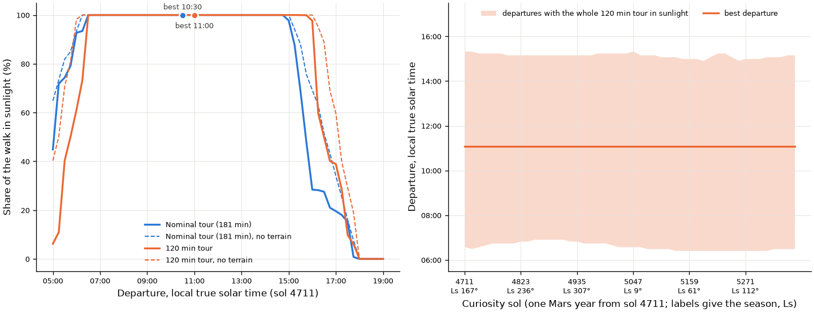

# P6 · Best time to leave, and working without Earth

Owner: Diana (`@dianagrz`), handed over from Juan with the lead's approval (JB, #45, 2026-11-15) · Issue: #45 (closed) · PRs: #97 (module, note), #100 (API and HUD line) · Status: done · Last update: 2026-11-15

Two of the quick extras of P6. "EVA as a pair", "plan against the walk" and "wrist card" are done by JB and Sebas ([E11 note](E11_comms.md), [product note](product_api_hud.md)).

## Question
1. **Best time to leave.** For a planned EVA, at what time of the sol should the astronaut leave so that the whole walk happens in sunlight, and how much does the terrain's shadow change that?
2. **Works without Earth.** Can the planner and the guide work with no help from mission control?

## Data
- **Tours:** the E5 tours of the [E5 note](E5_orienteering.md): the 13 manual stations from the habitat at the box centre, 1000 Wh with 10 % margin, 205 W of service, plain E3 cost. Nominal (180.9 min, all 13 stations) and with a 120 min limit (111.4 min, 8 stations). They are built with the same `orienteering.tour.plan_tour` that `/plan` uses, so each comes with its own clock: `t_s`, the seconds since leaving at each vertex, including the service at the stops.
- **Terrain:** the 1 m DEM of the base grid (`data/base/dem_1m.tif`, [base grid note](base_grid.md)).
- **Sol:** 4711, the Nevado Sajama drill, the same default as the 3D view ([P1 note](P1_3d_map.md)).
- **REMS** (release `rems-v1`, Sebas, P4): sunrise and sunset times and the air temperature range for each of 4,745 sols, used only to check the Sun. The file says it is an outreach product.

## Method
1. **The Sun.** A line-by-line Python port (`src/orienteering/departure.py`) of Juan's `web/3d/mars_sun.js`: the Mars24 algorithm [Allison2000], with the same conventions (longitudes east, planetographic latitude, azimuth from north through east). The habitat's longitude and latitude come from the equirectangular CRS (sphere of 3,396,190 m). Departures are given in local true solar time, the Sun's own clock that the 3D view uses; each also carries the local mean solar time, the mission clock.
2. **The terrain horizon.** From each vertex of the route, at 1.7 m (eyes and suit radio, as E11), the DEM is sampled every 2 m up to 400 m in 72 directions (5° apart). The horizon in each direction is the highest elevation angle found.
3. **Light along the walk.** For each departure (every 15 min from 05:00 to 19:00), vertex k is reached `t_s[k]` seconds later, and the Sun is placed in the sky at that instant. The vertex is *dark* if the Sun is below a smooth horizon, *shadowed* if it is up but below the terrain horizon in its direction (nearest 5° bin), and *sunlit* otherwise. Each vertex weighs the time until the next one, so a 10 min stop counts 10 min.
4. **The recommendation.** The best departure has the largest sunlit share; ties go to the one whose lowest Sun is highest (shorter shadows), then to the earliest. The **lit window** is the earliest and latest departure with the whole walk sunlit.
5. **Works without Earth.** Not code: a check of what the demo needs from outside the local server. The paragraph is in the demo script (`docs/demo.md`, section 4, Sebas's #92).
6. **Not used:** temperature. REMS gives each sol's minimum and maximum, not the hour, so it cannot rank departure times. Choosing the hour by temperature would need a diurnal model or the hourly data in PDS.

## Results
All numbers from `src/orienteering/paper_departure.py` → `data/p6/departure_summary.json`.

| Tour (sol 4711) | Best departure (true / mission clock) | Lowest Sun then | Whole walk sunlit for departures | Same without terrain shadows |
|---|---|---|---|---|
| Nominal, 180.9 min | 10:30 / 09:52 | 65.3° | 06:30–14:30 | 06:15–15:00 |
| 120 min limit, 111.4 min | 11:00 / 10:22 | 71.8° | 06:45–15:15 | 06:15–16:00 |

- **The window is wide: about 8 hours.** Any departure inside it keeps the whole walk in sunlight; the best one only centres the walk on noon (the latest arrival times 13:26 and 12:48).
- **Terrain shadows shorten it by 15–45 min.** Without them the 120 min tour could leave as early as 06:15 and as late as 16:00; with them, 06:45 and 15:15. Leaving at 06:00, 37 % of that walk is in a ridge's or a slope's shadow (shadowed share 0.3716), against 0.7 % of the nominal tour, which heads another way first. Leaving at 16:00 the nominal tour spends 41 % of the walk in shadow and 31 % in the dark.
- **Through a Mars year** (sols 4711–5369, every 14 sols, 120 min tour, departures every 5 min): a lit window exists on every sol. It opens at 06:25–06:55 and closes at 14:55–15:20 (width 8.25–8.83 h). The best departure stays at 11:05 all year, because the habitat is 4.8° south of the equator and the walk is centred on noon; the lowest Sun then varies between 56.9° and 76.3° with the season.
- **Speed:** the horizon of a tour takes 0.6–1.0 s, and scoring 57 departures 0.03–0.05 s, so it can run after every `/plan`.
- **Works without Earth:** a radio signal takes about 3 to 22 minutes to cross from Mars to Earth, one way (54.6 to 401.4 million km at the speed of light [NASA-MarsFact]). Everything the astronaut uses during the EVA (the plan, the walkback check, the way home, the off-route recalculation, the solar-storm return) runs on the local server from data already on board, and no page loads a script from the internet: deck.gl is vendored, and a test fails if a page loads one from a CDN ([product note](product_api_hud.md)).


*Figure 1. Left: share of the walk in sunlight against the departure time on sol 4711, for the two E5 tours, with the 1 m DEM's shadows (solid) and on a smooth planet (dashed); dots mark the best departure. Right: departures that keep the whole 120 min tour in sunlight through one Mars year, and the best one. Times are local true solar time at the habitat.*

## Checks
- **Same Sun as the 3D view:** the port matches `web/3d/mars_sun.js` run in Node (elevation, azimuth, local true and mean solar time to 10⁻⁹ degrees or hours; the instant of a sol and local time to 1 ms) in `tests/orienteering/test_departure.py`.
- **Against REMS:** over all 4,745 sols, the computed sunrise and sunset (the Sun crossing a smooth horizon) differ from the times REMS reports by a median of 0.40 min, 1.09 min at the 95th percentile and 1.56 min at most. REMS's times are local mean solar time; in true solar time the differences reach the equation of time (about 50 min). The computed season at sol 4711 (Ls 167°) is the one REMS gives.
- **Terrain only removes light:** on the saved 120 min `/plan` tour, the sunlit share with terrain is never above the one without, at 29 departures, and some departures are shadowed.
- **Synthetic terrain:** a 20 m wall 19.5 m to the east has a horizon of atan(20 / 19.5) = 45.7°; behind a 200 m wall the morning Sun is shadowed, and the afternoon Sun from the west is not; at midnight the walk is dark.
- **Unit tests:** `pytest tests/orienteering/test_departure.py` passes 8 tests; `tests/api/test_departure_api.py` 3 more (the saved 120 min tour gives 06:45–15:15 and 11:00; an E4 round trip works; 404 and 422 cases).
- **In the browser:** headless Edge on the live HUD: after *Plan the walk* the line appears with those times, it dims when a limit changes, and the page logs no errors.

## Limitations
- **Light only.** No temperature (see Method 6), no dust: a dusty sky dims the light and scatters it, so shadows are softer than this geometry says.
- **The DEM's relief only.** Rocks and the 1–3 m boxwork ridges the 1 m DEM does not resolve can cast shadows it misses ([base grid note](base_grid.md)); the horizon is searched to 400 m.
- **Geometry of the Sun:** the centre of the disc, no refraction, as in the 3D view.
- **One habitat and the E5 tours.** At Gale, so close to the equator, the window barely changes through the year; at high latitude it would.
- **Sunlight is a criterion, not a rule.** It is the one the issue asked for; there is no agreed operational rule (for example a minimum Sun elevation) for an EVA at Gale.

## What other pieces can use
- **API and HUD (Sebas's files, with his handoff on #45):** `GET /plan/departure?sol=` (`api/departure.py`) scores the last saved plan, an E5 tour or an E4 round trip, and answers 404 without a plan and 422 for a route without a clock. The HUD shows it as the *Best time to leave* line under the plan in step 3, for the sol of *Weather on the day*; it dims with the rest of the plan when the inputs change. In the browser, the HUD's own 120 min plan gives "leave between 06:45 and 15:15; best 11:00 (10:22 on the mission clock)".
- **3D view (Juan):** the same Sun as `mars_sun.js`; the best departure can set the 3D view's local time (`?lt=`).
- **E5 (Diana, #111):** the same light rule per station gives each station a time window, so the planner chooses the stations knowing when each is lit ([E5 note](E5_orienteering.md), *Results with time windows from the light*). The best departures it finds are these (10:30 and 11:00).
- **E12 (Juan):** the departure sets the hours of the EVA; the dose does not depend on them unless there is a solar storm.

## Reproduce
```powershell
# Inputs of the E5 note, plus the REMS release for the sunrise check:
gh release download rems-v1 --dir data; Expand-Archive data\rems_v1.zip data\rems -Force; Remove-Item data\rems_v1.zip
python src/orienteering/paper_departure.py                       # about 1 min
python src/orienteering/departure.py --plan data/plans/last_plan.json --sol 4711   # on the last /plan
python -m pytest tests/orienteering/test_departure.py
```

## Outputs
- `data/p6/departure_summary.json` (from `paper_departure.py`).
- `paper/figures/p6_fig1_departure.png`.

`data/` is not in git; regenerate with the commands above.
