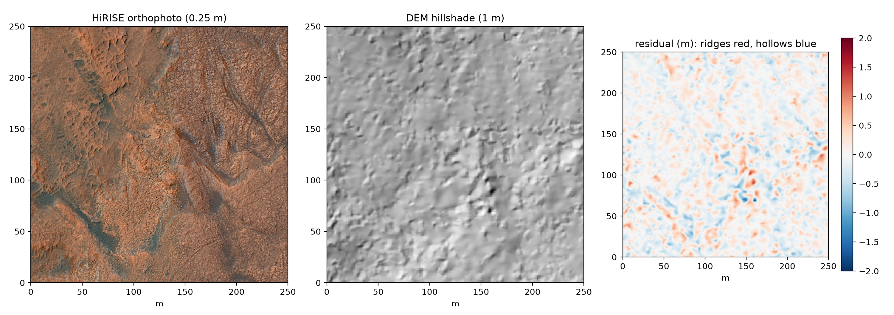
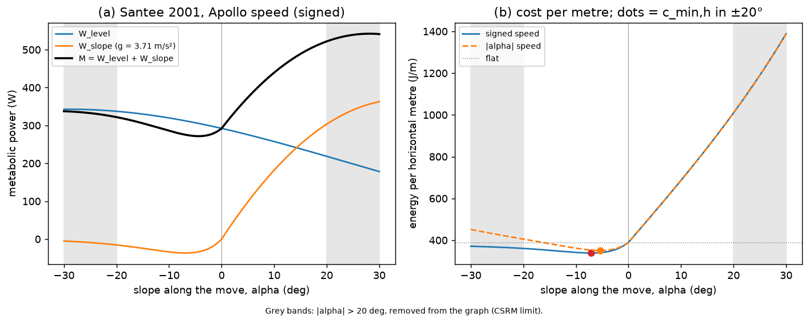
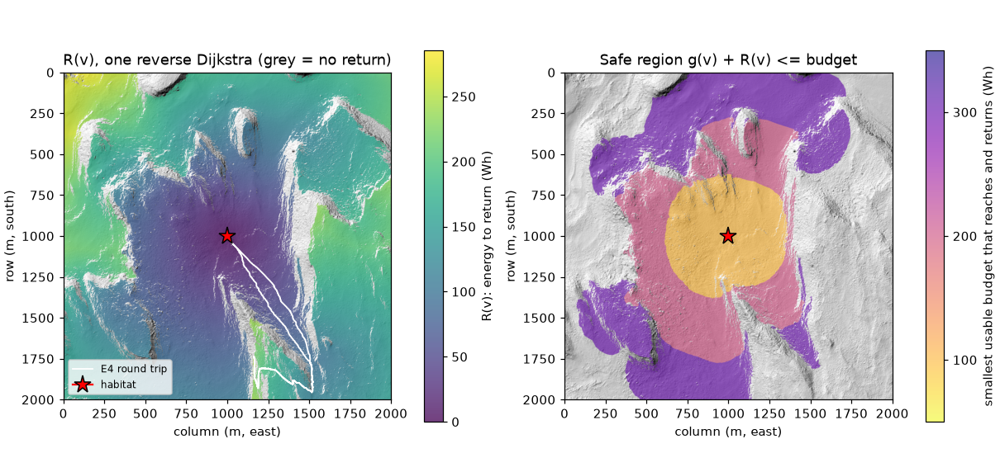
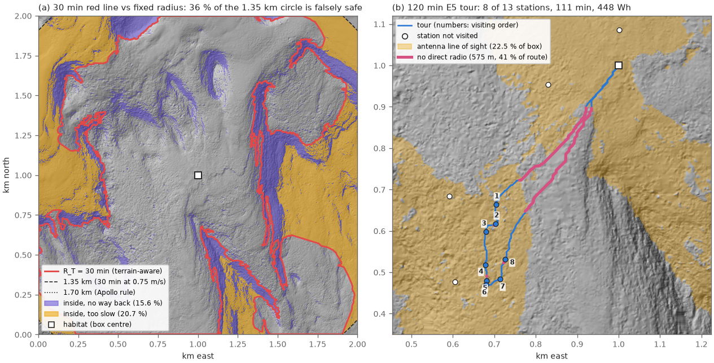
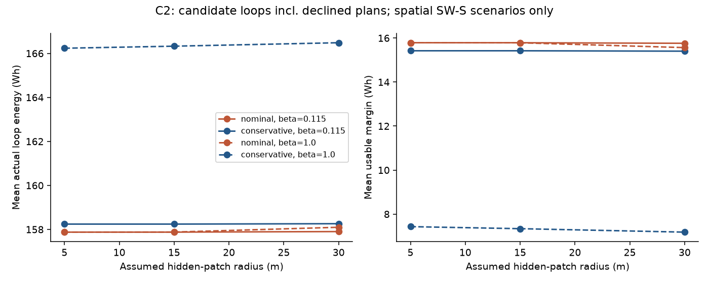
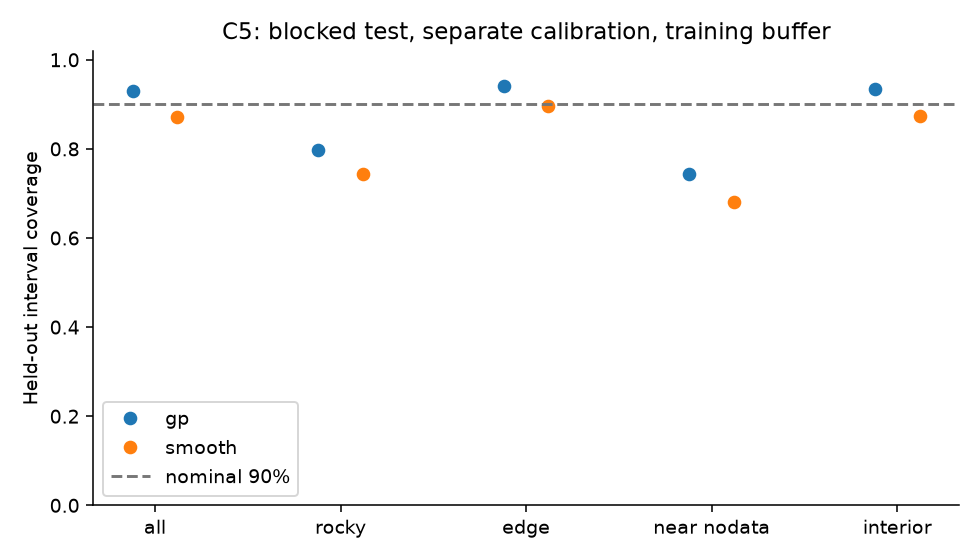
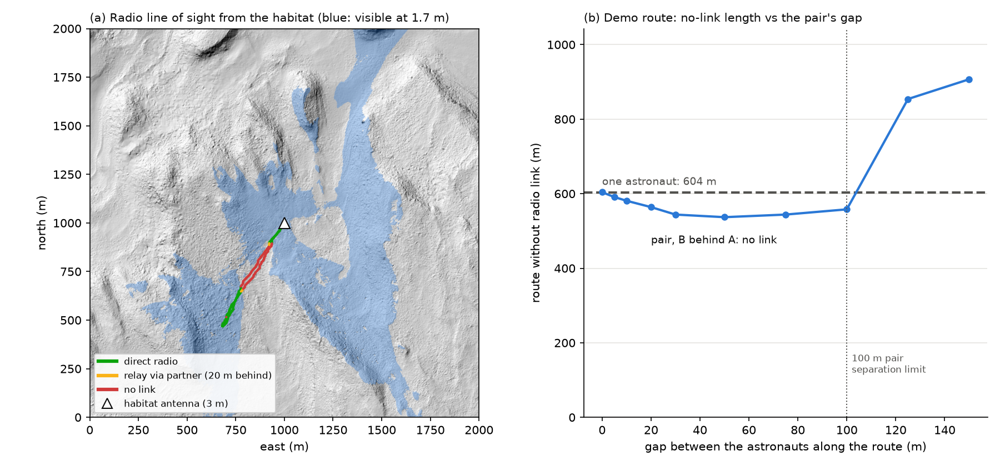
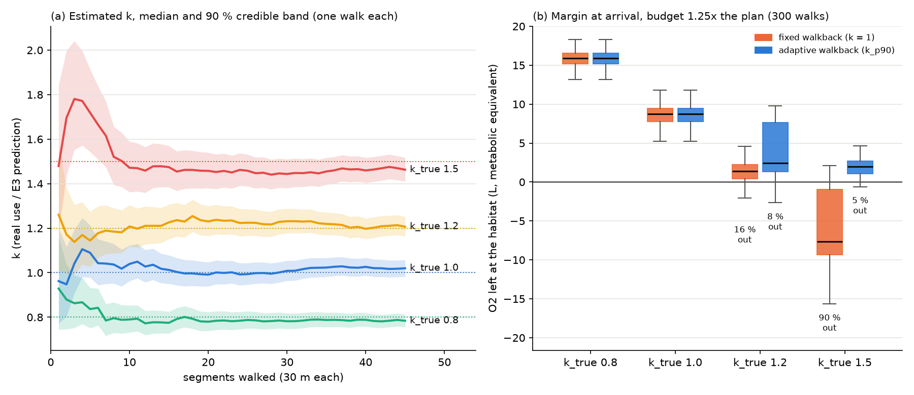

## Abstract

Astronauts exploring Mars on foot will have to plan each extravehicular activity (EVA) so that, at every point of the walk, they can still return to the habitat with the energy, oxygen and time left in the suit, without real-time help from Earth. We present a planner built around that requirement and apply it to a 2 × 2 km area of the boxwork, a network of mineralised ridges on the lower slopes of Mount Sharp in Gale crater that the Curiosity rover explored between late 2024 and 2026. Walking costs come from a published metabolic model for suited walking, adapted to Mars gravity, and are evaluated on a 1 m elevation model as a directed graph, because climbing a scarp costs more than descending it. A single shortest-path computation on the reversed graph gives the energy and time needed to return home from every cell, and the planner uses it to build round trips and station tours that respect the return condition at every vertex, choosing which science stations to visit with an exact orienteering solver. On this terrain, rules commonly used for EVA planning fail: at half the energy of the costliest round trip, a fixed radius, a slope-only A\* route and a constant-rate oxygen budget call 21–46 % of their goals safe when their own route cannot complete them, whereas the planner never does, and about a third of the area inside a fixed 1.35 km radius cannot be left and re-entered within the 30 min emergency oxygen reserve. Within the area, the time limit binds before energy, and the work at the stations dominates the cost of a tour. We test the terrain model against the rover's own traverse: elevation-derived features explain which valley the rover drove through but not its path within the boxwork, and an inverse reinforcement learning model finds that only sand, mapped from 0.25 m orbital images, carries a small price. We further add radio line of sight to the habitat, radiation dose with a solar-storm alert, the best departure time for sunlight, boulder density with its uncertainty, and an adaptive reserve that learns the astronaut's own consumption during the walk; in simulation it reduces oxygen exhaustion from 90 % to 4.7 % of walks when consumption is 1.5 times the prediction. All results come from simulation and from a rover's traverse, not from crewed tests.

## 1. Introduction

An extravehicular activity (EVA) is any period an astronaut spends outside a pressurised vehicle or habitat, protected only by a spacesuit. A surface EVA is limited by the suit's consumables (oxygen, battery energy, cooling and carbon-dioxide removal) and by the need to walk back to the habitat before they run out. Suits also carry a separate emergency supply: the secondary oxygen pack of the Extravehicular Mobility Unit used on the International Space Station provides at least 30 min of oxygen in an emergency [@NASA-EMU]. During the Apollo missions, traverses were planned on Earth with fixed return distances and constant consumption rates, and mission control recomputed the remaining margins from telemetry during the walk. That arrangement does not carry over to Mars, where a radio signal takes between 3 and 22 min each way depending on the planets' relative positions [@NASA-MarsFact]. A question such as "can the astronaut still get home from here?" therefore has to be answered on site, by the plan itself, and the answer must remain valid at every point of the route rather than only at the planned destination.

Gale crater is a 154 km impact crater just south of the Martian equator whose central mound, Aeolis Mons (informally Mount Sharp), preserves several kilometres of layered sedimentary rock. The Mars Science Laboratory rover Curiosity landed in Gale in August 2012 and has been climbing the lower slopes of Mount Sharp since 2014. Among the units mapped on those slopes is a *boxwork*: a network of resistant ridges a few metres wide that enclose polygonal hollows, often floored with sand [@Siebach2014]. Boxworks form when fluids moving through fractured bedrock deposit minerals in the fractures, and later erosion removes the weaker host rock and leaves the mineralised fracture fills standing as ridges. On Mount Sharp, the boxwork is therefore a record of groundwater circulating through the sedimentary rocks of the mound, and Curiosity spent its 2025–2026 campaign drilling and imaging it [@Siebach2026; @JPL2026; @NASA-blog-4804; @Hausrath2026]. The same features that make it scientifically attractive make it a demanding place to walk. Scarps and knolls make the cost of moving strongly direction-dependent, since going up an edge costs much more than coming down it, and the features that matter for walking (ridges, sand and boulders) are at or below the resolution of the orbital elevation model.

Earlier traverse planners for crewed exploration have combined terrain, metabolic cost and science objectives. SEXTANT, for example, plans paths that minimise metabolic cost with a model for suited walkers [@Johnson2010], and EVA analogue campaigns have scheduled science stations against operational constraints [@Marquez2019; @Brady2019]. Our contribution is a planner that treats the return home as a guarantee checked at every vertex of the route on a directed cost graph, combines it with an exact choice of stations, and tests the underlying terrain model against a rover's real traverse through the same terrain. Specifically, we contribute:

1. directed metabolic costs on a 1 m grid under Mars gravity (Section 3.2);
2. an exact return layer and round trips that respect the return condition under energy, duration and oxygen limits (Sections 3.3 and 3.4);
3. an exact station tour with time windows (Section 3.5);
4. a test of the terrain model against Curiosity's traverse, with a terrain price learned by maximum-entropy inverse reinforcement learning (Section 3.6), and sand and boulder layers mapped from 0.25 m orbital images, including how their errors propagate to routes (Sections 3.7 and 3.8);
5. operational layers for the walk itself: radiation dose and a solar-storm alert, radio line of sight, an adaptive reserve that learns the astronaut's consumption, and the best time to leave for sunlight (Sections 3.9 to 3.12);
6. software that runs offline on site, with a planning interface, an arm-mounted tablet guide and a 3D rehearsal (Section 3.13).

We report negative results alongside positive ones and state explicitly which results come only from simulation.

## 2. Study area and data

The study area is a square of 2 × 2 km centred at about 4.80° S, 137.39° E, on the boxwork unit of lower Mount Sharp. We chose it so that it contains the rover's localised positions during the boxwork campaign: 5,247 poses between sols 4369 and 4868 of the mission, that is, between November 2024 and April 2026 (a sol, the Martian solar day, lasts 24 h 39 min). The square is aligned with the pixel grid of the elevation model, so no layer needs to be resampled. Every analysis layer shares one 1 m grid, one map projection (an equirectangular projection on a sphere of radius 3,396,190 m, the one used by the elevation model) and one convention for missing values (Table 1). The terrain is rugged: the steepest slope of a cell averages 16.2°, 12.4 % of the cells exceed 30°, and the elevation spans 475 m across the area.

**Table 1. The base grid.**

| Quantity | Value |
|---|---|
| Projection | Mars equirectangular, sphere R = 3,396,190 m |
| Extent (m) | x 8,142,537.49 – 8,144,537.49 · y −285,463.08 – −283,463.08 |
| Analysis grid | 2000 × 2000 cells of 1 m (images 8000 × 8000 at 0.25 m) |
| Elevation | −3876.1 to −3401.2 m, no gaps |
| Steepest slope per cell | mean 16.2°; 44.0 % > 15°, 12.4 % > 30°, 1.92 % > 45° |
| Curiosity poses inside | 5,247 rover poses, sols 4369–4868 |

The terrain comes from the 1 m digital elevation model (DEM) of Gale crater produced by the US Geological Survey for the Mars Science Laboratory mission [@Parker2016]. It is a mosaic of stereo models from three orbital cameras: the High Resolution Stereo Camera (HRSC) on Mars Express, the Context Camera (CTX) and the High Resolution Imaging Science Experiment (HiRISE), both on the Mars Reconnaissance Orbiter. The mosaic is vertically tied to the Mars Orbiter Laser Altimeter (MOLA). Although it is posted at 1 m, its effective resolution is coarser: it does not resolve the boxwork ridges, which are 1–3 m wide (Figure @fig:detail). This limitation shapes several of the results below. The surface itself is seen in the HiRISE orthophoto mosaics of Gale at 0.25 m per pixel, in colour and in greyscale, assembled from images taken between 2006 and 2011 [@HiRISE-Gale]. The orthophotos therefore predate the rover's passage by more than a decade, which matters little for bedrock and boulders but can matter for wind-blown sand.

The rover's traverse comes from the PLACES database (Position Localization and Attitude Correction Estimate Storage) of the Planetary Data System, which gives Curiosity's localised position after each drive, reconciled with orbital imagery [@PLACES]. We use the interpolated poses as the closest available record of where a vehicle actually moved through this terrain. For boulder detection we use BoulderNet, a published detector trained on boulders labelled by humans in high-resolution planetary images, with its authors' weights [@Prieur2023].

Three further datasets describe the conditions of a walk. The Radiation Assessment Detector (RAD) on Curiosity measures the dose rate at the surface; we use 57,843 observations from January 2025 to November 2026 [@RAD-L2]. The rover's navigation cameras (Navcam) provide ground-level photographs taken in the area between sols 4450 and 4848, which we place in the 3D rehearsal [@MSL-raw]. Weather from the Rover Environmental Monitoring Station (REMS) [@REMS-feed], night-time infrared from the Thermal Emission Imaging System (THEMIS) on Mars Odyssey [@THEMIS-night] and orbital detections of hydrated minerals from the Compact Reconnaissance Imaging Spectrometer for Mars (CRISM, on the Mars Reconnaissance Orbiter) and the OMEGA spectrometer (on Mars Express) are used only as context and do not enter any cost. The infrared and mineral layers were obtained through NASA's Mars Trek portal [@MarsTrek].

**Table 2. Data.**

| Data | Resolution and period | Use |
|---|---|---|
| DEM, HRSC + CTX + HiRISE tied to MOLA [@Parker2016] | 1 m posting | terrain, costs, line of sight, shadows |
| HiRISE colour and greyscale orthophotos [@HiRISE-Gale] | 0.25 m, images of 2006–2011 | sand, boulders, display |
| PLACES localised rover poses [@PLACES] | 5,247 poses, sols 4369–4868 | Curiosity's traverse |
| BoulderNet detector [@Prieur2023] | published weights | boulder detection |
| RAD dosimetry [@RAD-L2] | 57,843 observations, 2025-01-01 – 2026-11-11 | dose and solar-storm alert |
| Navcam images [@MSL-raw] | sols 4450–4848 | photographs in the 3D rehearsal |
| REMS weather [@REMS-feed] | one record per sol | context only |
| THEMIS night infrared, CRISM and OMEGA mineral detections [@THEMIS-night; @MarsTrek] | 100 m mosaic; point detections | context only |

{#fig:detail}

## 3. Theory and methods

### 3.1 Grid and terrain features

The DEM is cropped to the study area without resampling, with a 64 m margin so that neighbourhood filters see real neighbours at the edges. From the elevation $z(i,j)$ of each cell, on a grid of spacing $h = 1$ m, we derive four terrain descriptors that later serve both the cost model and the comparison with the rover's traverse.

The steepest slope of a cell is computed with Horn's method, which estimates $\partial z/\partial x$ and $\partial z/\partial y$ from the 3 × 3 neighbourhood with weights 1–2–1:
$$\theta = \arctan\sqrt{\left(\frac{\partial z}{\partial x}\right)^2 + \left(\frac{\partial z}{\partial y}\right)^2}.$$
Here $\partial z/\partial x$ and $\partial z/\partial y$ are the rates of change of elevation towards the east and the north, and $\theta$ is the slope in the steepest direction. Because it has neither sign nor direction, it cannot distinguish walking uphill from walking downhill, which is why the cost model in Section 3.2 uses the elevation difference along each move instead. Three further descriptors capture local relief at scales the slope alone misses. The residual $r = z - G_{\sigma} * z$, where $G_{\sigma} * z$ is the elevation smoothed by convolution with a Gaussian kernel of standard deviation $\sigma = 5$ m, is the elevation above the local trend; the roughness is the standard deviation of $r$ in a 7 × 7 m window; and the topographic position index, $\mathrm{TPI} = z - \bar z_{15 \times 15}$, where $\bar z_{15 \times 15}$ is the mean elevation of the surrounding 15 × 15 m window, is positive on ridges and negative in hollows. As consistency checks, the greyscale and colour orthophotos agree with a Pearson correlation of 0.953, and Horn's slope matches an independent central-difference slope to a median of 0.30°.

### 3.2 Metabolic cost of walking under Mars gravity

The cost of a move has to capture what an astronaut spends walking over a given slope at a given speed. We use the model of Santee et al. for walking on slopes [@Santee2001], in the form adopted by the SEXTANT traverse planner for suited astronauts [@Johnson2010]. For a total equipped mass $m$ (kg), a speed $v$ parallel to the surface (m s⁻¹), a slope along the move $\alpha$ and gravity $g$, the metabolic power is the sum of a level-walking term and a slope term,
$$M = W_\text{level} + W_\text{slope},\qquad W_\text{level} = (3.28\,m + 71.1)\,(0.661\,v\cos\alpha + 0.115),$$
$$W_\text{slope} = \begin{cases} 3.5\,m\,g\,v\sin\alpha & \alpha > 0,\\ 2.4\,m\,g\,v\sin\alpha\cdot 0.3^{|\alpha|/7.65} & \alpha < 0,\\ 0 & \alpha = 0,\end{cases}$$
with $M$, $W_\text{level}$ and $W_\text{slope}$ in watts and $\alpha$ in degrees in the exponent. The level term is the cost of walking on flat ground: its first factor, $3.28\,m + 71.1$, grows with the load carried, and its second, $0.661\,v\cos\alpha + 0.115$, with the horizontal speed $v\cos\alpha$; the constants are the empirical coefficients of the model. The slope term is the work done against gravity, $m\,g\,v\sin\alpha$, the vertical speed times the weight. Uphill it is multiplied by an empirical factor of 3.5, because muscles turn metabolic energy into lifting work with low efficiency. Downhill it is negative, because walking down saves energy relative to flat ground; the saving, with empirical factor 2.4, shrinks as the descent steepens through $0.3^{|\alpha|/7.65}$, since steep descents require braking. The asymmetry between the uphill and downhill branches is what later makes the graph directed.

Reduced gravity enters only through $W_\text{slope}$, the work done raising or lowering the body's mass; the cost of moving the legs on level ground does not scale with $g$. The alternative of scaling the whole power by $g/g_\oplus$, used for example in a recent NASA traverse model [@Kim2025] on top of the Pandolf equation [@Pandolf1977], fails a simple lunar check: on flat ground it predicts 52 W on the Moon, whereas about 290 W has been inferred for the Apollo 14 EVAs [@Carr2003]. We therefore keep the Pandolf variant only for a sensitivity test.

Walking speed follows the Apollo regression $V(\alpha) = 0.75 - 0.01\,\alpha$ m s⁻¹, with $\alpha$ signed so that walking downhill is faster. The published regression does not state whether the slope is signed, so we adopt the signed reading and test the unsigned one as a sensitivity case. The astronaut's total mass is $m = 124.2$ kg, the Apollo 14 commander's 76.4 kg plus a 47.8 kg suit (cooling garment, suit and life support) [@Carr2003], and $g = 3.71$ m s⁻².

The grid becomes a graph by connecting each cell to its eight neighbours. For the move from cell $u$ to cell $v$, of horizontal length $d_h \in \{1, \sqrt2\}$ m,
$$\alpha_{uv} = \arctan\frac{z_v - z_u}{d_h},\qquad \Delta t_{uv} = \frac{d_h}{V(\alpha_{uv})\cos\alpha_{uv}},\qquad E_{uv} = M(\alpha_{uv}, V(\alpha_{uv}), g)\,\Delta t_{uv}.$$
Here $z_u$ and $z_v$ are the elevations of the two cells, $\alpha_{uv}$ is the slope along the move, $\Delta t_{uv}$ is its duration, obtained by dividing the distance along the surface, $d_h/\cos\alpha_{uv}$, by the walking speed, and $E_{uv}$ is its metabolic energy, the power times the duration. Since $\alpha_{vu} = -\alpha_{uv}$ and $M$ is not symmetric in $\alpha$, $E_{uv} \neq E_{vu}$, and the graph is directed. We use the elevation difference along the move rather than the steepest slope of the cell, because the steepest slope has no sign and overstates the slope of a move that crosses a hillside.

The model is only valid within a range of slopes, so we restrict the graph in three ways. Moves steeper than 20° in either direction are removed, because that is the slope limit of the NASA traverse model whose speed regression we use [@Kim2025], and the model would be extrapolated beyond it. A cell whose steepest slope exceeds 30° is blocked entirely, with no move into or out of it; this is a modelling assumption that stands in for the risk of slipping on a cross-slope, which the Santee model does not represent. Finally, the speed regression would reach zero at 75°, so steeper moves would be refused in any case.

The suit's oxygen use is computed from the metabolic energy through the oxygen energy equivalent,
$$O_2 = \frac{E}{20.1\ \text{kJ L}^{-1}} + q\,t,$$
where $O_2$ is the volume of oxygen in litres, $E$ the metabolic energy, 20.1 kJ L⁻¹ the energy released per litre of oxygen consumed, $t$ the elapsed time, and $q$ (L min⁻¹) an optional constant loss, for a leak or a purge, set to zero by default. With $q = 0$, an oxygen limit is simply a rescaled energy limit.

It is useful to express the cost per horizontal metre walked,
$$c(\alpha) = \frac{M(\alpha, V(\alpha), g)}{V(\alpha)\cos\alpha},$$
the metabolic power divided by the horizontal speed, because it shows where walking is cheapest. The minimum is not on flat ground but on a gentle descent (Figure @fig:e3). That minimum, $c_\text{min} = 338.75$ J m⁻¹, serves as an admissible heuristic for A\* searches. Table 3 checks the implementation against values computed by hand from the published equations.

**Table 3. Implementation against hand-computed values of the published models.**

| Quantity | Implementation | Hand computation |
|---|---|---|
| Flat power at 0.75 m s⁻¹ (Earth, Moon, Mars) | 292.23 W in all three | 292.23 W |
| Pandolf flat power, Earth | 316.63 W | 316.63 W |
| Pandolf × $g_\text{Moon}/g_\text{Earth}$, flat | 52.29 W | 52.29 W |
| Test route of 5 km (4.1 km flat + 0.9 km at +10°) | 2215.5 kJ, 615.4 Wh, 110.2 L, 1.91 h | same |
| Minimum cost per horizontal metre, signed speed | 338.75 J m⁻¹ at −7.10° | same |
| Same with speed from \|α\| | 351.00 J m⁻¹ at −5.41° | same |
| Flat cost per horizontal metre | 389.64 J m⁻¹ | same |

Section 3.6 learns, from Curiosity's route, which terrain the driver avoided beyond slope. When we use that result, which we call the *human cost*, it multiplies the energy of each move by a terrain factor at the arrival cell,
$$E^{\text{human}}_{uv} = E_{uv}\,\phi(v),\qquad \phi(v) = 1 + \sum_k w_k\, f_k(v) \ge 1,$$
where $f_k(v)$ are terrain features of the arrival cell $v$ (in practice, its sand fraction) and $w_k$ their learned weights. The weights are non-negative, so $\phi(v) \ge 1$ and costs stay positive. Time is unchanged.

{#fig:e3}

Table 4 varies one parameter at a time on the route from the centre of the area to Nevado Sajama, a ridge Curiosity drilled. Mass scales energy almost proportionally and leaves the route unchanged. The choice of metabolic model is the largest source of energy uncertainty. The area reachable within 30 min depends only on the speed convention and on the cell block, because speed does not depend on mass, gravity or the metabolic model.

**Table 4. Sensitivity of the cost model.**

| Scenario | Median return energy $R_E$ | Cells that can return | Area within 30 min | Route energy / time | Route within 5 m of nominal |
|---|---|---|---|---|---|
| nominal | 135.0 Wh | 84.4 % | 63.4 % | 93.4 Wh / 15.7 min | 100 % |
| mass 100 kg | 112.3 Wh | 84.4 % | 63.4 % | 77.3 Wh / 15.7 min | 100 % |
| mass 150 kg | 159.3 Wh | 84.4 % | 63.4 % | 110.5 Wh / 15.7 min | 100 % |
| speed from \|α\| | 138.4 Wh | 84.4 % | 53.1 % | 93.5 Wh / 15.9 min | 100 % |
| gravity Moon 1.62 | 125.6 Wh | 84.4 % | 63.4 % | 81.8 Wh / 15.7 min | 82 % |
| gravity Earth 9.81 | 145.1 Wh | 84.4 % | 63.4 % | 127.0 Wh / 15.8 min | 100 % |
| Pandolf + correction | 200.8 Wh | 84.4 % | 63.4 % | 137.8 Wh / 15.8 min | 89 % |
| Pandolf + correction × g/g⊕ | 75.9 Wh | 84.4 % | 63.4 % | 52.1 Wh / 15.8 min | 89 % |
| cell block 20° | 95.3 Wh | 42.9 % | 35.9 % | 94.8 Wh / 16.0 min | 39 % |
| no cell block | 107.5 Wh | 99.1 % | 92.4 % | 93.3 Wh / 15.7 min | 100 % |

### 3.3 Directed graph, return layer and the walkback condition

Every cell of the grid is a node and every finite move cost of Section 3.2 is a directed arc. The resulting graph has 4,000,000 nodes and 25,296,494 arcs, 79.1 % of the eight possible per node; 12.5 % of the cells have no outgoing arc because they are blocked. For a weight $w \in \{E, t\}$ (energy or time), let $d_w(u, v)$ be the weight of the shortest directed path from $u$ to $v$.

The central object of the planner is the *return layer*: for every cell, the least energy and time needed to walk back to the habitat $h$, together with the least energy needed to reach the cell from the habitat,
$$R_E(v) = d_E(v, h),\qquad R_T(v) = d_t(v, h),\qquad g_E(v) = d_E(h, v).$$
Here $R_E(v)$ and $R_T(v)$ are the energy and time of the cheapest and of the fastest way home from cell $v$, and $g_E(v)$ is the energy of the cheapest way out to it. Computing $R$ separately for every cell would be prohibitive, but all of it follows from a single Dijkstra search from $h$ on the *reversed* graph, in which the arc $v \to u$ carries the cost of the original arc $u \to v$. The cost is $O(|A| + |V|\log|V|)$ for the whole area, and $g$ follows from the forward search. The return is far from symmetric: across the area, $R_E(v)/g_E(v)$ has 5th, 50th and 95th percentiles of 0.531, 0.877 and 1.674, so a rule that assumes the way back costs the same as the way out is wrong in both directions. The largest strongly connected component of the graph holds 96.4 % of the walkable cells; a habitat or station that falls outside it, or on a blocked cell, is moved to the nearest valid cell and the move is reported.

With a usable budget $B$, the set of goals that can be reached and left again is
$$\mathcal S_E(B) = \{\, v : g_E(v) + R_E(v) \le B \,\}.$$
A cell belongs to $\mathcal S_E(B)$ when the cheapest way out to it plus the cheapest way back fit the budget. The same definition holds for time. When several resources apply at once, membership of every such set is necessary but not sufficient, and the round trip of Section 3.4 provides the exact test for a single goal.

Two boundaries summarise the return layer on a map. The emergency reserve of 30 min [@NASA-EMU] defines the *red line*, the level set $R_T(v) = 1800$ s, which encloses the cells from which the astronaut can still walk home within the reserve. During the walk, from the current position $p$ with energy $E_\text{rem}$ left, the energy-safe boundary is the level set
$$d_E(p, v) + R_E(v) = E_\text{rem},$$
the cells $v$ for which the energy to walk there from $p$, $d_E(p, v)$, plus the energy to walk home from there, $R_E(v)$, exactly use up what is left. Beyond it the astronaut could go but not return.

The safety requirement that we impose on every route is the *walkback condition*. A route $P = (v_0, \dots, v_n)$ from the habitat satisfies it for a budget $B$ if
$$\text{used}(v_i) + R(v_i) \le B \qquad \forall i,$$
where $v_0 = h$, $\text{used}(v_i)$ is the energy spent from the start up to the vertex $v_i$, station work included, and $R(v_i)$ is the return energy $R_E$ of Section 3.3 at that vertex. In words, from every point of the route the astronaut can abandon the plan and still return within budget by the cheapest way home.

*Proposition.* A **closed** round trip with total cost $C(P) \le B$ satisfies the walkback condition.

*Proof.* Here $C(P)$ is the total energy of the loop. The rest of the planned loop from $v_i$ is one way home, so $R(v_i) \le C(P) - \text{used}(v_i)$, and therefore $\text{used}(v_i) + R(v_i) \le C(P) \le B$. ∎

The per-point check therefore matters for routes that are not planned as a single closed loop: a station tour modified during the walk, the simple rules compared in Section 4.2, or a return to the plan after a detour. The planner applies it to every tour before returning it.

{#fig:rv}

### 3.4 Round trips under energy, time and oxygen limits

A round trip $h \to G \to h$ to a single goal must fit an energy budget $B_E$, a duration $B_T$ and an oxygen budget $B_{O}$ at once, respect the walkback condition, and minimise one objective (energy, time or oxygen). This is a resource-constrained shortest path problem, which is NP-hard in general [@Irnich2005]. Because energy and time are strongly correlated on this terrain, most instances are easy, and we solve them in three steps of increasing cost, each exact or with a bounded gap.

The first step runs two Dijkstra searches, from $h$ to $G$ and back, for the objective alone. If the result fits every limit, it is optimal. If it does not, the second step minimises the scalarised weight
$$w_\theta = \cos\theta\,\frac{E}{E_0} + \sin\theta\,\frac{t}{t_0},\qquad \theta \in [0, \pi/2],$$
where $E$ and $t$ are the energy and duration of a route, $E_0$ and $t_0$ are those of the minimum-energy and minimum-time round trips, used to make the two terms comparable, and the angle $\theta$ sets how much weight goes to time. Its minimisers are the *supported* Pareto-optimal routes, those on the convex hull of the energy–time trade-off. Bisection on θ locates the boundary between feasible and infeasible routes and keeps the best feasible one. The third step closes the remaining gap with label setting. Each label at node $v$, in the outbound or return phase, carries the pair $(E, t)$; a label dominates another when it is no worse in both; labels are expanded best-first by objective plus an exact lower bound, and are pruned when $E + R_E(v) > B_E$ or $t + R_T(v) > B_T$, or when they cannot beat the route found by the second step. Beyond 50,000 labels the search stops and returns the second step's route, flagged as not proven optimal, with a bound on the gap. Plain label setting without the bound from the second step did not finish within 10 min when time was binding, because energy and time are nearly tied along most routes and the Pareto sets grow without limit.

Work at a station is charged at 205 W, the top of the "low" metabolic band for suited activity [@NASA-xEMU-met], and oxygen follows Section 3.2.

To show what the return layer adds, we compare the planner with three simple rules on the same graph (Table 5). The first two represent common practice: a shortest route found with A\* under the slope limits, and a fixed radius around the habitat derived from the same flat-ground cost. The third uses a constant metabolic rate, as in oxygen budgets based on the average rate of the station suit [@NASA-Mars-mass].

**Table 5. Baseline rules and the exact planner.**

| Method | Route | Called safe if |
|---|---|---|
| A\* on slope | shortest distance (A\*, octile heuristic) under the slope limits; back along the same path | $2\,L\,c_\text{flat} \le B$, with $c_\text{flat} = 389.6$ J m⁻¹ |
| Fixed radius | same as A\* on slope | straight-line distance $\le r = B / (2\,c_\text{flat})$ |
| Linear oxygen | shortest-time route out and back | $293\ \text{W} \times t \le B$ |
| Exact planner | minimum-energy route out and back | $g_E(G) + R_E(G) \le B$ |

The reference for every route is its energy under the metabolic model. A *false safe* is a goal that a method calls safe while its own route needs more than the budget. Since the habitat is chosen by the user, budgets are expressed as fractions (25, 50 and 75 %) of each habitat's costliest exact round trip. We use the centre of the area plus 20 random habitats, and as goals the 13 manually selected science stations plus 2,000 random cells.

### 3.5 Station selection: an orienteering problem with time windows

An EVA rarely visits a single goal. Given a set of candidate science stations, each with a value, a work time and possibly a time window, the planner must choose which to visit and in what order. Stations $i = 1..n$ have prizes $p_i$ (points from a scoring rubric), service times $s_i$ and optional time windows $[a_i, b_i]$. Starting from the habitat (node 0), the astronaut visits a subset $S$ in an order $\pi$ that solves
$$\max_{S,\pi}\ \sum_{i \in S} p_i \quad \text{s.t.}\quad \sum_{k} c_{\pi_k \pi_{k+1}} + P_s \sum_{i \in S} s_i \le B_E,\quad T(\pi) \le B_T,\quad a_i \le \tau_i \le b_i,$$
plus the walkback condition along the walked cells. This is the orienteering problem with time windows [@Vansteenwegen2011; @Gunawan2016]. The objective adds the prizes of the visited stations. In the first constraint, $c_{ij}$ is the directed minimum-energy cost of walking from station $i$ to station $j$ (with $\pi_k$ the $k$-th station of the tour, starting and ending at the habitat), obtained from one Dijkstra search per station, and $P_s = 205$ W is the power spent working at a station, so the walking plus the station work must fit the energy budget $B_E$. In the second, $T(\pi)$ is the total duration of the tour, walking, work and waiting included, which must fit the duration limit $B_T$. In the third, $\tau_i$ is the time at which work at station $i$ starts, which must fall within its window. The walking time of each leg is measured along its minimum-energy path, so the solver's times match the route actually walked. The ratio $c_{ij}/c_{ji}$ between the two directions of a leg has 5th, 50th and 95th percentiles of 0.625, 1.0 and 1.599, so the direction in which a tour is walked matters.

For the problem sizes of a single EVA, exact solution is affordable. We use the Held–Karp dynamic programme [@HeldKarp1962]. Let $D[S][j]$ be the least energy that visits and serves the set $S$ and ends at $j \in S$:
$$D[\{j\}][j] = c_{0j} + P_s s_j,\qquad D[S \cup \{j\}][j] = \min_{i \in S} \big( D[S][i] + c_{ij} + P_s s_j \big).$$
The first equation starts a tour at a single station $j$: walk from the habitat and work there. The second extends the best tour over $S$ that ends at $i$ by walking to a new station $j$ and working there, keeping the cheapest choice of $i$. A set is *closable* if $\min_j D[S][j] + c_{j0} \le B_E$, that is, if the cheapest tour over it can also walk home within budget, and the solution is the closable set with the most points, ties broken by lower energy. The cost is $O(2^n n^2)$, which we use up to 20 nodes. With time windows or a duration limit, one value per state is not enough, because a cheaper partial tour may arrive too late. Each state then keeps the Pareto set of (energy, departure time) labels [@Irnich2005]. An astronaut who arrives early waits. For two labels A and B at the same state, with energies $e_A, e_B$ spent so far, departure times $t_A, t_B$ and waiting power $w$, label A dominates label B when
$$t_A \le t_B \quad\text{and}\quad e_A + w\,(t_B - t_A) \le e_B,$$
that is, when A could wait until B's time and still have spent no more. Beyond 20 nodes, the problem is solved as a constraint program with the CP-SAT solver [@ORTools]: one Boolean variable per arc and per station, a circuit constraint in which skipped stations close on themselves, the energy budget as a linear constraint, and a start-of-service variable per station that each chosen arc pushes forward. Its result is used only when the solver proves optimality.

After solving, the full cell path of the tour is checked against the walkback condition. If it fails, two repairs are tried, with at most five additional solves: lowering the budget by the deficit, or excluding the station where the first violation occurs. When no tour exists, the solver reports why: which resource is short, by how much and for the closest station, together with the budget that would make a tour feasible. That budget is rounded up, so the reported minimum always suffices.

The value of each station type comes from a rubric reviewed against the literature on the boxwork and on sampling priorities [@Siebach2014; @Siebach2026; @Hausrath2026; @JPL2026; @NASA-blog-4804; @Herd2025]: ridge 5, hollow 4, sand–rock contact 4, and a site Curiosity studied 3. Because such scores are judgements, we test how sensitive the choice of stations is to them with seven fixed alternative rubrics and 500 random rubrics that keep the same order, measuring the Jaccard similarity of the visited sets and Kendall's τ of the visiting order.

We also compare the exact solvers with four metaheuristics, to check whether exactness costs too much time: iterated local search [@Vansteenwegen2009], simulated annealing [@Kirkpatrick1983], ant colony system [@Dorigo1997; @Montemanni2009] and a genetic algorithm [@Tasgetiren2000]. The test set has 60 random instances with 10–18 nodes, with and without time windows, the 49 standard instances of Tsiligirides [@Tsiligirides1984], and the 4 tours of this study. The gap is (optimum − points) / optimum.

### 3.6 Learning the terrain price from Curiosity's route

The cost model of Section 3.2 knows only slope. Curiosity's traverse through the same terrain offers a way to ask whether other terrain properties, visible in the DEM or in the images, make a route more or less costly in practice. The rover is not an astronaut, and its drivers also chose paths for science and operations, so this test bounds what the orbital data can explain rather than calibrating a human cost.

The localised poses (median spacing 0.92 m) are joined by segments sampled every 0.25 m, which gives an 8-connected sequence of 4,687 cell steps over 4,477 visited cells. As a first, model-free test, a logistic regression on standardised features compares the visited cells with unvisited cells 2–50 m from the route. The features are slope, roughness, TPI and the mean slope in 5 and 15 m windows. Cells closer than 2 m are excluded because the rover is 3 m wide, and skill is measured by the area under the ROC curve, cross-validated over five blocks of the route.

The logistic test asks whether visited cells differ from their neighbours, but not whether the route as a whole was cheap. For that we use maximum-entropy inverse reinforcement learning [@Ziebart2008], which has also been applied to rover path planning [@Pflueger2019]. The model assumes that, between a given start and goal, the driver chose a route $\zeta$ with probability that decreases exponentially with its cost,
$$P(\zeta \mid w) = \frac{e^{-C_w(\zeta)}}{Z(w)},\qquad C_w(\zeta) = \sum_{(u,v) \in \zeta} d_{uv}\,\frac{c_w(u) + c_w(v)}{2},\qquad c_w(x) = w^\top f(x),$$
and learns the non-negative weights $w$ that make the observed routes most likely. Here $C_w(\zeta)$ is the cost of the route, the sum over its moves $(u, v)$ of the move length $d_{uv}$ times the mean cost per metre of its two cells; $c_w(x)$ is the cost per metre at cell $x$, a weighted sum of the terrain features $f(x)$ of that cell; and $Z(w)$ is the partition function, the sum of $e^{-C_w}$ over all possible routes between the same start and goal, which makes the probabilities add up to one. The features $f$ are a constant per metre, slope, roughness, mean slope at 5 and 15 m, and TPI split into a ridge part $\max(\mathrm{TPI}, 0)$ and a hollow part $\max(-\mathrm{TPI}, 0)$, each scaled by its 99th percentile.

The partition function $Z$ is computed by soft value iteration,
$$V(\text{goal}) = 0,\qquad V(u) = -\log \sum_{k} e^{-(\text{cost}(u \to v_k) + V(v_k))},$$
where $V(u)$ is the soft cost of reaching the goal from cell $u$, the sum runs over the neighbours $v_k$ of $u$, and $\text{cost}(u \to v_k)$ is the cost of the move. $V$ is a soft minimum of the cost to the goal. Its hard version, with min in place of log-sum-exp, is exactly the return layer $R$ of Section 3.3. The resulting policy, $\pi_k(u) = e^{-(\text{cost}(u \to v_k) + V(v_k)) + V(u)}$, is the probability of moving from $u$ to its neighbour $v_k$; it favours moves that keep the remaining cost low. A forward pass that pushes unit mass from the start along $\pi$ gives the expected feature counts $\mathbb E_w[f]$. The negative log-likelihood and its gradient are
$$\mathrm{NLL}(w) = C_w(\zeta) - V_w(\text{start}),\qquad \nabla_w \mathrm{NLL} = f(\zeta) - \mathbb E_w[f].$$
The negative log-likelihood is the cost of the observed route minus the soft cost of the best routes from its start, and it is small when the observed route is nearly as cheap as any alternative. In the gradient, $f(\zeta)$ is the total of each feature along the observed route and $\mathbb E_w[f]$ its expected total under the model. The gradient therefore has a direct reading: if the model's routes cross more of a feature than the real route did, that feature's price rises. The NLL is convex in $w$, and we minimise its mean per metre with L-BFGS-B [@SciPy] on a GPU [@PyTorch].

One technical constraint matters. With eight neighbours the number of possible walks grows exponentially with length, so if moves are too cheap $Z$ diverges. For a uniform price $c$ per unit cell length, the branching sum per step, the total weight of the four straight moves of length 1 and the four diagonal moves of length $\sqrt2$, is $4e^{-c} + 4e^{-\sqrt2 c}$. When it is at least 1, which happens for $c \le 1.78$, the weight of long walks does not decay and $Z$ is infinite. We therefore keep the per-metre weight at or above 2.0; no fit ended on this floor.

The comparison that decides whether terrain matters is against a control that uses distance only: all terrain prices at zero and only the per-metre weight fitted. The control already knows each drive's start and goal, so it captures everything that the choice of destination explains. A terrain model counts only if it beats the control on held-out blocks of the route, and only then do its prices become the factor $\phi(v)$ of Section 3.2.

### 3.7 Boxwork sand from the orthophoto

No pixel-level map of the Gale boxwork exists [@Siebach2014], so we generated training labels by rules applied to the 0.25 m colour orthophoto, a technique known as weak labelling. The spatial split was fixed before any tuning: the southern half of the south-west quadrant of the study area is held out for validation, and the rest is used for training. All rule thresholds are percentiles of the training area. Two earlier rule sets were discarded because they marked loose clasts and layer edges as ridges. In the final rules, sand is a grey-blue surface darker than the median, and a ridge is a watershed divide of the smoothed brightness that agrees with a Sato ridge filter [@Sato1998], kept only where a regional boxwork score is high.

A U-Net segmentation network with an EfficientNet-B0 encoder [@Ronneberger2015; @Tan2019] is trained on 256 × 256 pixel patches with a class-weighted cross-entropy plus a Dice term, which counteracts the rarity of ridges and sand:
$$\mathcal L = -\sum_x \omega_{y_x} \log \hat p_{y_x}(x) \;+\; \Big(1 - \frac{2\sum \hat p\, y}{\sum \hat p + \sum y}\Big),$$
In the first term, the sum runs over the pixels $x$ of a patch, $y_x$ is the labelled class of pixel $x$, $\hat p_{y_x}(x)$ the probability the network gives to that class, and $\omega_{y_x}$ the weight of the class, 1 : 10 : 6.16 for background, ridge and sand. The second term is one minus the Dice overlap between the predicted probabilities $\hat p$ and the labels $y$ of a class, summed over pixels; it is zero when prediction and labels coincide. The sand layer used by the planner is the fraction of the 16 sub-cells of each 1 m cell predicted as sand.

Because the training labels come from rules, agreement with them would say little about the real surface. We therefore validate on 240 points labelled blind on the orthophoto, 80 per predicted class, and correct for the unequal sampling with area-weighted estimators [@Olofsson2014]. With $W_h$ the share of the map in class $h$ and $n_{hj}$ the number of points mapped as $h$ and labelled $j$, the estimated area proportions are
$$\hat p_{hj} = W_h\,\frac{n_{hj}}{n_{h\cdot}},$$
where $n_{h\cdot}$ is the number of points mapped as $h$. The user's accuracy (precision) of class $j$, $\hat U_j = \hat p_{jj}/\hat p_{j\cdot}$, is the share of the area mapped as $j$ that really is $j$, with $\hat p_{j\cdot}$ the total over the true classes. The producer's accuracy (recall), $\hat P_j = \hat p_{jj}/\hat p_{\cdot j}$, is the share of the area that really is $j$ that the map finds, with $\hat p_{\cdot j}$ the total over the mapped classes. To ask whether a layer is useful for routing, we measure $\text{AUC}_\text{avoid} = \Pr(x_\text{driven} < x_\text{alternative})$, the probability that the value of a layer $x$ at a randomly chosen cell the rover drove is lower than at a randomly chosen alternative cell 2–50 m away; 0.5 means the layer carries no information about where the rover went.

A map that misses most sand raises the question of how much the missed sand would change a route. We study this with spatial scenarios rather than per-pixel statistics. The validation sample contains 45 sand points that the map labels as something else, which group into 43 distinct 20 m blocks. Each block can host a hidden sand disk, present with probability 0.5, with its centre jittered by up to a third of its radius, and with radii of 5, 15 or 30 m; we draw 30 independent worlds per radius, confined to the validation region. The energy of a move into a cell with hidden sand fraction $h$ becomes $E(1 + \beta h)$, where $E$ is its nominal energy and $\beta$ the assumed extra cost of fully sandy ground, either $\beta = 0.115$, on the scale of the learned sand factor, or $\beta = 1.0$, a deliberately strong case; neither is a measured human penalty. We compare the nominal routes with a precautionary policy that avoids the surroundings of detected sand, treating each cell as if it hid a sand fraction $\hat h = 0.5\,e^{-(d/20\,\text{m})^2}(1 - \text{sand})$ and multiplying the energy of a move by $1 + \beta\,\hat h$. Here $d$ is the distance of the arrival cell to the nearest detected sand and $\text{sand}$ its mapped sand fraction: the guessed hidden fraction is at most one half next to detected sand, fades over about 20 m, and is zero where sand is already mapped, which the nominal cost already prices. The policy sees only the map, never the hidden worlds. Each round trip from the centre to the 28 station sites gets a usable budget of 1.10 times its nominal energy, tight on purpose because the real suit budget does not bind in this area, and a policy that predicts it would exceed that budget declines the goal. Results are aggregated per world and bootstrapped over worlds.

### 3.8 Boulders: detection, distillation and uncertainty

Boulders matter both for safety and for radio, and the orthophoto resolves those larger than about 1 m. The detector, which we call the teacher, is BoulderNet, a Mask R-CNN instance-segmentation network [@He2017; @Wu2019] with its authors' weights [@Prieur2023]. It runs over the greyscale orthophoto in 500 pixel windows every 250 pixels. Each detection belongs to the window whose central block contains its bounding-box centre, so no boulder is counted twice, and each mask becomes a polygon with equivalent diameter $2\sqrt{A/\pi}$.

The teacher takes about six minutes on the whole area even on a GPU, which is impractical for updating a map on site. We therefore distil it [@Hinton2015] into a small student network that predicts boulder cover directly. Each pixel's target $y \in [0,1]$ is the score of the teacher mask that covers it, and a three-level U-Net with 0.93 M parameters minimises binary cross-entropy on these soft targets,
$$\mathcal L = -\big[y \log \sigma(s) + (1-y)\log(1-\sigma(s))\big],$$
where $s$ is the student's output (logit) for a pixel, $\sigma(s) = 1/(1 + e^{-s})$ turns it into a probability, and $y$ is the teacher's soft target. Its minimiser is $\sigma(s) = \mathbb E[y \mid x]$, the expected target given the image $x$. The student thus learns the teacher's expected cover, and its mean cover stays calibrated; weighting the positive class, as is common for rare objects, would inflate it. The boulder layer is the mean probability over each 4 × 4 pixel block, that is, the fraction of each 1 m cell covered by boulders.

A planner that penalises boulders needs to know how far to trust the density between detections. We model the teacher's cover, averaged over 20 m blocks, with a Gaussian process. The cover is very skewed, since 65.5 % of the blocks contain no boulders, so we model $z = \sqrt{\text{cover}\,\%}$ with a Matérn kernel of smoothness 3/2 plus white noise,
$$k(r) = C\Big(1 + \frac{\sqrt3\,r}{\ell}\Big)\exp\Big(-\frac{\sqrt3\,r}{\ell}\Big) + \sigma_n^2\,\delta(r).$$
The kernel gives the covariance of $z$ between two blocks a distance $r$ apart. $C$ is the variance of the spatial signal, $\ell$ the length scale over which blocks remain correlated, $\sigma_n^2$ the variance of the noise that is independent from block to block, and $\delta(r)$ equals 1 when $r = 0$ and 0 otherwise, so the noise only adds to a block's own variance. These hyperparameters are fitted by maximising the marginal likelihood. With the predictive mean $\mu$ and standard deviation $\sigma$ of $z$, the back-transform to cover is exact:
$$\mathbb E[z^2] = \mu^2 + \sigma^2,\qquad \mathrm{Var}[z^2] = 4\mu^2\sigma^2 + 2\sigma^4.$$
We validate it by spatial cross-validation in two settings: held-out 400 m tiles, which test extrapolation to unseen areas, and held-out random blocks, which test interpolation between known ones. The references are the training mean and a Gaussian smoothing. As an independent check of the interval coverage, we repeat the tile validation with a stricter protocol: a separate calibration fold, a 20 m buffer between training and held-out blocks, and a smoothing width chosen on inner folds of the training data only. Under this protocol the smoothing receives an interval from the 90th percentile of its absolute residuals on the calibration fold.

Finally, an optional risk term multiplies the energy of each move by $1 + k\,(\text{mean} + \lambda\,\text{std})$, where mean and std are the predicted boulder cover of the arrival cell and its standard deviation, $k$ is the assumed extra cost per unit of cover, and $\lambda$ sets the caution: with $\lambda = 0$ only the expected cover is priced, and with $\lambda = 1.645$ the cover is taken at its one-sided 95 % upper bound. It remains off ($k = \lambda = 0$) because no boulder price could be validated (Section 4.5).

### 3.9 Radiation dose and the solar-storm alert

Outside the habitat, the astronaut is exposed to galactic cosmic rays and, occasionally, to solar energetic particle events. The background absorbed-dose rate $\dot D_0$ is the median of the good-quality tissue-equivalent RAD observations over the boxwork sols [@RAD-L2]. These measurements are not corrected for the rover's own radioisotope power source, so they are an upper estimate. Along a route, with the walk's clock $t(s)$ including station work, the absorbed and estimated equivalent doses are
$$D = \int_{t_0}^{t_1} \dot D(t)\,dt,\qquad H \approx Q\,D,\quad Q = 3.05,$$
where $D$ is the absorbed dose (energy deposited per unit mass of tissue, in grays), $\dot D(t)$ the dose rate at time $t$, $t_0$ and $t_1$ the start and end of the EVA, and $H$ the equivalent dose (in sieverts), which weights the absorbed dose by its biological effect through $Q$, the mean quality factor of galactic cosmic rays measured at the surface [@Hassler2014]. $\dot D(t)$ is either the constant background or the real RAD series, which is piecewise linear and integrated exactly. At the background rate the dose is proportional to the time spent outside, not to the distance walked.

A solar particle event can raise the dose rate within minutes. We define an alert from the RAD series itself. Let $\tilde D(t)$ be the median of the previous three days of observations. The alarm fires at the second of two consecutive observations with
$$\dot D(t_j) > 1.5\,\tilde D(t_j),$$
where $t_j$ is the time of observation $j$, that is, when the dose rate exceeds its recent median by half. The event ends after two observations below $1.2\,\tilde D$. On an alarm, the astronaut takes the fastest way home, whose duration is $R_T$, and the dose saved is the dose of the rest of the plan minus that of the return.

### 3.10 Radio line of sight to the habitat

Without real-time contact with Earth, the link between the astronaut and the habitat is the main channel for help. We model it as line of sight between an antenna 3 m above the habitat cell, $h_A$, and a suit radio 1.7 m above a cell, $h_B$. On a sphere of radius $R$, two points a horizontal distance $D$ apart see each other if the terrain between them, raised by the curvature of the planet, stays below the straight line joining them:
$$z(s) + \kappa\,\frac{s\,(D - s)}{2R} \;<\; (z_A + h_A) + \frac{s}{D}\big[(z_B + h_B) - (z_A + h_A)\big]\qquad \forall s \in (0, D).$$
Here $s$ is the horizontal distance from the antenna along the line, $z(s)$ the terrain elevation there, $z_A$ and $z_B$ the ground elevations at the two ends, and $h_A$ and $h_B$ the heights of the antennas above them. The left side is the terrain raised by the bulge of the sphere, $s(D - s)/2R$, which is largest halfway; the right side is the straight line between the two antennas. The curvature coefficient $\kappa$ scales the bulge to account for refraction; we set $\kappa = 1$, with no atmospheric refraction, since the Martian atmosphere is too thin to bend the path noticeably. To first order this is equivalent to lowering the target by $D^2/2R$, as standard viewshed implementations do. Two checks confirm the implementation. On a flat DEM, the farthest distance at which two antennas still see each other over the curvature is $d = \sqrt{2Rh_A} + \sqrt{2Rh_B}$, the sum of the distances to the horizon from each, which for both ends at 0.1 m gives 1,648.3 m with the Mars radius (2,258.9 m with Earth's), and the last visible cell is at 1,648 m. On 5,000 random cells, the viewshed agrees with an exact bilinear profile in 99.6 % of cases.

Each vertex of a route either has direct radio or not, and a step counts as without radio if either end lacks it. For a pair of astronauts, B walks a fixed gap behind A on the same route, and the pair is linked if
$$\big(\text{A sees } h \wedge \text{B sees } h\big) \;\vee\; \big(\text{A sees } h \oplus \text{B sees } h\big) \wedge \text{A sees B} \wedge \|A - B\| \le 100\ \text{m},$$
where $\wedge$ is "and", $\vee$ "or", $\oplus$ "exactly one of the two", and $\|A - B\|$ the straight-line distance between the astronauts. That is, the pair is linked if both see the habitat, or if only one does and the two see each other within 100 m, so that one relays for the other. With one route and a gap of at most 100 m, the separation limit never binds, because the straight-line distance is at most the gap. The model is pure line of sight: it ignores diffraction and the link budget, and it misses the ridges and boulders that the DEM does not resolve.

### 3.11 Adaptive walkback: learning the astronaut's own consumption

The metabolic model predicts consumption, but a given astronaut, suit and load may spend more or less. If the real consumption is higher than predicted, a reserve computed from the model is too small, and the astronaut learns this only on the way home. We model real consumption as
$$E^\text{real} = k\,E^\text{model},$$
where $E^\text{model}$ is the energy predicted by the cost model of Section 3.2 and $E^\text{real}$ the energy actually spent, with a single factor $k$ per EVA that absorbs fitness, suit, load and terrain effects the model misses. We learn $k$ during the walk.

We work with $\ell = \log k$, so that a factor and its inverse are equally likely, with a normal prior $\ell \sim \mathcal N(\mu_0, \sigma_0^2)$: $\mu_0 = 0$ says that before walking the model is believed to be right on average, and $\sigma_0 = 0.3$ allows $k$ to be off by about 30 %. Every 30 m walked yields one observation
$$y_j = \log\frac{E^\text{real}_j}{E^\text{model}_j} = \ell + \varepsilon_j,\qquad \varepsilon_j \sim \mathcal N(0, \sigma^2),\ \sigma = 0.15.$$
where $E^\text{real}_j$ and $E^\text{model}_j$ are the real and predicted energy of segment $j$, and $\varepsilon_j$ is the measurement noise of one segment, with standard deviation $\sigma$. A normal prior and a normal likelihood are conjugate, so the posterior stays normal and its precision, the inverse of its variance, is the sum of the precisions of the prior and of the observations. After $n$ observations, the posterior mean $\mu_n$ and standard deviation $\sigma_n$ of $\ell$ are
$$\frac{1}{\sigma_n^2} = \frac{1}{\sigma_0^2} + \frac{n}{\sigma^2},\qquad \mu_n = \sigma_n^2\Big(\frac{\mu_0}{\sigma_0^2} + \frac{1}{\sigma^2}\sum_{j=1}^n y_j\Big).$$
so the mean is a precision-weighted average of the prior mean and the observations, and the uncertainty shrinks as segments accumulate. The factor $k$ is then log-normal, with quantiles $k_q = e^{\mu_n + z_q \sigma_n}$, where $z_q$ is the $q$ quantile of the standard normal distribution, median $e^{\mu_n}$, mean $e^{\mu_n + \sigma_n^2/2}$ and central 90 % interval $[k_{0.05}, k_{0.95}]$. Because oxygen is energy divided by a constant, the same $k$ applies to oxygen.

A uniform $k$ multiplies every arc's energy by the same factor, so the shortest-path energy home under factor $k$ is $d^{(k)}_E(v, h) = k\,d_E(v, h)$ and the cheapest way home does not change. The return reserve at factor $k$ is exactly $k\,R_E(v)$, and no new shortest-path search is needed during the walk. The 30 min line does not move, because $k$ is metabolic and does not change speed.

The decision rule uses a high quantile of $k$, $k_{0.9}$, rather than its mean. Before the astronaut walks the next segment, of predicted energy $\Delta E$ to the next point $v'$, the rule checks
$$\text{used}^\text{real} + k_{0.9}\,\big(\Delta E + R_E(v')\big) \le B ,$$
where $\text{used}^\text{real}$ is the energy actually spent so far and $B$ the budget: the energy already spent plus a pessimistic estimate of the next segment and of the way home from its end must fit. If the check fails, the rule tells the astronaut to return now. Looking one segment ahead matters, because the work at a station is charged in a single step.

We test the rule in two simulations. In the first, on the round trip from the centre to a ridge station (1,331 m, 40.0 min, 199.75 Wh predicted), an astronaut with a known $k_\text{true} \in \{0.8, 1.0, 1.2, 1.5\}$ walks in 30 m segments with log-normal noise of $\sigma = 0.15$ per segment, the walk home included. The budget is set to 1.25 times the plan, because the real suit budget never binds in this area, and we run 300 walks per case, comparing a fixed reserve ($k = 1$) with the adaptive one ($k_{0.9}$) on the same walks. In the second, on one station tour with its own budget and a 40 Wh reserve, we compare three policies (nominal, $k = 1$; conservative, the prior's $k_{0.9}$; and adaptive) on the same pre-generated random world per EVA. That study adds autocorrelated noise, an AR(1) process with $\rho \in \{0, 0.7\}$, to test the filter's assumption of independent errors. We use Wilson intervals for rates and paired bootstrap intervals for differences.

### 3.12 Light: the best time to leave

Walking in shadow makes the terrain harder to read and the suit colder, and some science stations can only be imaged in sunlight. The Sun's elevation $e_\odot(t)$ and azimuth $A_\odot(t)$ follow the Mars24 algorithm [@Allison2000]. From every route vertex $k$, at a height of 1.7 m, the terrain horizon in direction $\beta$ is
$$H_k(\beta) = \max_{0 < d \le 400\,\text{m}} \arctan\frac{z(\mathbf x_k + d\,\mathbf u_\beta) - (z_k + 1.7)}{d},$$
the highest angle above the eye at which terrain is seen in that direction. Here $\mathbf x_k$ is the position of the vertex, $\mathbf u_\beta$ the unit vector pointing in direction $\beta$, $d$ the distance along it, $z(\cdot)$ the terrain elevation and $z_k + 1.7$ the height of the eyes; the profile is sampled every 2 m in 72 directions. For a departure time $t_0$, vertex $k$ is reached at $t_0 + t_k$, following the plan's own clock, and it is dark if $e_\odot < 0$, shadowed if $0 \le e_\odot < H_k(A_\odot)$ and sunlit otherwise. The sunlit share weights each vertex by the time until the next one,
$$\text{share}(t_0) = \frac{\sum_k (t_{k+1} - t_k)\,\mathbb 1[\text{sunlit}_k]}{\sum_k (t_{k+1} - t_k)},$$
where $t_k$ is the time at which the plan reaches vertex $k$ and $\mathbb 1[\text{sunlit}_k]$ equals 1 if the vertex is sunlit and 0 otherwise, so a stop counts with its full work time. The best departure maximises the share, with ties broken by the highest minimum solar elevation. The same windows of light can also be imposed as station time windows in the orienteering problem of Section 3.5.

### 3.13 Software

The methods above run as a local web service that plans on request and returns routes in the map projection of the DEM. An infeasible request returns an error and a diagnosis, never an invented route; parameters that the planner does not use are rejected rather than silently ignored, and each plan reports the parameters it actually used. A planning interface shows the terrain, the cost layers and the plan. One shared guidance component drives two views of the same walk, an arm-mounted tablet guide and a 3D rehearsal, with spoken directions, meters for energy and time, radio warnings and the adaptive alert. It also computes the way home and the return to the plan after a detour, checking energy, time and oxygen on the same path: if the fastest way home does not fit what the astronaut has left, a slower one that fits is taken, and the fastest path is never presented as safe. The 3D view exaggerates only the local relief, lights the scene with the Sun of the EVA's sol, and places 383 Navcam photographs at their measured camera positions [@MSL-raw; @VICAR-CAHVOR]. Everything runs on a local server with its data on board, and no page loads code from the internet.

## 4. Results

Unless stated otherwise, the habitat is at the centre of the study area.

### 4.1 The return layer and the safe area

From the centre, the energy needed to return has a median of 135.0 Wh, a 99th percentile of 259.7 Wh and a maximum of 285.5 Wh. 15.6 % of the cells cannot return at all, because they are blocked or lie outside the main connected component. The round trip to the most expensive cell that can still return needs 562.8 Wh, 91.1 min, 100.8 L of metabolic oxygen and 3,930 m of walking. A 7 h suit budget (7 h × 293 W ≈ 2,050 Wh) is far from binding: within this area it is the terrain, not the suit, that limits the EVA. Table 6 shows how the share of the area that can be reached and left again grows with the usable energy.

**Table 6. Share of the grid that is reachable and returnable against the usable energy.**

| Usable energy (Wh) | 100 | 200 | 300 | 400 | 500 | ≥ 600 |
|---|---|---|---|---|---|---|
| Reachable and returnable (%) | 10.7 | 26.9 | 49.8 | 71.7 | 83.5 | 84.4 |

When time is the binding limit, the second step of the round-trip search finds the route. Near the farthest cell, the minimum-time route takes 90.93 min and 564.89 Wh and the minimum-energy route 91.1 min and 562.8 Wh. With the time limit set halfway between them, at 91.03 min, the planner returns a route of 563.31 Wh in 91.01 min. The exact search reached its label cap, and the bound on the gap is 0.5 Wh (0.09 %).

### 4.2 Simple rules call unsafe goals safe

Table 7 shows how often each rule calls a goal safe when its own route cannot complete it. At every budget, all three rules do so for a substantial share of their goals, whereas the planner never does.

**Table 7. False safes: share of the goals each method calls safe that its own route cannot complete under the metabolic model.** 42,273 evaluations per method and budget.

| Budget (of the costliest round trip) | A\* on slope | Fixed radius | Linear oxygen | Exact planner |
|---|---|---|---|---|
| 25 % | 34.0 % | 56.9 % | 25.6 % | 0 % |
| 50 % | 27.7 % | 45.7 % | 21.4 % | 0 % |
| 75 % | 15.8 % | 16.3 % | 12.5 % | 0 % |

The rules are not too conservative but too optimistic: they underestimate the real energy. To avoid false safes in 99 % of cases, they would need safety factors (the 99th percentile of real over estimated energy) of 1.42 for A\* on slope, 4.05 for the fixed radius and 1.32 for linear oxygen. We repeated the comparison with the 15 sand–rock contact sites mapped from the orthophoto added as goals, once with the metabolic cost and once with the human cost, which includes the learned sand factor, as the terrain truth. The rules keep their flat-ground calibration, as a planner that knows nothing about sand would. At 50 %, A\* on slope goes from 27.7 to 28.5 % and linear oxygen from 21.4 to 22.4 %, about one point worse, while the fixed radius stays at 45.6–45.5 %, and the planner stays at 0 %. The sand factor raises arc energy by about 1 % on average, whereas slope makes the real cost 20–55 % higher than the flat estimate: slope, not sand, drives the failures.

The same contrast appears with the emergency reserve. Of the cells inside the classic 1.35 km circle, 36 % cannot get back to the habitat within 30 min (Figure @fig:redline): 15.6 % have no way back at all, because they are blocked or cut off by scarps, and 20.7 % are simply too slow. The red line follows the terrain, not a circle.

{#fig:redline}

### 4.3 Station tours: time binds, station work dominates

Table 8 shows the tours planned from the centre with a 1000 Wh budget and a 10 % margin, so 900 Wh usable, and 10 min of work at 205 W per manually selected station.

**Table 8. Station tours from the centre of the area.**

| Tour | Solver | Stations | Points | Energy | Duration | Smallest return margin |
|---|---|---|---|---|---|---|
| Nominal, 13 manual stations | DP | 13 | 56 of 56 | 723.6 Wh | 180.9 min | 176.4 Wh |
| 120 min limit | DP | 8 | 37 | 445.1 Wh | 111.4 min | — |
| Nominal, + 13 contact sites from the sand map | CP-SAT, proven | 15 | 60.47 of 79.26 | 872.0 Wh | 222.9 min | 28.0 Wh |
| 120 min limit, + contact sites | CP-SAT, proven | 8 | 37 | 445.1 Wh | 111.4 min | — |

Station work dominates the cost of a tour: it is 61 % of the energy and 72 % of the time of the nominal tour. Counting that work, visiting all 13 stations needs 750 Wh, whereas walking alone would need 300 Wh. Time is the binding limit, except when the contact sites are added, where energy binds at 872.0 of 900 Wh. The choice of stations stops depending on the rubric once the time budget reaches the nominal duration; below that, ties within the reference rubric have as large an effect as changing the rubric. The human cost raises leg energies by at most 3.5 % and leaves the chosen stations unchanged.

We planned 16 tours over energy budgets from 100 to 1000 Wh, with and without duration limits. Every tour found satisfies the walkback condition at every vertex and is a proven optimum. The smallest return margin along each tour equals the energy left on arriving home; over these tours it is smallest, 3.6 Wh, for the 600 Wh budget without a duration limit, and it is 176.4 Wh for the nominal tour. At 40 Wh no tour exists, and the planner explains why: energy is short, because the closest station alone needs 56.4 Wh against 36.0 Wh usable. The budget it advises is 62.8 Wh, that is, 56.448 / 0.9 = 62.72 Wh rounded up so that the reported minimum always suffices. Planning again just above the exact need, at 62.78 Wh, gives the tour to that station with 0.06 Wh to spare.

Light changes which stations are visited, not only when to leave (Table 9). When stations can only be served in sunlight on sol 4711, a plan that ignores the light would claim 56 points at every departure time. At 06:00, the 120 min tour keeps its 37 points but with a different set of stations (Jaccard similarity 0.78 against the set chosen without light).

**Table 9. Points of the station tours against the departure time when stations need light** (local true solar time, waiting at 0 W).

| Tour | Ignoring the light | Full points for departures | Best departure | At 15:00 | At 16:00 | At 17:00 |
|---|---|---|---|---|---|---|
| Nominal | 56 | 05:00–14:45 | 10:30 | 53 | 37 | 10 |
| 120 min limit | 37 | 06:00–16:00 | 11:00 | 37 | 37 | 10 |

From 17:45 onwards, no station of the nominal tour can be served.

### 4.4 Exact solvers are fast enough

Table 10 compares the exact solvers with the four metaheuristics.

**Table 10. Exact solvers against four metaheuristics.** Share of instances solved to optimality, mean gap and median time.

| Instances | Exact | ILS | SA | ACO | GA |
|---|---|---|---|---|---|
| Random, energy (30) | 100 % · 0 · 0.051 s | 76.7 % · 1.40 % · 0.065 s | 93.3 % · 0.28 % · 0.21 s | 84.4 % · 0.83 % · 0.049 s | 97.8 % · 0.15 % · 0.096 s |
| Random, windows (30) | 100 % · 0 · 0.046 s | 76.7 % · 4.77 % · 0.10 s | 93.3 % · 0.46 % · 0.45 s | 82.2 % · 0.92 % · 0.10 s | 96.7 % · 0.16 % · 0.17 s |
| Tsiligirides (49) | 100 % · 0 · 0.32 s | 73.5 % · 1.17 % · 0.59 s | 62.6 % · 1.63 % · 0.35 s | 90.5 % · 0.31 % · 0.20 s | 96.6 % · 0.12 % · 0.62 s |
| Tours of this study (4) | 100 % · 0 · 0.24 s | 100 % | 100 % | 100 % | 100 % |

The exact solvers always find the optimum, and their median time is within 0.12 s of the fastest metaheuristic. Iterated local search misses the optimum in about a quarter of the instances, with gaps of up to 37.5 % when time windows apply, and the genetic algorithm is the best of the metaheuristics. At the sizes of a single EVA, up to 27 nodes, the exact answer is the right choice.

### 4.5 What Curiosity's traverse says about terrain

The logistic test (Table 11) shows that terrain explains the choice of valley but not the path within it. Over the whole area, visited cells are well separated from the rest (AUC 0.730), but within 50 m of the route the separation is close to chance (0.526). In the three route blocks that lie mostly in the boxwork, the AUC is 0.47–0.50, and inside the 50 m corridor visited and unvisited cells have nearly identical slopes (median 8.9° against 8.8°).

**Table 11. Terrain-only logistic baseline: visited against unvisited cells** (AUC, mean over route blocks).

| Unvisited cells compared | All features | Slope only |
|---|---|---|
| ≤ 25 m from the route | 0.512 | 0.490 |
| ≤ 50 m (main) | 0.526 (blocks 0.473–0.612) | 0.458 |
| ≤ 100 m | 0.561 | 0.537 |
| Whole area | 0.730 | 0.663 |

Inverse reinforcement learning leads to the same conclusion (Table 12). At every scale, the DEM features receive a price of zero or close to zero, at most 4 % of the price of a metre, and none beats distance alone on held-out drives. This is not a failure of the method: on synthetic terrain with a hidden price of 2.5, the same procedure recovers 2.514 ± 0.169.

**Table 12. Inverse reinforcement learning on Curiosity's route: negative log-likelihood per metre of the terrain model and of the distance-only control.**

| Demonstrations | n | Terrain | Control | Largest terrain price / metre price |
|---|---|---|---|---|
| One per sol, 1 m cells | 129 | 1.17997 | 1.18002 | 0.019 (TPI ridge) |
| 100 m pieces | 48 | 1.34766 | 1.34766 | 0 |
| 250 m pieces | 19 | 1.42311 | 1.42311 | 0 |
| 500 m pieces | 10 | 1.48642 | 1.48642 | 0 |
| 1000 m pieces, 5 m cells, whole area | 5 | 0.29981 | 0.29997 | 0.040 (mean slope 15 m) |

On held-out drives, with one demonstration per sol, the DEM model scores 1.18373 against the control's 1.18349, which is worse, whereas a model with sand alone scores 1.18281 and is better in 4 of 5 blocks. Sand mapped from the orthophoto is therefore the only learned price, a terrain factor between 1.0 and 1.115. With it, the route to Nevado Sajama costs 1.8 % more (162.5 → 165.3 Wh) and shifts by up to 23 m, and the 120 min tour visits the same stations. A boulder price, tested in the same way, did not hold out of sample.

### 4.6 Sand and ridges from the orthophoto

**Table 13. Blind point validation in the held-out region** (240 points, 80 per predicted class, area-weighted, 95 % intervals). The second pass applies a stricter sand rule.

| | Pass 1 | Pass 2 |
|---|---|---|
| User's accuracy, sand | 0.912 (0.830–0.957) | **0.925 (0.846–0.965)** |
| User's accuracy, ridge | 0.150 (0.088–0.244) | **0.000 (0.000–0.046)** |
| User's accuracy, background | 0.612 | 0.688 |
| Producer's accuracy, sand (area-weighted) | 0.124 | **0.110** |
| Overall accuracy (area-weighted) | 0.604 | 0.667 |

When the map says sand, it is sand about 92 % of the time, but it finds only about one in nine sand pixels (Table 13). The sand layer is therefore a conservative lower bound on the real sand. The predicted ridges are not reliable, which is a negative result. Along Curiosity's route, driven cells carry less mapped sand than the alternatives (0.039 against 0.085 during the boxwork sols, $\text{AUC}_\text{avoid}$ 0.523), whereas slope (0.467) and roughness (0.450) carry no avoidance signal.

The missed sand matters little for these routes, but for a reason that does not generalise. In the scenario study, the hidden patches barely touch the routes: with radii of 5 m they intersect no route in any world, and at 15 m the intersection is very small. At the largest radius, 30 m, and with the weak penalty, the hidden sand adds only about 0.025 Wh to the mean round trip of 157.88 Wh, and no nominal route violates its reserve. The precautionary policy does not help. With the weak penalty, it changes 27 of 28 routes, adds up to 14.40 m of walking and spends 0.358 Wh more per round trip (95 % interval over worlds 0.355–0.361 Wh), which is more than the hidden sand itself costs. With the strong penalty, it declines all 28 goals, which is an unacceptable loss of science rather than a safety gain. Avoiding the surroundings of detected sand does not find sand that the map misses, because missed patches can lie anywhere. These results are conditional on a small validation region that the station routes barely cross, so they do not show that the missed sand is harmless elsewhere (Figure @fig:c2).

{#fig:c2}

### 4.7 Boulders

BoulderNet finds 8,380 boulders with a score of at least 0.10, of which 2,525 have a score of at least 0.5. Their median equivalent diameter is 1.7 m and their 95th percentile 3.8 m. They cover 0.37 % of the area, mostly in debris at the foot of scarps. On the authors' Mars test patches, the detector's precision is 0.74 and its recall 0.59.

**Table 14. Distilled student against the teacher and against human labels.**

| Measure | Value |
|---|---|
| Cover, Pearson r with the teacher (held-out blocks, 1 m and 10 m) | 0.66 / 0.66 |
| Mean cover, teacher / student | 0.33 % / 0.35 % |
| Pixel ROC-AUC / average precision (chance 0.003) | 0.986 / 0.47 |
| Boulder F1 against human labels, student / teacher | 0.27 / 0.66 |
| Run time over the area, student / teacher | 8.6 s / 362 s |

The student reproduces the teacher's boulder density, with calibrated mean cover, 42 times faster and with 47 times fewer parameters, but it finds individual boulders poorly (Table 14). It is a density map, not a boulder detector.

**Table 15. Boulder cover uncertainty: held-out RMSE / MAE of cover (%) and coverage of the Gaussian process's 90 % interval.**

| | Extrapolation, 400 m tiles | Interpolation, random blocks |
|---|---|---|
| Training mean | 1.315 / 0.562 | 1.310 / 0.557 |
| Gaussian smoothing, best σ | 1.309 / 0.546 | **1.142 / 0.427** |
| Gaussian process on √cover | **1.280 / 0.544** | 1.154 / 0.466 |
| GP 90 % coverage: all / empty / rocky blocks | 0.93 / 0.99 / 0.80 | 0.92 / 0.98 / 0.81 |

When filling gaps between known blocks, the Gaussian process is no more accurate than a 20 m smoothing (Table 15), a negative result. When extrapolating to unseen tiles it is slightly better, and the stricter independent protocol confirms this: with the smoothing width chosen on training data only, the Gaussian process reaches an RMSE of 1.306 against 1.387 for the smoothing. Its 90 % interval is calibrated overall (93.0 % coverage, against 87.2 % for the calibrated smoothing envelope), but too narrow where it matters most: it covers 79.8 % of the rocky blocks and 74.4 % of the blocks next to gaps in the data (Figure @fig:gp). Part of the difference with the smoothing comes from the shape of the intervals, since the smoothing envelope has the same width everywhere whereas the Gaussian process interval varies, and the bootstrap intervals of the overall coverage overlap (90.8–95.1 % and 81.7–91.7 %). An interval from this model is therefore not a guarantee of safe terrain.

{#fig:gp}

With the risk term at $k = 10$ on the 28 round trips from the centre, the routes cross 34 % less teacher boulder cover with the mean alone and 56 % less with one-sided 95 % caution ($\lambda = 1.645$), for less than 1 % more energy (0.87 % at most) and at most 12.3 m of detour. Because the sum of cover along a route counts cells that the outbound and return paths share, this is a relative exposure index, not a unique area. The same sweep shows the price of caution: under a tight budget of 1.10 times each round trip's nominal energy, the strongest setting leaves a negative margin on the priced objective. As $k$ has no empirical source, the term stays off in the nominal cost.

### 4.8 Radiation

The background dose rate in the boxwork is 156.4 µGy day⁻¹ (6.52 µGy h⁻¹; daily means between 145.8 and 166.1 at the 5th and 95th percentiles). The estimated equivalent dose is about 0.48 mSv day⁻¹, below the 0.64 mSv day⁻¹ measured in 2012–2013 [@Hassler2014].

**Table 16. Dose of the station tours at the background rate.**

| Tour | Length | EVA time (walking + stations) | Absorbed dose | Equivalent dose (estimate) |
|---|---|---|---|---|
| Nominal, 13 stations | 2,252 m | 3.01 h (0.85 + 2.17 h) | 19.6 µGy | ≈ 60 µSv |
| 120 min limit, 8 stations | 1,391 m | 1.86 h (0.52 + 1.33 h) | 12.1 µGy | ≈ 37 µSv |

The dose follows the time outside, 72 % of which is station work, rather than the distance (Table 16). The alert rule finds exactly one event in 22 months, on 11 November 2025, with the alarm 17 min after onset, a peak of 1.92 times the baseline and 31.9 µGy of excess dose. From any point of either tour, the fastest walk home takes under 20 min, and returning at the alarm saves 2–22 µGy depending on how much of the plan remains. The background does not change the plan; only a solar event can, through the return.

### 4.9 Radio

A 3 m antenna at the demonstration habitat sees 22.5 % of the area, and over 20 random habitats the mean is 13.0 % (4.3–27.6 %). The scarps and knobs of the boxwork confine a mast to its own valley. On the 120 min tour, 575 m of the route (41 %) has no direct radio, and a partner walking 20 m behind reduces the unlinked length only to 526 m. On the round trip to the ridge station (1,331 m), the unlinked length depends on the gap between the partners (Table 17).

**Table 17. Route length with no link against the gap between the partners, round trip to the ridge station.**

| Gap (m) | 0 (alone) | 10 | 20 | 50 | 100 | 125 | 150 |
|---|---|---|---|---|---|---|---|
| No link (m) | 604 | 581 | 564 | 537 | 558 | 854 | 907 |

Beyond 100 m the relay is not allowed and the length without contact jumps. Most of the radio shadow remains at every gap, because both astronauts end up behind the same ridge (Figure @fig:radio).

{#fig:radio}

### 4.10 Light

**Table 18. Departures that keep the whole walk in sunlight, sol 4711** (local true solar time).

| Tour | Best departure | Lowest Sun then | Whole walk sunlit | Same on a smooth planet |
|---|---|---|---|---|
| Nominal, 180.9 min | 10:30 | 65.3° | 06:30–14:30 | 06:15–15:00 |
| 120 min limit, 111.4 min | 11:00 | 71.8° | 06:45–15:15 | 06:15–16:00 |

The window in which the whole walk is sunlit is about 8 h wide, and terrain shadows shorten it by 15–45 min compared with a smooth planet (Table 18). Over a Mars year, sampled every 14 sols, such a window exists on every sol: it opens between 06:25 and 06:55, closes between 14:55 and 15:20, and the best departure stays at 11:05. The computed sunrise and sunset times match those recorded by REMS to a median of 0.40 min.

### 4.11 Adaptive walkback

**Table 19. Simulated walks with a known consumption factor** (round trip to the ridge station, budget 1.25 times the plan, 300 walks per case).

| $k_\text{true}$ | Policy | Ran out of O₂ | Turned back | Plan done (mean) | O₂ left, median (p5) |
|---|---|---|---|---|---|
| 0.8 | fixed / adaptive | 0 % / 0 % | 0 % / 0 % | 100 % / 100 % | 15.9 (14.0) L |
| 1.0 | fixed / adaptive | 0 % / 0 % | 0 % / 0 % | 100 % / 100 % | 8.7 (6.3) L |
| 1.2 | fixed | 15.7 % | 15.7 % | 97.9 % | 1.4 (−0.9) L |
| 1.2 | adaptive | 7.7 % | 46.0 % | 77.5 % | 2.4 (−0.2) L |
| 1.5 | fixed | **90.0 %** | 100 % | 51.2 % | −7.7 (−11.7) L |
| 1.5 | adaptive | **4.7 %** | 100 % | 48.2 % | 2.0 (0.05) L |

When the astronaut consumes 1.5 times the prediction, the fixed reserve runs out of oxygen in 90 % of the walks (Table 19). It turns back on time by its own account, but its estimate of the way home is 1.5 times too low. The adaptive reserve runs out in 4.7 % of the walks, and those are small overshoots. When consumption is lower than predicted ($k_\text{true} = 0.8$), neither policy turns back early, so the adaptive rule offers no advantage there. The price of caution shows at $k_\text{true} = 1.2$, where the adaptive rule completes fewer stations. The filter learns quickly: its 90 % interval contains $k_\text{true}$ and is narrower than 0.2 after a median of 4, 6, 9 and 14 segments of 30 m for $k_\text{true}$ = 0.8, 1.0, 1.2 and 1.5, and its coverage at the end of the walk is 88.0–91.3 % (Figure @fig:x2).

**Table 20. Paired evaluation on one station tour, $k_\text{true} = 1.2$, independent noise.**

| Policy | Reserve violations | Mean science points | Mean margin |
|---|---|---|---|
| Nominal | 60.67 % | 18.200 | −2.519 Wh |
| Conservative (prior p90) | 0.00 % | 12.400 | 46.854 Wh |
| Adaptive | 3.67 % (Wilson 95 % 2.06–6.45) | 15.217 | 22.400 Wh |

In the paired evaluation (Table 20), the adaptive policy reduces reserve violations by 57.0 percentage points relative to the nominal one (bootstrap 95 % interval −62.33 to −51.0) and keeps more science than the conservative policy. No policy exhausted the full capacity, so these are violations of the reserve, not oxygen depletion, and they are not comparable with Table 19, which uses another plan and budget. The filter's calibration fails when its assumption does: with serially correlated noise ($\rho = 0.7$), its 90 % interval covers $k_\text{true}$ only 47–54 % of the time. Its $k_{0.9}$ is a margin, not a guarantee.

{#fig:x2}

## 5. Discussion

### What the tests show

The return guarantee and the station tours are exact on the model's costs, and the guarantee holds by construction (Section 3.3). Because the simple rules are compared on the same graph and with the same costs, the false-safe rates measure the rules themselves rather than noise in the data. The guarantee is, however, only as good as the model and its data: the metabolic energy and time on the 1 m DEM, a placeholder for station work, and oxygen derived from energy. It does not cover errors in those costs. The adaptive reserve of Section 3.11 addresses one such error, a consumption factor that differs from the model, and only in simulation.

Curiosity's traverse tests something narrower than the planner. DEM features separate the valleys the rover's drivers chose from the rest of the area (AUC 0.73), but within the boxwork they do not explain the path. That path also followed science targets, operational constraints and features the DEM does not resolve. Between given start and goal points, sand mapped from the orthophoto is the only learned price that holds out of sample.

### Why the walkback has to be terrain-aware

A fixed radius assumes that costs are symmetric and the same in every direction. Neither holds here: the return can cost half or 1.7 times the way out (5th to 95th percentile of $R_E/g_E$), and scarps cut some cells off entirely. The two errors of the radius rule have different causes. Cells with no way back, 15.6 % of the circle, are a topological error that no safety factor can fix. Cells that are too slow, 20.7 %, are a metric error that a large enough factor would absorb; in the energy comparison of Section 4.2, the radius rule would need a factor of 4.05 to avoid false safes in 99 % of cases, which in practice means planning almost nothing. This is the main operational argument for computing the return cost on the directed graph.

### Negative results

Several results are negative, and we report them because they show where the signal is not. Prices learned from the DEM are zero or near zero at every scale, and none beats distance alone on held-out drives. The boxwork ridges could not be mapped reliably from weak labels. A boulder price did not hold out of sample. A Gaussian process on boulder cover is no more accurate than a 20 m smoothing when interpolating, and its intervals are too narrow on rocky blocks. A precaution based on the sand map does not protect against the sand the map misses. Night-time infrared from THEMIS, at 81 m per pixel, does not see the sand. Finally, the consumption filter is over-confident when errors are correlated in time.

### Limitations

The metabolic model of Santee et al. with Mars gravity is an extrapolation that has not been validated for a suited astronaut on Mars, and oxygen is a metabolic equivalent, not a tank reading. The orbital data limit what the planner can see: the 1 m DEM is coarser than its posting, the sand map finds about one in nine sand pixels, and boulders smaller than about 1 m are invisible. BoulderNet misses about four in ten labelled boulders on Mars, no boulder labels exist in Gale, and the boulder uncertainty covers interpolation between detections, not that undercount. The learned sand price measures how much Curiosity's drivers avoided sand, and applying it to an astronaut is an assumption. The missed-sand scenarios cover a small region that the routes barely cross. Radio is modelled as pure line of sight. The dose covers one habitat and the station tours, and the storm replay uses the single weak event in the RAD record (1.9 times the baseline). The adaptive reserve is tested only in simulation, on data generated by the same model the filter assumes. Station values encode an expert ranking, not measurements, and station work time and power are placeholders. Everything is one 2 × 2 km area and, for most numbers, one habitat. Walking is simulated: there is no satellite navigation on Mars, and a real suit would locate itself with beacons on the habitat and rover and with motion sensors.

### Future work

Three extensions follow directly from these results: a consumption filter that handles errors correlated in time; an evaluation under uncertainty of the joint energy, time and oxygen check that the way home and the return to the plan now perform, since the paired evaluation covered energy only; and a planning cost for time spent without radio. Beyond a single area, a two-level grid, with a rover between zones and walking within them, would extend the planner to a full campaign.

## 6. Conclusions

On a 1 m grid of the Gale boxwork, an exact walkback planner with directed metabolic costs never calls an unsafe goal safe, whereas fixed-radius and constant-rate rules call 21–46 % of their goals safe when they are not, at half the energy of the costliest round trip. Within a 2 × 2 km area, the time limit binds before energy, and the work at the stations dominates the cost of a tour; light changes which stations can be served, not only when to leave.

Curiosity's traverse shows that the orbital DEM explains where to go but not how to move within the boxwork. Only sand mapped from the orthophoto earns a price, and a small one; the sand the map misses, and a precaution against it, change these routes little. Boulder density can be mapped quickly by a distilled network, but its uncertainty is underestimated on rocky ground, and no boulder price could be validated.

Radio line of sight, light and an adaptive reserve are cheap to compute on the same grid, and they change what an astronaut should be told during the walk. A learned consumption factor turns a reserve that runs out in 90 % of simulated walks into one that runs out in 5 %, at the price of turning back earlier. The planner runs offline and on site, with the guarantees and limits stated above.

## Data and code availability

The code of the planner, the analysis scripts and the figures are available in the project repository (https://github.com/JuanCorredor2023/martian-map). Every number reported here is recorded in a results registry in the same repository, together with the script and output file it comes from, the code version, the version of the input data and a checksum of the output; a checker reads each number back from its output file. The derived data products are published as versioned releases of the repository. The source data are public, and each is listed with its download address in the references: the Gale DEM and orthophoto mosaics from the USGS Astrogeology Science Center [@Parker2016; @HiRISE-Gale]; Curiosity's PLACES localisations from the NASA Planetary Data System [@PLACES]; the RAD dosimetry from NASA's Space Physics Data Facility [@RAD-L2]; the REMS weather feed and the Navcam raw images from NASA's public Mars Science Laboratory archives [@REMS-feed; @MSL-raw]; the THEMIS, CRISM and OMEGA context layers from NASA's Mars Trek portal [@THEMIS-night; @MarsTrek]; and the BoulderNet weights and labels from their authors' Zenodo record [@Prieur2023].

## References

Allison, M. and McEwen, M. (2000). A post-Pathfinder evaluation of areocentric solar coordinates with improved timing recipes for Mars seasonal/diurnal climate studies. *Planetary and Space Science* 48, 215–235. Implemented with the revised constants of the NASA GISS Mars24 algorithm, https://www.giss.nasa.gov/tools/mars24/help/algorithm.html.

Brady, A. L. et al. (2019). BASALT science operations: station selection against a science traceability matrix. *Astrobiology* 19(3).

Calef, F. J. III and Parker, T. J. (2016). MSL Gale crater HiRISE orthophoto mosaics, colour and greyscale, 0.25 m/pixel, from HiRISE images acquired 2006–2011. USGS Astrogeology Science Center. https://astrogeology.usgs.gov/search/map/mars_msl_gale_merged_orthophoto_mosaic_25cm

Carr, C. E., Newman, D. J. and Hodges, K. V. (2003). Geologic traverse planning for planetary EVA. SAE Technical Paper 2003-01-2416. http://web.mit.edu/aeroastro/www/people/dnewman/pdfs/DJN_paper3.43.pdf

Centro de Astrobiología and NASA. Mars Science Laboratory REMS weather data, one record per sol. https://mars.nasa.gov/rss/api/?feed=weather&category=msl&feedtype=json

Dorigo, M. and Gambardella, L. M. (1997). Ant colony system: a cooperative learning approach to the traveling salesman problem. *IEEE Transactions on Evolutionary Computation* 1(1), 53–66.

Gunawan, A., Lau, H. C. and Vansteenwegen, P. (2016). Orienteering problem: a survey of recent variants, solution approaches and applications. *European Journal of Operational Research* 255(2), 315–332.

Hassler, D. M. (PI). MSL RAD Level 2 observational radiation data, MSL_RAD_OBS-L2, 2025-01-01 to 2026-11-11. NASA Space Physics Data Facility. doi:10.48322/20qb-4e17.

Hassler, D. M., Zeitlin, C., Wimmer-Schweingruber, R. F. et al. (2014). Mars' surface radiation environment measured with the Mars Science Laboratory's Curiosity rover. *Science* 343(6169), 1244797. doi:10.1126/science.1244797.

Hausrath, E. M. et al. (2026). CheMin mineralogy of the boxwork drill samples (Altadena, Valle de la Luna, Nevado Sajama). *Lunar and Planetary Science Conference* 2026, abstract 1489.

He, K., Gkioxari, G., Dollár, P. and Girshick, R. (2017). Mask R-CNN. *IEEE International Conference on Computer Vision (ICCV)*, 2961–2969.

Held, M. and Karp, R. M. (1962). A dynamic programming approach to sequencing problems. *Journal of the Society for Industrial and Applied Mathematics* 10(1), 196–210.

Herd, C. D. K. et al. (2025). Sampling Mars: geologic context and preliminary characterization of samples collected by the NASA Mars 2020 Perseverance rover. *Proceedings of the National Academy of Sciences*.

Hinton, G., Vinyals, O. and Dean, J. (2015). Distilling the knowledge in a neural network. arXiv:1503.02531.

Irnich, S. and Desaulniers, G. (2005). Shortest path problems with resource constraints. In Desaulniers, G., Desrosiers, J. and Solomon, M. M. (eds.), *Column Generation*, Springer, 33–65.

Johnson, A. W., Hoffman, J. A., Newman, D. J., Mazarico, E. M. and Zuber, M. T. (2010). An integrated traverse planner and analysis tool for planetary exploration. *AIAA SPACE 2010 Conference*.

Kim et al. (2025). NASA CSRM traverse model. *International Conference on Environmental Systems*, ICES-2025-129.

Kirkpatrick, S., Gelatt, C. D. and Vecchi, M. P. (1983). Optimization by simulated annealing. *Science* 220(4598), 671–680.

Marquez, J. J. et al. (2019). Minerva: planning and scheduling for the BASALT EVA analog. *Astrobiology* 19(3).

Montemanni, R. and Gambardella, L. M. (2009). Ant colony system for team orienteering problems with time windows. *Foundations of Computing and Decision Sciences* 34(4), 287–306.

NASA (2009). Extravehicular Mobility Unit fact sheet. https://www.nasa.gov/wp-content/uploads/2009/07/188963main_extravehicular_mobility_unit.pdf

NASA (2022). xEMU metabolic rate study. NASA Technical Reports Server 20220009964. https://ntrs.nasa.gov/citations/20220009964

NASA (2026). Mars EVA mass study. *International Conference on Environmental Systems* 2026. NASA Technical Reports Server 20260003038.

NASA Curiosity blog (2026). Sols 4804–4811: kicking off the final phase of boxwork exploration. https://science.nasa.gov/blog/curiosity-blog-sols-4804-4811-kicking-off-the-final-phase-of-boxwork-exploration/

NASA/JPL (2026). NASA's Curiosity rover sees Martian 'spiderwebs' up close. Press release, 23 February 2026. https://www.jpl.nasa.gov/news/nasas-curiosity-rover-sees-martian-spiderwebs-up-close/

NASA/JPL-Caltech. Curiosity raw images and image metadata, sols 4450–4848. https://mars.nasa.gov/api/v1/raw_image_items/

NASA-AMMOS/JPL. VICAR camera model library, CAHVOR projection. https://github.com/NASA-AMMOS/VICAR

Olofsson, P., Foody, G. M., Herold, M., Stehman, S. V., Woodcock, C. E. and Wulder, M. A. (2014). Good practices for estimating area and assessing accuracy of land change. *Remote Sensing of Environment* 148, 42–57. doi:10.1016/j.rse.2014.02.015.

Pandolf, K. B., Givoni, B. and Goldman, R. F. (1977). Predicting energy expenditure with loads while standing or walking very slowly. *Journal of Applied Physiology* 43(4), 577–581.

NASA Solar System Treks. Mars Trek portal: THEMIS night-time infrared mosaic tiles and the "Aqueous Mineral Distribution" and "Hydrous Mineral Detections OMEGA/CRISM" layers, accessed 13 November 2026. https://trek.nasa.gov/mars/

Parker, T. J. and Calef, F. J. (2016). MSL Gale crater DEM mosaic, 1 m/pixel, version 3 (HRSC, CTX and HiRISE tied to MOLA). USGS Astrogeology Science Center. https://asc-pds-services.s3.us-west-2.amazonaws.com/mosaic/Mars/MSL/MSL_Gale_DEM_Mosaic_1m_v3.tif

Paszke, A. et al. (2019). PyTorch: an imperative style, high-performance deep learning library. *Advances in Neural Information Processing Systems* 32 (NeurIPS 2019).

PDS Imaging Node (2026). MSL PLACES localization database, PDS4 bundle msl_places. NASA/JPL. https://planetarydata.jpl.nasa.gov/img/data/msl/msl_places/

Perron, L. and Furnon, V. Google OR-Tools, version 9.15. https://developers.google.com/optimization

Pflueger, M., Agha, A. and Sukhatme, G. S. (2019). Rover-IRL: inverse reinforcement learning with soft value iteration networks for planetary rover path planning. *IEEE Robotics and Automation Letters* 4(2), 1387–1394. doi:10.1109/LRA.2019.2895892.

Prieur, N. C., Amaro, B., Gonzalez, E., Kerner, H., Medvedev, S., Rubanenko, L., Werner, S. C., Xiao, Z., Zastrozhnov, D. and Lapôtre, M. G. A. (2023). Automatic characterization of boulders on planetary surfaces from high-resolution satellite images. *Journal of Geophysical Research: Planets* 128, e2023JE008013. doi:10.1029/2023JE008013. Weights and labels: doi:10.5281/zenodo.8171052.

Ronneberger, O., Fischer, P. and Brox, T. (2015). U-Net: convolutional networks for biomedical image segmentation. *MICCAI 2015*, LNCS 9351, 234–241. doi:10.1007/978-3-319-24574-4_28.

Santee, W. R., Allison, W. F., Blanchard, L. A. and Small, M. G. (2001). A proposed model for load carriage on sloped terrain. *Aviation, Space, and Environmental Medicine* 72(6), 562–566.

Sato, Y., Nakajima, S., Shiraga, N., Atsumi, H., Yoshida, S., Koller, T., Gerig, G. and Kikinis, R. (1998). Three-dimensional multi-scale line filter for segmentation and visualization of curvilinear structures in medical images. *Medical Image Analysis* 2(2), 143–168. doi:10.1016/S1361-8415(98)80009-1.

Siebach, K. L. and Grotzinger, J. P. (2014). Volumetric estimates of ancient water on Mount Sharp based on boxwork deposits, Gale crater, Mars. *Journal of Geophysical Research: Planets*. doi:10.1002/2013JE004508.

Siebach, K. L. et al. (2026). Curiosity's exploration of the boxwork unit, Gale crater. *Lunar and Planetary Science Conference* 2026, abstract 1716.

Tan, M. and Le, Q. V. (2019). EfficientNet: rethinking model scaling for convolutional neural networks. *ICML 2019*, PMLR 97, 6105–6114.

Tasgetiren, M. F. and Smith, A. E. (2000). A genetic algorithm for the orienteering problem. *Proceedings of the 2000 Congress on Evolutionary Computation*, vol. 2, 910–915.

THEMIS team, Mars Odyssey. THEMIS night-time infrared controlled mosaic, 100 m, version 2 (October 2018). Accessed through NASA Mars Trek, https://trek.nasa.gov/mars/

Tsiligirides, T. (1984). Heuristic methods applied to orienteering. *Journal of the Operational Research Society* 35(9), 797–809.

Vansteenwegen, P., Souffriau, W., Vanden Berghe, G. and Van Oudheusden, D. (2009). Iterated local search for the team orienteering problem with time windows. *Computers & Operations Research* 36(12), 3281–3290.

Vansteenwegen, P., Souffriau, W. and Van Oudheusden, D. (2011). The orienteering problem: a survey. *European Journal of Operational Research* 209(1), 1–10.

Virtanen, P. et al. (2020). SciPy 1.0: fundamental algorithms for scientific computing in Python. *Nature Methods* 17, 261–272.

Williams, D. R. Mars fact sheet. NASA Space Science Data Coordinated Archive. https://nssdc.gsfc.nasa.gov/planetary/factsheet/marsfact.html

Wu, Y., Kirillov, A., Massa, F., Lo, W.-Y. and Girshick, R. (2019). Detectron2. https://github.com/facebookresearch/detectron2

Ziebart, B. D., Maas, A., Bagnell, J. A. and Dey, A. K. (2008). Maximum entropy inverse reinforcement learning. *Proceedings of the AAAI Conference on Artificial Intelligence* (AAAI-08), 1433–1438.
