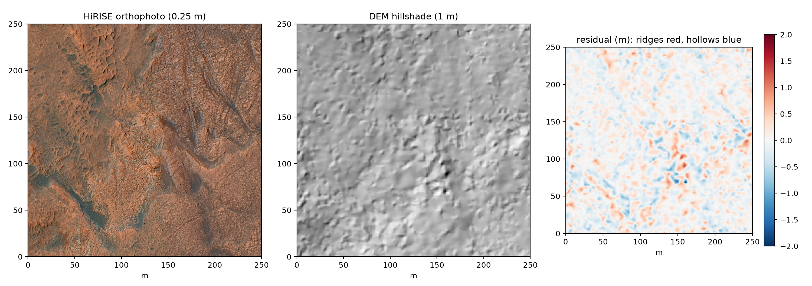

<!-- Owner: JB (grid); Juan (E2, E12); Aaron (E9) · Sources: base_grid.md, E2_curiosity_traverse.md, E9_boulders.md, E12_radiation_dose.md · Status: drafted from the notes by JB's Claude; owner to confirm -->

## 2. Study area and data

**Box and grid.** The study box is 2 × 2 km of Gale crater, centred on Curiosity's poses in the boxwork campaign and snapped to the DEM pixel grid (x 8,142,537.49–8,144,537.49 m, y −285,463.08 to −283,463.08 m, Mars equirectangular CRS on a sphere of radius 3,396,190 m). Every analysis layer is a 2000 × 2000 grid of 1 m cells; orthophotos are 8000 × 8000 at 0.25 m.

**Terrain.** The DEM is the HRSC + CTX + HiRISE mosaic tied to MOLA at 1 m [@Parker2016]; inside the box it spans −3876.1 to −3401.2 m with no gaps. The orthophotos are the HiRISE colour and grey mosaics of Gale [@HiRISE-Gale]. Their detail comes from images acquired in 2006–2011, before landing, so they show no rover tracks. The DEM is posted at 1 m but its effective resolution is coarser: it does not resolve the 1–3 m boxwork ridges, which only the orthophoto shows (Figure @fig:grid-detail).

**Curiosity's traverse.** PLACES localized poses [@PLACES]: 5,247 rover poses inside the box (sols 4369–4868), a single 3,900.3 m route.

**Other data.** BoulderNet weights for boulder detection [@Prieur2023]; RAD dosimetry, 57,843 observations from 2025-01-01 to 2026-11-11 [@RAD-L2]; and, as context only, REMS weather, THEMIS night infrared and CRISM/OMEGA mineral detections.

{#fig:grid-detail}
