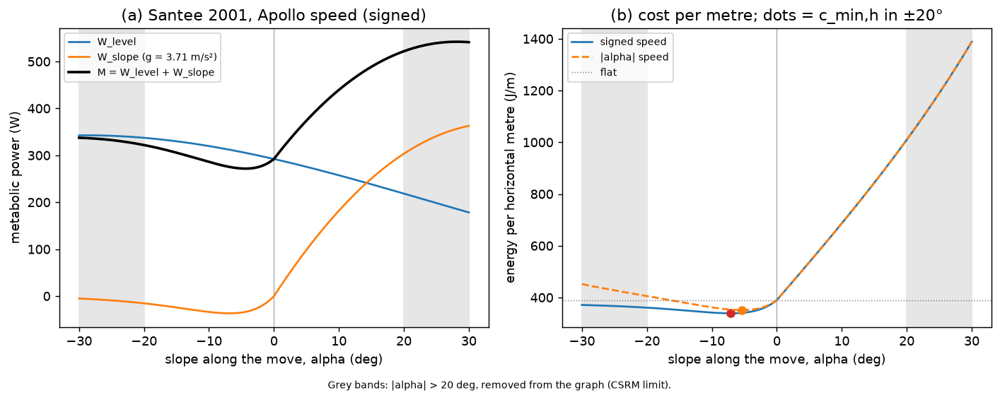

<!-- Owner: Sebas · Sources: E3_metabolic_cost.md · Status: drafted from the notes by JB's Claude; owner to confirm -->

### 3.3 Metabolic and O2 cost under Mars gravity

Metabolic power follows Santee et al. (2001) in the form used by SEXTANT [@Johnson2010]: $M = W_{level} + W_{slope}$. The level term $(3.28m + 71.1)(0.661 v\cos\alpha + 0.115)$ does not depend on gravity. The slope term $3.5\,m g v \sin\alpha$ uphill, and $2.4\,m g v\sin\alpha \cdot 0.3^{|\alpha|/7.65}$ downhill, carries Mars gravity g = 3.71 m s⁻², with m = 124.2 kg (astronaut and suit). Scaling the whole Pandolf power by g fails a lunar check (52 W on flat ground against about 290 W inferred for Apollo 14 [@Carr2003]); Pandolf with the downhill correction [@Kim2025] is kept for sensitivity only. Speed follows the Apollo regression V = 0.75 − 0.01α m s⁻¹ (α signed, degrees). On every directed edge of the 8-neighbour grid, α = atan(Δz/d_h), dt = d_h/(V cos α) and E = M dt. The graph is directed: going up an edge costs more than coming down. Edges steeper than 20° along the move are removed, and cells whose steepest slope exceeds 30° are blocked (a team decision that stands in for cross-slope risk). Metabolic O2 is E / 20.1 kJ L⁻¹. The model reproduces the reference values of the team guide [@Guide-REV3]: 292.23 W on flat ground at 0.75 m s⁻¹, a minimum cost per horizontal metre of 338.75 J m⁻¹ at −7.10°, and 389.64 J m⁻¹ on flat ground (Figure @fig:e3-cost). The "human cost" multiplies E3's energy by E1's sand factor (1.0–1.115) at the arrival cell; time is unchanged.

{#fig:e3-cost}
