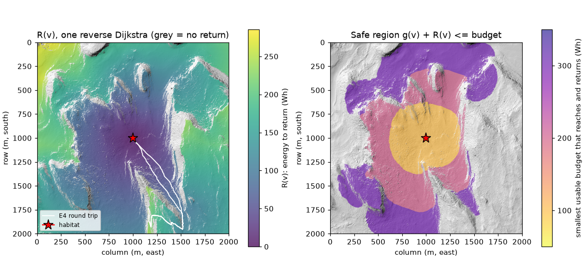

<!-- Owner: Aaron · Sources: E4_walkback.md · Status: drafted by JB's Claude; confirmed with corrections by the owner (Aaron), 2026-11-15 -->

### 3.4 Graph, return layer R(v) and walkback routes

Each cell is a node, and each finite E3 edge a directed arc (4,000,000 nodes, 25,296,494 arcs). R(v), the minimum energy from v back to the habitat, is one Dijkstra from the habitat on the reversed graph, where each arc keeps the cost of the original. R_T(v) is the same in time. The habitat is a user input; a blocked or disconnected position is moved to the nearest valid cell of the largest strongly connected component, which holds 96.4 % of the walkable cells. A round trip habitat → goal → habitat must satisfy the walkback rule at every point, used(v) + need(v) ≤ budget, for energy, time and O2, where O2 = E / 20.1 kJ L⁻¹ + q·t with an optional time-based use q. Service at a station is charged at 205 W, the top of the low metabolic band [@NASA-xEMU-met]. The solver first tries the plain shortest route for the objective. If it breaks a limit, it sweeps weighted sums of energy and time and refines them by bisection (Lagrangian). If needed, an exact label-setting search follows, with Pareto labels per node and leg, capped at 50,000 labels (beyond the cap it reports a bound on the gap). The return is asymmetric: R(v)/g(v) has percentiles 5/50/95 of 0.531/0.877/1.674, so a symmetric radius is wrong in both directions. The most expensive returnable cell from the box centre needs a round trip of 562.8 Wh and 91.1 min. A 7 h suit budget (about 2,050 Wh) is far from binding in the box (Figure @fig:e4-rv).

**Baselines.** On the same graph, three simple rules are compared with the exact planner, over 21 habitats and the 13 stations plus 2,000 random goals:
- B1: shortest distance with A\*, costed at E3's flat-ground energy (389.6 J m⁻¹), out and back;
- B2: a fixed radius r = budget / (2 × 389.6 J m⁻¹), an Apollo-style walkback circle;
- B3: a constant O2 rate of 293 W over E3's fastest route [@NASA-Mars-mass].

A "false safe" is a goal that a method calls safe but whose own route needs more than the budget. Because the habitat is a user input, budgets are fractions (25, 50, 75 %) of the most expensive exact round trip from each habitat. The evaluation was repeated with the human cost as terrain truth and the 15 E8 contact stations as extra goals, with the baselines still calibrated on flat E3.

{#fig:e4-rv}
