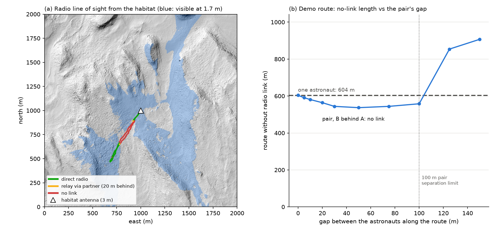

<!-- Owner: JB · Sources: E11_comms.md, X2_adaptive_walkback.md · Status: drafted from the notes by JB's Claude; owner to confirm -->

### 3.8 Radio line of sight and adaptive walkback

**Radio (E11).** The habitat antenna's coverage is a viewshed on the 1 m DEM: an antenna 3 m above the ground, a suit radio 1.7 m above each cell, and a curvature coefficient of 1.0 (no refraction), with Mars' radius taken from the CRS. GDAL agrees with an exact bilinear profile on 99.6 % of 5,000 random cells. On a flat DEM its last visible cell is at 1,648 m, the Mars horizon 2√(2Rh) for both ends at 0.1 m (the Earth value would be 2,258.9 m). Along a route, each vertex has direct radio or not. For a pair, a second astronaut walks a fixed gap behind on the same route, and the pair is linked if both see the antenna, or if one does and the two see each other within 100 m (relay). The model is pure line of sight: it ignores diffraction and the link budget, and it misses the ridges and boulders the DEM does not resolve.

**Adaptive walkback (X2).** Real consumption is modelled as k times E3's prediction, with one factor k per EVA. A conjugate normal filter on log k (prior N(0, 0.3²)) is updated every 30 m walked, from log(observed/predicted) with σ_obs = 0.15. A uniform k scales every arc by the same factor, so the cheapest way home does not change and the reserve is exactly k·R(v), with no new Dijkstra. The 30 min line is unchanged, because k is metabolic, not a speed. The reserve uses the posterior 90th percentile k_p90, and a "return now" alert fires when used + k_p90·R(v) no longer fits the budget. Simulated walks with a known k_true compare this rule with a fixed walkback (k = 1); the data are simulated, since no O2 sensor is available.

{#fig:e11-radio}
