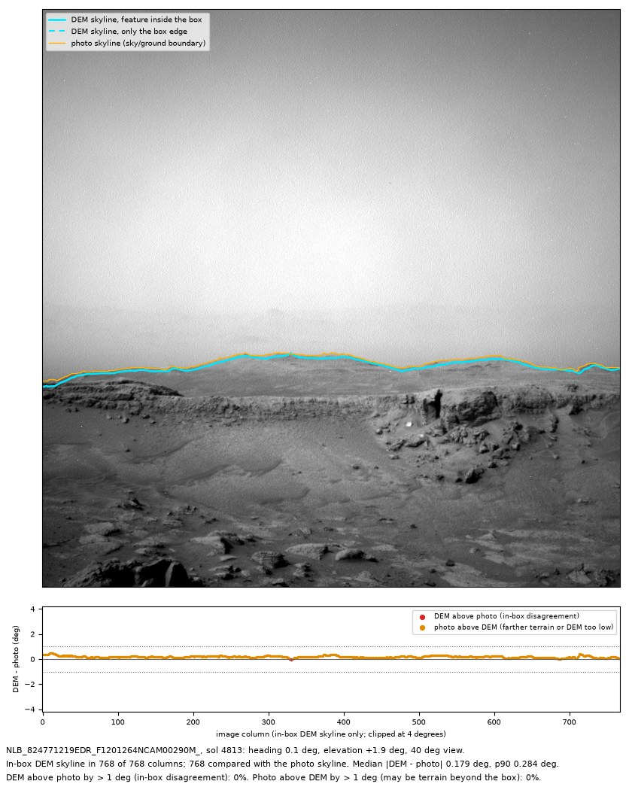

<!-- Owner: Sebas (API, HUD, guide); Juan (3D, photos) · Sources: product_api_hud.md, P1_3d_map.md, P3_rover_photos.md · Status: drafted from the notes by JB's Claude; owner to confirm -->

### 3.10 Product: API, HUD, guide mode and 3D rehearsal

**API and HUD.** A FastAPI service plans live. `/plan` returns E5's tour, or E4's round trip to an explicit goal, as GeoJSON in the DEM's CRS; an infeasible request returns an error, never an invented route. Parameters the engine does not use (another gravity, an unsigned speed rule) are rejected rather than ignored, and each plan reports the parameters it actually used. `/walkback` returns the 30 min line R_T = 1800 s, the energy-safe boundary F_E + R_E = E_remaining, and the fixed-radius circles for comparison. The planning HUD (deck.gl, raster tile profile) shows the terrain, the cost and blocked-cell layers, sand, boulders, radio, radiation and context data (REMS, THEMIS, CRISM/OMEGA). Station values come from an editable rubric, and a live budget bar splits energy into used, needed to return and free. In-context tips introduce each step of the HUD.

**Guide.** One module drives two views of the same walk: the arm-tablet guide and the 3D rehearsal. It gives voice maneuvers, meters for energy, return time and EVA time, radio warnings, a way home on demand, re-routing when off route, a solar-storm return, and a "plan against the walk" summary. The way home and the rejoin are checked against what the astronaut has left, with energy, time and O2 on the same path. If the fastest way home does not fit, a slower one that does is taken and the guide says why. If none fits, the guide says so and never presents the fastest path as safe. A rejoin whose rest of the plan no longer fits sends the walker home instead. The adaptive-walkback meter and "return now" alert (Section 3.8) are in both views, the arm-tablet guide and the 3D rehearsal, with the same simulated consumption and the same rules. Everything runs on the local server with data on board; no page loads a script from the internet.

**3D map (P1, P3).** The DEM is meshed at 2 or 4 m, and only the local relief is exaggerated (shown = height + (k − 1)·detail), so a 475 m hillside does not become a wall. The mesh error against the 1 m DEM has a median of 0.03 m at 2 m spacing. The route is draped on the mesh and can be rehearsed at eye height, under the Sun of the EVA's sol [@Allison2000]. A "Walk freely" mode lets the user walk anywhere in the box at eye height, with an astronaut figure in the chase view; it is a visualisation aid, not a model of the EVA (no slope limit, obstacle or E3 cost applies). The 2D planner's map layers (radio coverage, slope, steep cells, sand, walking cost, boulders) can be draped on the relief. 383 Navcam photographs from 100 stops are placed at their measured camera poses [@MSL-raw; @PLACES; @VICAR-CAHVOR]. Over 23 near-horizontal photographs of 17 sols, where the DEM skyline lies above the photograph's, the difference has a median of 0.07° and a maximum of 0.69°; the check is one-sided, since a photograph skyline above the DEM's can be terrain beyond the box.

