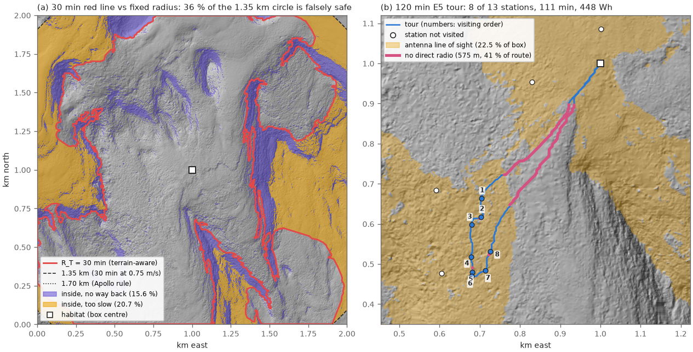
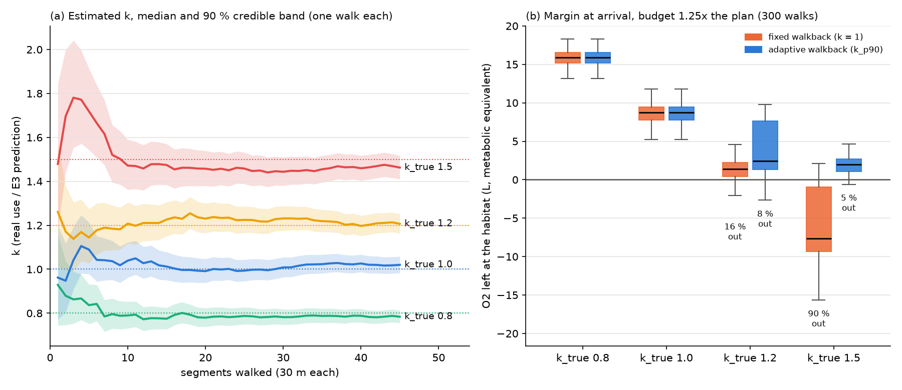

<!-- Owner: JB assembles; owners confirm their numbers · Sources: E4_walkback.md, product_api_hud.md, E5_orienteering.md, E6_benchmark.md, E2/E1/E8/E9/E12 notes, E11_comms.md, X2_adaptive_walkback.md, C1_eva_robustness.md, P6_departure_time.md · Status: drafted from the notes by JB's Claude; owner to confirm -->

## 4. Results

**Simple rules call unsafe goals safe.** At a budget of 50 % of the farthest round trip, the share of goals each method calls safe that its own route cannot complete is:
- A\*-slope: 27.7 %;
- fixed radius: 45.7 %;
- linear O2: 21.4 %;
- exact planner: 0 %.

The baselines are not too conservative; they underestimate E3. Avoiding every false safe would need a safety factor (99th percentile of real over estimated energy) of 1.42 for A\*-slope, 4.05 for the fixed radius and 1.32 for linear O2.

With the human cost (E3 × sand) as terrain truth and the E8 contacts as extra goals, every baseline gets about 1 point worse (50 % budget: 28.5 %, 45.5 % and 22.4 %), and the planner stays at 0 %. Slope, not sand, drives the failures.

A terrain-aware 30 min line also beats the classic fixed radius: 36 % of what the 1.35 km circle calls safe cannot get back in 30 min. Of that, 15.6 % of the cells have no way back at all, blocked or cut off by scarps, and 20.7 % are too slow (Figure @fig:redline).

**Time, not energy, binds in the box.** The costliest round trip from the centre is 562.8 Wh, against about 2,050 Wh of a 7 h suit budget. The full tour of the 13 manual stations collects 56 of 56 points in 723.6 Wh and 180.9 min. Service, not walking, is 61 % of the energy and 72 % of the time. With a 120 min limit the tour visits 8 stations for 37 points (111.4 min, 445.1 Wh). The station choice stops depending on the rubric once the time budget covers the nominal duration. Adding E8's contacts (26 reachable stations, solved and proven optimal by CP-SAT in 0.3 s) raises the score to 60.47, and then energy binds (872.0 of 900 Wh).

**Every planned tour keeps its walkback, and a refusal says why.** Over 16 energy and duration budgets, every tour found passes the walkback at every vertex and is a proven optimum. Its smallest return margin is the energy left on arriving home: 3.6 Wh at its smallest (600 Wh with no duration limit) and 176.4 Wh for the nominal tour. When no tour exists, the planner says why: at 40 Wh, energy is short by an exact amount (station C1 alone needs 56.4 Wh against 36.0 Wh usable), the advice is a budget of at least 62.8 Wh (56.448 / 0.9 = 62.72 Wh, rounded up so the printed minimum always fits), and planning again just above the exact need (62.78 Wh) gives the tour to C1 with 0.06 Wh to spare. The guarantee is conditional on the model and its data (E3's costs on the 1 m DEM, the service placeholder, O2 as a transformation of energy). It does not cover uncertainty in those costs, which Section 3.8 addresses. On the way home the guide checks energy, time and O2 on one path. On the Nevado Sajama position the candidate paths differ only a little (852–855 s, 70.4–70.6 Wh), because speed and energy follow the same slopes, so the trade-off matters near the limits, not as a different route.

**Light changes which stations are visited, not only when to leave.** With station windows from the terrain's shadows (Section 3.9), the nominal tour keeps all 56 points for departures between 05:00 and 14:45 local true solar time. Later, the evening shadows take stations away: 53 points at 15:00, 37 at 16:00 and none from 17:45. Ignoring the light, the plan would claim 56 points at every departure. At 06:00 the 120 min tour still collects 37 points, but with a different set of stations (Jaccard 0.78 against the set chosen without light).

**Exact solvers are fast enough.** The exact solvers reach the optimum on every instance, with a median time within 0.12 s of the fastest metaheuristic. ILS misses the optimum in about a quarter of the instances, with gaps up to 37.5 % with time windows. GA is the best metaheuristic (97 % optimal on the random instances). All methods find the optimum on the real E5 instances.

**What the terrain explains.** DEM features explain the choice of valley (AUC 0.73 over the whole box) but not the path within it (0.53 in a 50 m corridor, about chance; 0.47–0.50 in the three mostly boxwork blocks). Learned DEM prices are zero or near zero (at most 4 % of the price of a metre), and none beats distance alone on held-out drives. Only orthophoto sand earns a small price (factor 1.0–1.115). With it, the route to Nevado Sajama moves up to 23 m and costs 1.8 % more, and the 120 min tour visits the same stations.

**Boulders.**
- **Detection:** BoulderNet finds 8,380 boulders in the box (2,525 with score ≥ 0.5).
- **Distillation:** a student 47 times smaller reproduces its density (r = 0.66 on held-out blocks, calibrated mean) in 8.6 s instead of 362 s, but finds single boulders poorly (F1 0.27 against 0.66).
- **Pricing boulders on the 28 stations:**
  - With the student's cover, k = 10 halves the boulder area the E4 round trips cross (45 → 21 m²) for a median +0.06 % energy and at most +16 m.
  - With the GP layer and one-sided 95 % caution (λ = 1.645), the boulder area falls by 56 % for < 1 % energy.
  - k has no source, so none of this enters the nominal cost.
- **GP (X1):** it adds no accuracy over a 20 m smoothing; its value is the uncertainty, calibrated overall (92–93 %) but too narrow on rocky blocks (~80 %).

**Radio, light and dose.** A 3 m antenna at the box-centre habitat used in the demo sees 22.5 % of the box (13.0 % on average over 20 random habitats). On the 120 min tour, 575 m (41 %) of the route has no direct radio, and a partner 20 m behind reduces the unlinked length only to 526 m. Leaving at any time from about 06:30 to 14:30 keeps the nominal walk sunlit on sol 4711 (06:45–15:15 for the 120 min tour); terrain shadows shorten these windows by 15–45 min. At the background rate the nominal tour (3.0 h) receives 19.6 µGy and the 120 min tour (1.9 h) 12.1 µGy. From any point of either tour the fastest walk back takes under 20 min, and returning at the alarm of the 2025-11-11 storm saves 2–22 µGy, depending on how much of the plan is left.

**Adaptive walkback.** In simulation (budget 1.25 × the plan, 300 walks per case), a fixed walkback runs out of O2 in 90.0 % of the walks when the astronaut uses 1.5 × the model, against 4.7 % for the adaptive rule. With k_true = 0.8 neither policy turns back early (Figure @fig:x2). A separate paired evaluation on one E5 tour with its own budget and reserve (C1, see the C1 note) gives, at k_true = 1.2 and independent noise (ρ = 0), reserve violations of 60.67 % for the nominal policy and 3.67 % for the adaptive one, at the cost of less science (18.200 against 15.217 points on average); no policy exhausted the full capacity in that scenario, so these are reserve violations, not O2 depletion, and they are not comparable with the X2 numbers above. With serially correlated noise (ρ = 0.7), the coverage of the filter's 90 % interval drops to 47–54 %.

{#fig:redline}

{#fig:x2}
